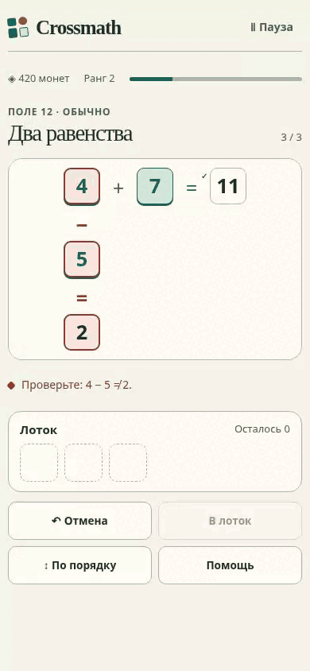
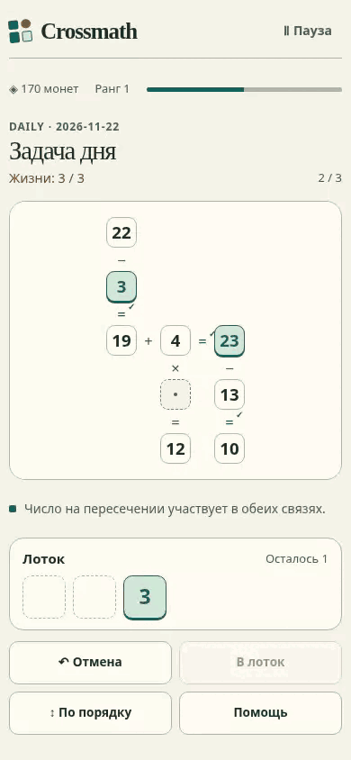

# Crossmath

Офлайн-головоломка с пересекающимися арифметическими равенствами. Реализация по [ТЗ 1.0](docs/spec/Crossmath_TZ_v1.0_RU.md), а не копия исследованных приложений.

Версия 0.4.0: портретный Android host, 240 собственных полей кампании, касания/drag/обмен/отмена/сортировка, сохранение, однократные награды, объясняемая помощь и отдельное раскрытие. Есть свободная игра, Daily с календарём и жизнями, задания дня и альбом из 12 приборов. Есть Endless, профиль, отдельные рекорды и 12 достижений. В 0.4.0 добавлены RU/EN, таймер в спокойных режимах и интерфейс рекламы для Android с проверяемой выдачей наград. Доступность рекламы зависит от подключения SDK. [Статус и ограничения](docs/STATUS.md) · [Дорожная карта](docs/ROADMAP.md) · [Приёмка A–C](docs/ACCEPTANCE_2026-11-18.md) · [Приёмка D](docs/ACCEPTANCE_D_2026-11-18.md) · [Приёмка E1](docs/ACCEPTANCE_E1_2026-11-19.md) · [Приёмка E2](docs/ACCEPTANCE_E2_2026-11-19.md).

## Геймплей 0.4.0

| Кампания · обмен фишек | Daily · награда за решение |
| --- | --- |
|  |  |

[Главная](evidence/preview-0.4.0/01-home.png) · [Кампания](evidence/preview-0.4.0/02-campaign.png) · [Daily](evidence/preview-0.4.0/03-daily.png) · [Endless](evidence/preview-0.4.0/04-endless.png) · [Альбом](evidence/preview-0.4.0/05-album.png) · [Профиль](evidence/preview-0.4.0/06-profile.png)

Запись из веб-сборки 0.4.0 в мобильном размере 390 × 844. Поля кампании пройдены через игровой интерфейс. Дата Daily зафиксирована для воспроизводимости. [Параметры записи](evidence/preview-0.4.0/capture.json).

## Запуск

Node 24+, доступ для чтения закрытого `DanilaH/mini-games-kit` на точном SHA `469928d03f4bae5053e23db26e82187bedbc252e`.

```sh
npm ci
npm run dev -- --host 127.0.0.1
```

Без Git-аутентификации можно собрать локальный архив проверенного checkout kit (`npm ci`, `npm run build`, `npm pack`) и выполнить `node tools/use-ci-kit.mjs <archive.tgz> 469928d03f4bae5053e23db26e82187bedbc252e`, затем `npm install`. Это временная замена зависимости только в локальной рабочей копии; не коммитить её вместо Git pin.

```sh
npm run check
npm run content:verify
npx playwright install chromium
npm run test:browser
npm run android:sync:release
```

Браузерный прогон проходит первые 25 полей через настоящий ввод и отдельный сценарий новых режимов; кадры и отчёты — в `.test-output/ui/` и `.test-output/meta-ui/` и `.test-output/endless-ui/`. Долгий прогресс 228/229 явно отмечен как fixture. Это не подтверждение Android/TalkBack/реальной рекламы. ТЗ и исходные данные лежат в `docs/spec/`; APK конкурентов отсутствуют.

## Android

JDK 21, Android platform 36, build-tools 35.0.0 (default AGP) и 36.0.0 (проверка APK). Указать `JAVA_HOME` и `ANDROID_HOME` своей среды. После `android:sync:release`:

```sh
cd native/android
./gradlew --no-daemon assembleDebug assembleReleaseCheck
```

Оптимизированная проверка: `python3 tools/verify-apk.py native/android/app/build/outputs/apk/releaseCheck/app-releaseCheck.apk --kind releasecheck --out .test-output/apk-verification`. Test packages: `com.danilah.crossmath.playtest` / `com.danilah.crossmath.releasecheck`. Production package/signing/store publication ещё не утверждены. Никаких production-ключей в репозитории нет.

CI требует `KIT_READ_TOKEN` с read-only Contents к закрытому kit. APK/evidence публикуются как артефакты workflow, не отправляются в магазин. Хост сгенерирован штатной командой `bootstrap:android:create -- ../crossmath-game --app-id com.danilah.crossmath --orientation portrait --name crossmath-game --app-name Crossmath --kit-ref 469928d03f4bae5053e23db26e82187bedbc252e`.
