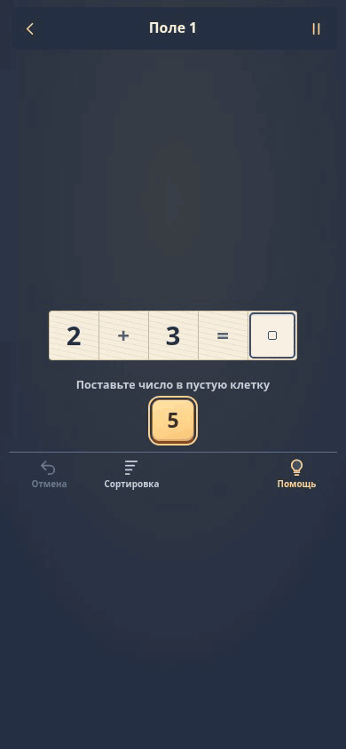

# Crossmath 0.5.10 · что открылось после победы

Подписанный Android preview, versionCode 15. Сравнение с подписанной 0.5.9 и [исходной проверкой в 0.5.8](https://github.com/DanilaH/crossmath-game/blob/2139e2be5634f38173b87f82ad67c5fc2138a945/docs/porting/ui-audit-057/unlocks-058.md). [Исходник этой сборки](https://github.com/DanilaH/crossmath-game/commit/4e90a1691ed74c099c4dedbd932bfef1f8263bb8).

| Разных решённых полей | Надпись в обычном результате | Выплата | Баланс |
| --- | --- | ---: | ---: |
| 3 | Новый режим · Спокойная игра | +10 | 150 |
| 5 | Новый режим · Задача дня | +10 | 170 |
| 15 | Новые режимы · Испытание и Endless | +15 | 395 |

На третьей победе в лотке доступна «Рамка счётов · 1/4». На главной в «Все режимы» открывается «Спокойная игра». На пятой победе карточка главной ведёт в сегодняшний пазл, «Главная → Календарь задач → Задания дня» ведёт к целям. После пятнадцатой победы проверены оба отдельных входа. В английском меню названия совпали с результатом. При повторе пятнадцатого поля режимы и монеты повторно не выдаются.

**Как проверялось.** В Chromium с сенсорным вводом произведены все ходы с чистых профилей в веб-файлах, извлечённых из каждой подписанной сборки. До порогов проверены блокировки после 2/4/14 полей. Для проверки отдельных режимов и языков использовались копии сохранений, достигнутых в этих партиях. В 0.5.10 открыты сохранённые результаты 0.5.9, проверены надпись, неизменность квитанции и баланса. GIF показывает завершающий ход на третьем поле, результат, главную, меню и первое поле «Спокойной игры». Фрагмент начинается с сохранения за один ход до победы.

**Размеры.** Окна 320 × 568 и 390 × 844 CSS px. На каждом пороге проверены 100%, 120%, 150% и 200% корневого шрифта. Во всех 24 сочетаниях вся надпись помещается по ширине, «Следующее поле» полностью в кадре и принимает касание в центре. На третьей победе деталь целиком над панелью результата и доступна для касания. На 320 × 568 при 200% высокое решённое поле можно прокрутить внутри области доски. Стартовая доска и установившаяся первая выплата +10 при обычном шрифте совпали с 0.5.9 попиксельно на обоих размерах при включённом уменьшении движения. [Наблюдения и размеры](observations.json).

**Что доказано референсами.** В EasyFun 1.1.9 статически найдено `GameConfig.DailyShowLevel = 5` (`easy-daily-gate`). В Guru 4.17.0 задокументирована структура Endless (`guru-endless`). Пороги по числу разных решённых полей, одновременное открытие двух режимов и компоновка подписи — решения Crossmath. Общая степень переноса этих двух исходных функций остаётся PARTIAL. [Исходный реестр](https://github.com/DanilaH/mini-games-kit/blob/5ad2985fe6b1da8d137530a2cd13d632b9f8f263/research/games/crossmath/porting/SOURCE_FEATURES.json).

**Сборка.** `com.danilah.crossmath.releasecheck`, 1327628 байт. SHA-256 APK `303d2c42107d50e58db48b3817f2f6b0c2da031aa09587e80e2eebc926195a5a`. SHA-256 сертификата `4739355dd79808984bff922da97ba2a5d3bec4e06be67987daab9b14bdce4ea0`. Кит `469928d03f4bae5053e23db26e82187bedbc252e`. Прошли 73 модульных теста, три браузерных сценария, верификатор контента, Gradle debug и R8 releaseCheck. Проверены подпись v2, zipalign и соответствие содержимого APK собранному веб-коду.

**Следующая приёмка.** Понимание новичками, системный шрифт, Android Back и поведение установленного приложения на телефоне остаются UNKNOWN. [Готовый сценарий и лист наблюдений для 3–5 участников](PHONE_TEST_RU.md).

**KIT IMPACT.** Используются существующие типы наград и навигация. Исправления и тесты находятся в Crossmath.
