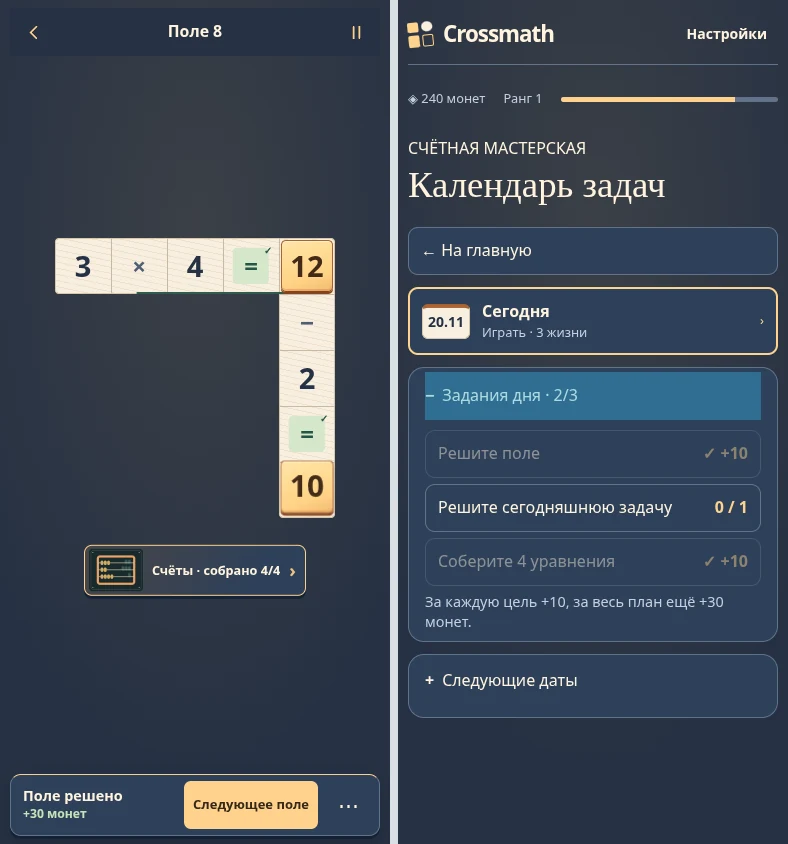

# Crossmath · что потерялось между оригиналами и 0.5.7

20 ноября 2026. В прежнем ТЗ действительно есть два преждевременных вывода. Мастерская считалась достаточной заменой и месячному трофею Daily, и сезонным открыткам. Но игрок получает их за три разных действия. Из описания календаря исчезла цель на месяц, а из описания коллекции — получение этапа после перезапуска и возможность посмотреть закончившееся событие. Кроме того, у EasyFun нашлось самостоятельное правило поля с одинаковыми скрытыми числами.

[Построчное сравнение всех 170 записей](FEATURE_INDEX_RU.md) · [Реестр игры с источником, кодом и следующей проверкой для каждой записи](ADOPTION_LEDGER.json) · [Исходные свидетельства и повторяемый скан трёх APK](https://github.com/DanilaH/mini-games-kit/tree/bcc5afcf9fb86e3bf98a51d45de62109fc532ef1/research/games/crossmath/porting)

## Основание сравнения

| Что проверено | Результат и предел |
|---|---|
| Наш клиент | Проверена рабочая ветка PR #2, HEAD 7d2f3e0. В main на fa19fab лежит 0.4.0. Проверенный preview 0.5.7 / versionCode 12 собран с d1d9080. Его SHA-256 — 1a7d16fdc408dcf4f22e07bd8c5478e1e30e521f7348aedf8dac3b0c5216cc5a. |
| Действия в нашем клиенте | Из точного APK взята web-часть. В Chromium с touch и viewport 390×844 на чистом профиле сыграны поля 1–8 через лоток и клетки. Открыты результат, хаб, ранг, мастерская, предмет, режимы, профиль, календарь, цели, настройки, пауза, помощь; на поле 9 совершена покупка помощи. В [журнале](CONSUMER_CHECK_057.json) сохранены суммы и состав квитанций. |
| EasyFun Offline Crossmath 1.1.9 / 1193 | Заново прочитаны 64 Unity-префаба, 18 таблиц и поля 12 000 Classic, 500 Daily, 2 Tutorial. Сверены названия узлов UI, тексты, содержимое таблиц и идентификаторы IL2CPP. Предыдущий визуальный разбор использовал 12 выбранных AssetBundle. Наличие кнопки или строки ещё требует проверки её достижимости в оригинале. |
| Guru 3.5.2 / 24070452 и 4.17.0 / 26101374 | Заново открыты оба комплекта SQLite. cm4 содержит 10 421 строку, cm5 — 10 400, попарные хеши баз между версиями совпадают. В Flutter-каталогах 702 и 1 349 записей соответственно. Прочитаны результаты прошлых исследований генератора, решателя и меты E17–48 и отдельный R2 по обеим сборкам. Повторное исполнение ARM64 не входило в этот прогон. |
| Кадры оригиналов | Лист Guru, 00:30 → 00:32 → 00:34, показывает заполненное поле, окно результата, следующее поле. Версия видео UNKNOWN. Рекламные изображения издателей показывают компоновку Battle, Endless, Daily и Event. Секундные срезы не измеряют задержку касания или звука. |
| Правила проекта | На момент проверки kit main 71d9b41. Исходная методика инициализации b6e7112, runtime из самой игры 469928d. Прочитаны AGENTS.md, спецификация, решения владельца, roadmap, материалы Researcher Chat Bootstrap / Reference Protocol / Reference → Product Porting Framework и код текущей ветки. |

[Код проверявшейся версии](https://github.com/DanilaH/crossmath-game/tree/7d2f3e03cc482b6b6fed28abc3cfe7dd8fc3bef6) · [Приёмка 0.5.7 и хеш APK](https://github.com/DanilaH/crossmath-game/blob/7d2f3e03cc482b6b6fed28abc3cfe7dd8fc3bef6/docs/ACCEPTANCE_PLAY_SCREEN_2026-11-19.md) · [Баланс и методы двух версий Guru](../spec/R2_APK_BALANCE_RU.md)

## Какие решения требовали пересмотра

| Ранний документ | Что именно изменить в трактовке |
|---|---|
| Дополнительное ТЗ Crossmath_TZ_RU.md для 0.5.3, §16, строка о трофеях | Альбом и достижения покрывают хранение постоянной награды. Появление цели определённого месяца, привязку к календарю и правила догоняющего прохождения изучаем по easy-month-trophy отдельно. |
| Там же, §16, строка Adventure / Unlock Puzzle | У 12 приборов есть постоянные этапы. Временная глава, сохраняемое ожидающее окно и журнал закончившегося события имеют собственные условия завершения. Их можно исследовать до заказа сезонного арта. |
| Там же, §16, билеты и бесплатный реванш | Бесплатный повтор был нашей гипотезой о том, как проверить ценность дуэли. В Guru есть расход и восстановление билетов. Цена повторного матча и действующая конфигурация UNKNOWN. |
| Product Map v0.2, §2, F29–F35 | В документе прямо указан статус DECISION. Гонка, Battle, реальный PvP, события, билеты, облако, Remove Ads и редактор остаются раздельными развилками. Само упоминание облака или редактора не доказывает их работу в исходных приложениях. |
| Основное ТЗ v1.0, ограничения первой версии | Эти ограничения управляют выпуском. В проверенных материалах для 170 текущих записей нет явного решения владельца об окончательном исключении. Подтверждённый выбор собственных цен и четырёх действующих режимов остаётся основанием продукта. |

## Четыре находки для следующего обсуждения с разработчиком

### 1. Одинаковые знаки расширяют саму головоломку

**easy-owl-equality, easy-owl-entry, easy-tray-sign.** В двух строках урока EasyFun игроку предлагают вывести закрытое число и объясняют, что за одинаковыми совами стоит одинаковое значение. Есть отдельный префаб урока, маркер клетки и идентификатор hiddenNumberDic. У всех 12 500 проверенных полей Classic/Daily gameMode=0 и hiddenNumber=0. Знаем смысл правила. Попадание игрока в такой уровень, частота и способ выбора знаков остаются UNKNOWN. Отдельное поле hiddenLevel к этому выводу не присоединяем.

**Наша адаптация.** Два одинаковых треугольника в разных частях поля дают общую зацепку. Из △ + 3 = 8 получается 5; из △ × 2 = □ получается 10. Даже без промежуточной общей клетки игрок переносит знание между уравнениями. Разные знаки по этому примеру не обязаны означать разные значения. В текущих Cell и Equation признака такой связи нет. Для оценки достаточно одного авторского разбора и валидатора существующего банка. На экране проверить форму, фокус, ошибку и цифру на маленькой клетке. Две отдельные фишки 5 сохраняют свои tokenId.

**Проверка переноса.** Уровень имеет одно решение по значениям, Explain может назвать связь между знаками без обращения к авторскому ответу, Undo и перезапуск сохраняют исходные связи. До проектирования места в кампании снять штатный вход в оригинале. Зависимости — схема версий уровня, валидатор, объяснение, отрисовка клетки. [Типы](../../src/core/types.ts) · [Валидатор](../../src/content/validator.ts) · [Explain](../../src/help/logic.ts)

### 2. Результат может рассказать человеку о его собственной игре

**easy-last-ten, easy-beat-table, easy-choice-percent.** EasyFun явно подписывает среднее последних 10 игр. У окна имеются значения текущего и среднего времени, в metadata есть GetCurrentAverageTime. Рядом существует совсем другой приём: процент «обогнали» берётся из локальных порогов. Например, значение 60 секунд есть в столбце Easy Short для ранга 75 и в Hell Short для ранга 97. Ещё одна подпись на выборе сложности говорит о доле игроков; источник этой доли UNKNOWN. В Crossmath Career хранит накопленные секунды и итоги режимов, восстановить по ним десять конкретных недавних финишей невозможно.

**Наша адаптация.** На результате Free строка «Сегодня 1:14 · обычно 1:29» под заголовком. В спокойном режиме со скрытым таймером её можно скрыть. Это пример текста. Собственная политика, предложенная для проверки: активные секунды, одна сложность и длина, отдельно от Daily/Endless, явное решение о повторах и помощи. У источника неизвестно, входит ли текущий финиш в среднее и что делает прерванная партия.

**Проверка переноса.** На одиннадцатой подходящей победе из окна выпадает первая. Смена сложности, сворачивание, миграция старого профиля и повтор результата не загрязняют базу. Следующее поле доступно сразу. Метрика успеха эксперимента — пользуется ли игрок сравнением, а не только замечает ли текст. [Статистика](../../src/meta/career.ts) · [Результат](../../src/ui/metaView.ts)

### 3. Месячный трофей даёт календарю собственную цель

**easy-month-trophy.** У EasyFun есть текст о трофее за Daily, отдельный вход из календаря, список изображений по месяцам, чтение трофея по дате и запись в базу. У нас можно решать сегодняшние и прошлые поля, а на восьмой победе получить собранные счёты. Человек, решавший только кампанию, может заработать этот прибор. Это и показывает, почему он не покрывает календарную цель.

**Наша адаптация.** В календаре одна строка под текущим месяцем: сколько подходящих дат закрыто и сколько осталось до следующей ступени. Открытый знак остаётся в истории месяца. Начать с собственного знака и существующих дат. До выбора порога и правил архива проверить оригинал при переходе месяца, при пропуске дня и при позднем прохождении. Для игрока с редкими визитами особенно важно, считается ли решённая позже дата.

**Проверка переноса.** Независимые записи за два месяца, одна награда при повторном входе, миграция с известной историей дат. Трофей не начисляется за финиш кампании. Отдельно проверить восстановление уже заработанного трофея, если окно закрыли до просмотра. [Календарь](../../src/meta/calendar.ts) · [Учёт наград](../../src/meta/progress.ts)

### 4. Ранг может вести игрока между режимами

**easy-rank-relax, easy-rank-challenge, easy-result-tabs.** У EasyFun две таблицы по 121 записи заданий. Строки задают следующую комбинацию сложности, числа прохождений, позиции маршрута и позднее Daily. Это 121 запись в каждой дорожке, число рангов другое. Отдельно работает XP профиля. В Crossmath уже сделаны две точные шестишаговые ротации и раздельные курсоры Free. Ни курсор, ни постоянный значок достижения не говорят игроку, в какой режим зайти ради следующей ступени.

**Наша адаптация.** В текущей карточке Free показать одну следующую цель выбранной дорожки. На результате экран уже сообщает «Следующее поле» — здесь можно добавить вторичную строку прогресса. Пример нашего задания: «До следующего звания Relax — ещё одно поле Normal». Использовать существующий банк. Сначала проверить одну достижимую связку, без новых валют.

**Проверка переноса.** Игрок читает цель, уходит в нужный режим и видит обновление по возвращении. Закрытый Daily не блокирует раннюю ступень. Одно завершение учитывается один раз; смена Relax/Challenge сохраняет обе позиции. [Ротации](../../src/content/rotation.ts) · [Мета](../../src/meta/progress.ts) · [Задания](../../src/meta/missions.ts)

## Что показало независимое измерение разнообразия

В Guru выбор по истории отбрасывает недавние значения holes, беря до 300 записей. Есть запасные пути при неудаче выборки. Мы измерили собственный маршрут по двум ключам: размер плюс точные пустые координаты и размер плюс все позиции числовых клеток. Операторы, числа, повороты и субъективное сходство в ключ не входят. Проверены все 240 позиций свежей кампании.

| Маршрут | Разных масок пустых клеток | Разных рисунков числовых позиций | Непосредственных повторов рисунка числовых позиций |
|---|---:|---:|---:|
| Вся кампания, 240 полей | 236 | 66 | 8 |
| После первых 15 уроков, 225 полей | 225 | 58 | 5 |

Фильтр повторяющихся пустых координат не изменит первую выдачу этих 225 полей. Если игрок жалуется на похожие поля, первым делом стоит показать ему соседние пары с одинаковым расположением числовых клеток и проверить, замечает ли он разницу в ходах. В следующем цикле Free задачи выдаются повторно и требуют отдельного измерения. В Guru есть ещё один независимый способ изменить сам процесс решения: предыдущая проверка E47 обнаружила длинные выражения у 1 702 из 10 598 уникальных рецептов. Доля таких выражений в сыгранных сессиях UNKNOWN. Для нашей модели a+b−c=d потребует расширения формата, вычислителя, объяснения и проверки единственности. [Измерения кампании](CAMPAIGN_MASKS_057.json) · [Воспроизведение](measure_campaign_masks.py)

Два кадра 0.5.7 в исходном размере 390×844 CSS px каждый. Слева завершён первый прибор, а справа две цели дня уже закрыты. Календарный трофей и сравнение с личным средним на этих экранах пока отсутствуют.

## Сверка остальных экранов и систем

| Сценарий игрока | Что ценно в оригинале | Что есть у нас и что осталось |
|---|---|---|
| Первый вход, поле, лоток | EasyFun различает урок выбора клетки и урок перетягивания. Ошибка появляется, когда допустима проверка заполненного выражения. Есть кнопка смены сложности прямо на поле. | В 0.5.7 уже работают оба порядка выбора, drag, возврат, сортировка, Undo, нейтральность неполного уравнения и сообщение с осью ошибки. Смена Free через хаб требует другого маршрута. Для улучшения входа полезнее измерить лишние касания, чем ещё раз заказывать drag. |
| Пауза, настройки, помощь | Смена темы и варианта деления, отдельные звук/вибрация, подтверждение потенциально разрушающего повтора. В Guru 4.17 есть прямой, монотонный, факторный, пересекающий и ограниченный поисковый пути помощи. | Есть RU/EN, собственный набор настроек, логический Explain и отдельный Reveal. Наличие подсказки не покрывает ранжирование нескольких объяснений или возврат нескольких ошибочных фишек. Практический тест — две перепутанные одинаковые фишки на пересечении и одно списание за помощь. |
| Победа, деньги, мастерская | EasyFun разделяет в результате цели и статистику. В Guru есть самостоятельные ресурсы для появления и открытия коробки, столкновения предмета, полёта звезды, шага и финиша задания. | Наша первая победа дала 120→130. На восьмом поле квитанция содержит +10 за поле и +20 за прибор, детали раскрываются. Покупка на поле 9 дала 240→180. В 0.5.7 есть звук контакта, разные резонансы для детали и прибора, блик и пять частиц готового предмета. Возможный следующий приём — дать награде видимую точку назначения. Новый жетон, Rubik, перелёт и его скорость — авторское предложение. |
| Хаб, ранг, профиль | EasyFun разделяет ветки рангов, показатели времени, календарные трофеи и значки. Guru привязывает XP к числу уравнений, отдельны три кривые на 200 уровней. | У нас уже есть профиль с детализацией по режимам и записями Endless, ранг по своему балансу, 12 достижений, мастерская 12×4. Лучшее место для одной новой цели — внутри уже выбранного режима или результата. |
| Daily и задания | В EasyFun одно событие ошибки Daily снимает одну жизнь даже при нескольких ошибочных клетках; возможен перезапуск за 200. В Guru при недоступных активностях меняются цели, есть отдельные счётчики сортировки, помощи, открыток, участия и победы. | Есть три жизни, бесплатный повтор, календарь, архив и достижимый дневной план. Каждый слот платит 10 монет, комплект ещё 30. Исторический тест на +100 суммирует поле, дату, три цели и комплект. Точные суммы исходной и нашей игры в реестре разведены. |
| Вход события, этап, истечение | EasyFun имеет лестницу подарков (монеты, помощь, отдельный claim), значок периода и сообщение окончания. Guru отделяет открытку, ожидающее окно, выдачу и историю. Adventure платит за завершение другой активности. | Событийных окон и журнала истёкших событий в продукте нет. Самая переиспользуемая часть — очередь уже заработанных показов и награда с ключом «активность + этап». Тематический арт можно оценивать отдельно. |
| Endless и соревнования | Guru показывает счёт и жизни в Endless. В Battle прогресс и реакция бота видны рядом с полем, в Star Race и Brains исход определяют другие события и часы. | Одиночный Endless, явный Submit и записи solo/assisted реализованы. Соревновательные режимы в актуальном union Mode отсутствуют. Такой режим пока нельзя помечать реализованным по старым картинкам или числам из R2. |
| Магазин, объявления, поддержка | В EasyFun отдельные табличные места показа, SKU, состояния отсутствия рекламы. Есть форма обратной связи с изображением, согласие, оценка, приглашение к уведомлениям и тексты бонуса. | Preview содержит адаптер rewarded для помощи/продолжения, условия interstitial и показа баннера. Внешний SDK и доступность предложений не подтверждены. Порядок «показ — закрытие — начисление» и отсутствие сети требуют самостоятельной проверки по каждому предложению. |
| Выход и возобновление | Guru сохраняет отдельные компоненты прогресса активности и раунда. При выходе из окна важно, произошло ли начисление, сохранилась ли очередь и наступил ли срок. | Наши слоты, транзакции, настройки и метрики существуют. Для Android нужно повторить уход после последней фишки до показа результата, во время получения, из окна Event и на границе суток. Браузерный reload не заменяет убийство процесса. |

## Три разных соревнования

| Механизм | Проверенный пример | Практический смысл для Crossmath |
|---|---|---|
| Star Race — внешняя цель поверх обычных полей | Трудности приносят 1/2/4/6 звёзд; первые цели 10/15/20/25/30. У бота B первый шаг сложности 2 в раунде 1 наступает через 120 секунд местного времени и даёт 2 звезды. У бота A другая формула, есть случайная прибавка. | Самый короткий путь проверки интереса к соревнованию: игрок продолжает решать обычные поля. Сначала принять время в фоне, ничью и одну квитанцию за раунд. |
| Battle — соперник на том же поле | 16 уравнений, уровень бота 6 и ноль длинных выражений дают 70 секунд базового плана. Отдельный ответ на ход с задержкой ограничен total−3. Также есть таймер, билет и серия побед. | Для переноса понадобятся собственный матч, состояние двух сторон, пауза, возобновление и проверка понятности соперника. Три внутренние единицы не означают три секунды. |
| Brains — недельная позиция | Цель бота задаётся по дню; девять шаблонов распределяют её между четырьмя местными окнами. На финише недели есть отдельная выдача, таблица активных призов по местам UNKNOWN. | Использовать только после решения о недельной экономике. Если будет введена локальная симуляция, обозначить её игроку прямо. Присутствие реального сетевого соперника требует самостоятельного доказательства. |

## Что делать с коммерческими следами

У EasyFun есть базовые 5 монет, множитель ×10 за rewarded, цена подсказки 120 и отдельные 120 за уровень профиля. Менять ровно одно из этих чисел в нашем кошельке было бы другой экономической моделью. Оригинал задаёт семь отдельных interstitial-сцен, четыре баннерных сцены и шесть IAP-записей, включая два SKU отключения рекламы. Для каждой есть свой ID. Наблюдавшиеся 0,5 Android / 0,2 iOS — встроенные вероятности из одной таблицы, не доля реальных показов. Известны данные SKU, фактическая витрина и цены для пользователя UNKNOWN.

Следы общей таблицы выделены отдельно. В ней встречаются колесо, алмазы, дополнительные шары и проба скина мяча, а в достижениях — VipPlayer. Пока не найден пользовательский вход, это отдельный класс доказательств. Аналогично для бонуса push: надпись о бонусе и кнопка получения ещё не показывают, за что именно платят. Удержание, конверсия, доход, opt-in и доступность активных серверных событий не измерялись.

## Очерёдность и приёмка

1. **Сначала установить путь к неизвестным условиям.** В EasyFun записать вход в особые поля, два завершения по обе стороны порога месяца и серию результатов одной сложности. Зафиксировать сборку, дату, состояние до/после, таймкод и сохранение. Для сов проверить отдельно Classic / Daily / Event. Для времени проверить финалы 1, 2, 10, 11, повтор и прерванную попытку. Для трофея проверить решённую сегодня и закрытую архивом дату. Это даст точные условия только для проверенных профилей.
2. **Для ближайшего продуктового решения вынести три небольших изменения.** Личное сравнение после финиша, месячная цель Daily и одна видимая ступень Free. У каждого уже есть место в интерфейсе. Совы и длинные выражения идут отдельной дорожкой исследования правил и валидатора.
3. **Для ощущений проверить один конец действия.** На фактическом экране 390×844 сравнить обычный финиш, деталь и готовый прибор. При начислении баланс уже записан; привязать собственный звук к конкретному видимому событию, сохранить доступный CTA, режим без движения и выключенный звук. Реальный Android: видеозапись с системным звуком, отдельная проверка мотора и конца касания. Переливы, блюр и дополнительные эмиттеры не объясняют, куда ушла выплата.
4. **После выбора события собрать общую модель времени и квитанций.** Сначала путь конца этапа и повторного входа, потом Star Race, Battle, Brains с разными часами и исходами. Билеты, IAP, ремонт дня и реклама требуют приватной проверки баланса и отдельного решения владельца.
5. **После каждого PR проверять фактический diff, точную сборку и сценарий.** Обновить соответствующие ID, сохранить предел доказательства. Браузер подтверждает маршрут web-части, телефон — аппаратный отклик и восстановление процесса, метрики игроков — влияние на поведение.

Из 170 строк 18 имеют сравнение MATCH, 38 PARTIAL, 87 MISSING, 27 UNKNOWN; 0 имеют решение OWNER_EXCLUDED. Здесь раздельно считаются виды выплат, триггеры, конфигурационные предложения и вопросы. По счётчику нельзя выводить процент готовности игры. Штатная проверка verify-reference-porting.py нашла 170 соответствующих ID и 0 ошибок. Отдельно сверены перечни префабов, файлов уровней, рекламных мест, SKU и источники по Guru. Физическое прохождение трёх оригиналов, серверные варианты, фактическое устройство и коммерческие показатели остаются открыты.

**KIT IMPACT.** В геймките появился версионированный реестр с доказательствами. В игре появились связанные по ID сравнение и дорожная карта. На переиспользование в других играх претендуют личная история сравнимых результатов и раздельные записи «награда заработана / показана / осталась в архиве». Следующий вопрос для общего runtime — какие из этих состояний действительно повторяются в другой игре.
