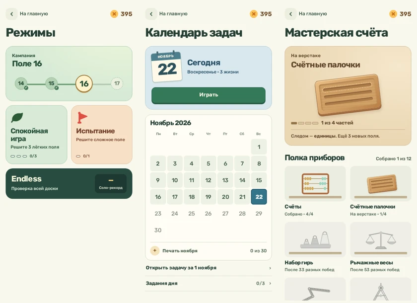

# Crossmath. ТЗ на редизайн интерфейса и отклика наград

**Передача разработчику · 22 ноября 2026.** Цель — чтобы игрок узнавал своё занятие по тому, что видит и может нажать. На главной это незаконченный ход, сегодняшняя дата и собираемый прибор. После победы видно, сколько заработано, какая деталь приблизилась или встала на место и куда ведёт следующая кнопка.

**Рабочая база** — DanilaH/crossmath-game, ветка `feat/mode-unlocks-0.5.10`, игровой PR №4. На момент передачи HEAD `bd5d2c7`, исходник подписанной сборки `715286f`, версия **0.5.21 / 26**. Ветка исследований PR №3 содержит эскизы и настоящее ТЗ. Реализацию вести поверх свежего игрового HEAD. При расхождении проверить уже выполненные правки. [Игровой PR](https://github.com/DanilaH/crossmath-game/pull/4) · [Состояние сборки и проверка APK](https://github.com/DanilaH/crossmath-game/blob/bd5d2c76b493ed8bed4ab9fc380b04f7edcb4627/docs/acceptance/qa-0521/README.md)

## 1. Чем руководствоваться

| Для чего | Финальный материал | Как читать |
|---|---|---|
| Главная | [390×844](delivery/home-final-390.webp) · [320×568](delivery/home-final-320.webp) · [нажатие главной кнопки](delivery/home-press.gif) | Сводный кадр собирает композицию V2, принятую золотую монету, простые пиктограммы и тот же лоток, что в финале. Размеры в таблице — CSS px окна, изображения экспортированы в двойном разрешении. |
| Пиктограммы | [16 WebP, готовый набор](secondary/approved-icons.zip) · [монета PNG 96×96](secondary/coin-96.png) | Источник для подключения. В старом `icon-study-0521` показаны и более подробные версии. |
| Остальные игровые меню | [Режимы](secondary/modes.webp) · [календарь](secondary/calendar.webp) · [мастерская](secondary/workshop.webp) | В каждом сравнении слева текущая игра, справа целевая композиция. Профиль, квитанции и служебные окна определены сценариями ниже. |
| Награда в движении | **[Финальный MP4 со звуком, 7 с, 60 кадров/с](delivery/workshop-final.mp4)** · [короткая GIF бирки](secondary/workshop-lettering.gif) | MP4 задаёт общую синхронизацию. Сначала обычная победа, потом одна деталь, затем проверочный пакет. Ролик начинается с блока мастерской. Место блока относительно начисления монет описано в §5. |
| Что было в игре | [Шесть исходных экранов](current.jpg) · [инвентаризация остальных окон](https://github.com/DanilaH/crossmath-game/blob/235b1c9f3134821992361348d129744edc50bf81/docs/porting/screen-audit-0520/SCREENS_RU.md) | Снимки и старый аудит объясняют исходную проблему. В рабочей версии уже исправлены первая победа, историческая награда, возврат Endless, восстановление, помощь у полуночи и ряд переходов. |

**Выбор владельца.** За основу главной взять вторую итерацию. Для компоновки и масштаба использовать сводный кадр, для посадки и надписей — финальный ролик. Пиктограммы простые, монета светло-золотая с маленьким янтарным ×. Характер движения и последняя итерация надписей мастерской согласованы. Текущие игровые клетки, перенос фишек и понравившаяся прибавка монет — контрольные образцы. Снять исходную запись начисления из рабочего билда и сравнить с новой. Сохранять видимый порядок событий, момент изменения суммы, отклик и время доступа к продолжению. Для победного блока использовать эту же монету. Значение выплаты и действие кнопки берутся из игровой квитанции.

**Решения для экранов без отдельного финального кадра.** Профиль строить вокруг заработанного знака и ранга. Для настроек, помощи и подтверждений использовать спокойные строки управления. Рабочее имя раздела — «Мастерская» на главной и «Мастерская счёта» внутри. «Коллекция» обсуждалась как возможное переименование. Для этого этапа в интерфейсе сохраняется текущее название.

## 2. Общий визуальный язык и управление

- **Типографика.** Существующий локальный Rubik с кириллицей и латиницей. Название действия, число, короткая подпись образуют три уровня. Цифры кошелька, даты, прогресса и рекорда занимают устойчивую ширину. Для окна 390 px ориентиры главной — поле около 37 px, главная кнопка 21 px, названия активностей 19 px, поясняющие строки 13–15 px. В `docs/PROJECT_DECISIONS.md` историческая строка про Georgia относится к раннему образцу. Для обновляемых экранов зафиксировать Rubik и новую иерархию в документации игрового PR.
- **Темы.** Основная светлая. На поле сохранить проверенную белую основу, кремовые условия и мятные фишки. В меню светлый бумажный фон, холодный голубой у даты, дерево у прибора, зелёный у действия. Тёмная тема сохраняет собственные поверхности и выбранную настройку. Для тёмно-зелёных знаков на тёмной панели подобрать светлый вариант заливки или тонкую светлую кромку. Отдельно проверить дату, пустые ячейки, выключенные элементы и чернила оттиска. [Действующий контракт тем](https://github.com/DanilaH/crossmath-game/blob/bd5d2c76b493ed8bed4ab9fc380b04f7edcb4627/docs/acceptance/THEMES_0513.md)
- **Иконки и поверхности.** Кошелёк — монета 24 px возле числа, профиль и настройки по 26 px в зонах нажатия 48×48. Навигация около 22 px, инструменты поля около 23 px. В набор входят также ранг, отмена, сортировка, возврат, подсказка, четыре режима, календарь, мастерская и полная жизнь. Стрелки, пауза, пустая жизнь и прочие служебные знаки берутся из согласованного простого семейства или текущих векторных контролов. Символ × относится к рисунку монеты. На узком экране сохранить свободное место между монетой и балансом. Кнопке-иконке дать доступное имя, дублирующий рисунок в подписанной кнопке скрыть от диктора.
- **Отклик на касание.** На основной кнопке небольшой нижний кант. При удержании поверхность опускается примерно на 3 px. Отпускание внутри запускает одно действие, отмена жеста возвращает поверхность. Выделение, фокус, недоступность, касание и покой различимы. Кошелёк и кнопка следующего поля стоят на месте во время выдачи. Блики и частицы живут у места события. Звук и вибрация следуют своим переключателям. В reduced motion сразу показать конечный смысл события.
- **Масштаб.** Композиция задаётся при 100%. Для 120–150% сохранить удобный доступ к основному действию. При 200% проект допускает перенос строк и прокрутку, включая путь мастерская → режимы → партия. На 320×568 главная кнопка видна при обычном масштабе. Длинные тексты RU/EN, возврат, крупный баланс и системные отступы проверять реальным нажатием. Родной контейнер по-прежнему единственный владелец системных отступов. [Решение проекта о размерах](https://github.com/DanilaH/crossmath-game/blob/bd5d2c76b493ed8bed4ab9fc380b04f7edcb4627/docs/PROJECT_DECISIONS.md#L13)

## 3. Главная и режимы

**Главная.** В шапке знак Crossmath, баланс, профиль и настройки. В центре — карточка продолжения с контекстом, реальным номером или названием режима, фрагментом живого поля и одной зелёной кнопкой. При 390 px наклонённая доска и кнопка разделены примерно 15 px. В примере на поле 16 `cm-own-02-001` видно пересечение равенств, заданные числа выступают над пустыми гнёздами. Для других полей выбирать пригодный реальный фрагмент из модели. Показывать исходные числа и подстановки игрока. Превью служит входом в сохранение и исключает раскрытие авторского ответа.

Ниже две активности. Голубой отрывной лист ведёт прямо в Daily, рядом более широкий верстак ведёт в мастерскую. В нижней строке «Все режимы» и отдельный «Календарь». На тестовом профиле после 15 разных побед видны 395 монет, поле 16, лоток 1/4 и «Ещё 3 поля» до единиц. Дата, остаток и баланс приходят из профиля. На первом запуске игрок сразу попадает на поле 1. При возврате на главную продолжить фактическую активную партию, включая Daily или живой Endless. Для завершённой кампании вести в историю пройденных полей. Состояние закрытых активностей содержит реальное условие открытия.

**Режимы.** Большая плитка кампании показывает участок пути и текущую остановку. При нажатии доступен раздел кампании с историей и последней квитанцией. У «Спокойной игры» и «Испытания» разный силуэт, действующая цель и её счётчик. Примеры на контрольном профиле — «Решите 3 лёгких поля · 0/3» и «Решите сложное поле · 0/1». У Endless широкое табло. До первого результата там прочерк, после завершения — действующий соло-рекорд. Для живого забега явно написать «Продолжить забег». Вся плитка нажимаема. Сохранить вход в старую свободную игру и подтверждение замены партии там, где оно действительно требуется.

**Пороговые состояния.** Три разные победы открывают Relax и первую деталь. Пять открывают Daily и задания. Пятнадцать открывают Challenge и Endless. На результате с двумя открытиями назвать оба режима. На закрытой плитке объяснить, сколько разных побед требуется. После входа и возврата сохранить фокус, прогресс и происхождение перехода. [Маршруты и состояния меню](https://github.com/DanilaH/crossmath-game/blob/bd5d2c76b493ed8bed4ab9fc380b04f7edcb4627/src/ui/metaView.ts)

## 4. Календарь, мастерская, профиль и остальные экраны

| Экран | Что сделать | Как принять |
|---|---|---|
| Сегодня и сетка месяца | Лист показывает реальный день и локализованный месяц. Ведущее действие отражает состояние попытки. Ниже семь столбцов месяца, печать и число решённых дат. Использовать `meta.effectiveDay`, вычисляемый в закреплённой зоне профиля. Будущий день недоступен, решённый отмечен ✓, начатый — знаком и текстовым статусом, сегодняшний — выделенной формой. | Проверить обычную дату, полночь в зоне профиля, офлайн, короткий месяц и переход года. При открытии прошлой даты поле, пауза и результат относятся к выбранной дате. Положение метки и доступное имя различимы без цвета. |
| Daily, задания, трофеи | Оставить три жизни у новой задачи, состояние начатой партии, бесплатный повтор там, где его разрешает игра, и возврат из истёкшего поражения. Входы в старую начатую дату, достижимый трофей прошлого месяца, «Мои трофеи» и задания дня остаются находимыми. | Проверить январь 30/31, переход из более позднего месяца к достижимому последнему дню, получение одной печати, перезапуск. Будущая дата не запускает игру. Возврат в незаконченный архив сохраняет фишки и жизни. |
| Мастерская и полка | Вверху крупный прибор на верстаке, заработанные части, место следующей части, её имя и остаток новых полей. Ниже 12 приборов. Собранные показывают готовую вещь, текущий — реальную сборку, будущие — силуэт и условие. У счётных палочек одинаковое расположение пазов на главной, в карточке и при выдаче. | В примере при 15 победах собраны счёты, у палочек только лоток, 1/4. На 18-й три маленькие палочки «Единицы» составляют **одну** деталь, стало 2/4. При 48 частях виден итог полной коллекции. |
| Карточка предмета | Касание текущего или готового прибора открывает его рисунок со списком четырёх частей. Карточка будущего прибора сообщает его собственный порог. При входе из результата источник данных — сохранённый снимок той победы. | Из результата поля 3 «Рамка счётов · 1/4» открывает именно 1/4, даже когда на полке уже 4/4. Закрытие возвращает в исходную квитанцию или на полку. |
| Профиль, ранг, достижения | Наверх вынести последний заработанный знак и прогресс ранга. На пустом профиле показывать текущий ранг и ближайшее реальное условие. После первого рекорда показать очки. Отдельные категории соло и с помощью, полная статистика и достижения доступны ниже. | На профиле из примера видны «За работу», ранг 2, 75/120 XP и 3/12 достижений. Проверить пустой профиль, один и оба рекорда, карточку ранга, старую неполную историю и возврат. |
| Итог партии, открытия, история | Обычный финиш — выплата, прогресс мастерской и действие, которое действительно выполняется. Особый финиш показывает полученную деталь, готовый прибор, новый режим или месячный трофей. Подробности доступны вторым действием. При совпадении открытия и детали разместить оба, не требуя двух отдельных окон. | Первая победа даёт +10, кошелёк 120 → 130. Повтор учитывает только реально положенные награды. У кампании сверить переход к фактическому полю, повтор, последний номер и завершённый маршрут. У Daily — точную дату. У Endless — этап, очки, завершение и рекорд. |
| Пауза, правила, помощь, настройки и восстановление | Унифицировать шрифт, простые значки, отступы и возврат. В помощи показать выбранный вид, эффект, доступный кредит или цену и нехватку. В подтверждении выхода из живого Endless — текущие очки и безопасное продолжение. | Проверить RU/EN, светлую/тёмную тему, отключённый звук и вибрацию, отмену траты, нехватку через полночь, возврат к тем же фишкам, восстановление из копии, подтверждение сброса при порче обеих копий. Сообщения ошибки остаются поверх диалога. |

## 5. Победа → процент → предмет → продолжение

**Источник прогресса.** Мастерская — коллекция из 12 приборов по 4 части. Шаг — впервые решённый `puzzleId`. Прибор собирается автоматически и приносит действующие +20 монет один раз. Очки Endless, покупки подсказок, ранг и отдельные виды денежных выплат не превращать в шаги. В каждом режиме читать фактическую квитанцию о прогрессе. Баланс, пороги, маршруты и обучающие условия уже заданы конфигурацией. [Код начисления](https://github.com/DanilaH/crossmath-game/blob/bd5d2c76b493ed8bed4ab9fc380b04f7edcb4627/src/app/model.ts#L65) · [Пороги всех 48 деталей](https://github.com/DanilaH/crossmath-game/blob/bd5d2c76b493ed8bed4ab9fc380b04f7edcb4627/docs/spec/product/meta_v08/config.json#L38)

1. Завершить победу и сохранить её результат с наградами атомарно. Показать принятую прибавку монет. Когда изменение кошелька видно, в той же карточке результата запустить блок мастерской. При подтверждённом прогрессе без денежной прибавки блок может стартовать сразу после появления результата. Кнопка продолжения становится доступной по текущему правилу игры, включая быстрый переход во время полёта.
2. **Обычный прирост.** Показать имя следующей детали, собранные части прибора и процент текущего интервала. Пример 40% → 60% за 330 мс. По переднему краю шкалы проходит светлый блик. Перед первой деталью считать от нуля. Для первых двух новых побед это 33% и 66% до рамы. Полку открывает существующий третий порог.
3. **Достижение порога.** В эталоне шкала идёт 80% → 100% за 320 мс. За следующие 90 мс на конце появляется золотой штрих. Три палочки выходят из него, расходятся веером вверху дуги и ускоряются в первый паз. Первый полёт — 500 мс, второй в серии — 430 мс. В момент контакта лоток чуть подаётся и возвращается, на части проходит один блик, несколько тёплых точек расходятся от места посадки. Шапка и основное действие неподвижны. Для других приборов подставлять принадлежащую им деталь и её место сборки. Механика остаётся общей для всех 48 частей.
4. **Надписи и звук.** Имя детали стоит на одной базе весь полёт. Надпись «На очереди» уступает место печати за последние 65 мс. На контакте имя становится цвета чернил, рядом припечатывается зелёное «✓ ПОЛУЧЕНО». Оттиск опускается примерно на 2,5 px и за 140 мс успокаивается под наклоном около 3,5°. В «1 из 4» только первая цифра прокатывается до «2» за 145 мс. Деревянный щелчок и визуальная посадка относятся к одному событию. Подружить его с существующим акцентом награды в победном звуке. Ранее принятый победный отклик первого уровня звучит один раз. При включённой вибрации проверить реальное совпадение с посадкой, при выключенной — тишину мотора. [Действующий звуковой отклик](https://github.com/DanilaH/crossmath-game/blob/bd5d2c76b493ed8bed4ab9fc380b04f7edcb4627/src/ui/feedback.ts#L76)
5. **Следующая цель.** Если есть остаток, старая бирка уходит вместе с печатью влево за 85 мс. Новое имя входит справа на 13–14 px за 105 мс. Шкала продолжается по новому интервалу. Каждая деталь получает свой оттиск только при своей посадке. После двух выдач под шкалой остаётся «В лотке · Единицы и пятёрки». При точном попадании в порог завершить показ на полученной вещи. При следующем открытии мастерская показывает новую цель с 0%. После последней части — «Коллекция собрана».
6. **Пропуск и повторы.** Нажатие «Следующее поле», фон во время полёта, перезапуск, открытие истории или возвращение из карточки читают уже сохранённый результат. Для уменьшенного движения сразу показать расположенные части, окончательный процент и подпись. Экранный диктор однократно сообщает осмысленный итог. Повторное начисление, звук или вибрация при чтении истории считаются дефектом.

### Расчёт, границы и примеры

Для текущей детали взять предыдущий порог **L** (в начале 0) и ближайший следующий **R**. Пока между ними **w** разных побед, показать целую часть `100 × (w − L) / (R − L)`. На границе предыдущая шкала достигает 100%. Каждый пересечённый порог выдаёт свою часть в порядке конфигурации. Оставшиеся **шаги** пересчитать относительно следующего интервала — ранние интервалы разной длины. У `getTierProgress` в используемом runtime отношение считается к абсолютной цели, поэтому его готовый `ratio` не подходит для этой подписи без пересчёта границ.

| Разные победы до → после | Ожидаемый результат |
|---|---|
| 15 → 16 | 40% → 60% до «Единиц», остаётся 1/4. |
| 17 → 18 | 80% → 100%, «Единицы» установлены, стало 2/4. В мастерской следующая цель — «Пятёрки». |
| 17 → 24, проверочный пакет | Через порог 18 — «Единицы», через 23 — «Пятёрки». 3/4 и 20% до «Десятков». |
| 2 → 5, проверочный пакет | На 3 — рама, на 4 — спицы. До левых костяшек 50%, потому что следующий порог 6. |
| 27 → 29, проверочный пакет | На 28 палочки готовы, +20 входят в общую выплату ровно один раз. До первой детали набора гирь 20%. |
| 227 → 228 | Последний прибор готов, 12/12, одно заключительное вознаграждение за прибор. |
| Старый результат или повтор с нулём шагов | Показать достоверный итог квитанции. Для старых данных без снимка процентов достаточно сохранённой награды. |

В 0.5.21 одно впервые решённое поле добавляет **один** шаг. Пакеты с двумя порогами — тест обработки составного начисления и переноса остатка. Параметры выдачи за сложность, скорость или рекламу в эту поставку не входят.

**Контракт сохранения.** Расширить снимок результата назад совместимыми данными о числе разных побед до/после и фактически выданных частях, включая получателя при переходе между приборами. Допустим эквивалентный снимок с границами целей, идентификаторами выданных частей и конечным остатком. Учитывать ранее зачтённые и мигрированные детали. Отрисовка читает квитанцию. Единственный источник изменения баланса и инвентаря — существующая транзакция игровой сессии. Привязать воспроизведение к свежему событию победы после успешной записи. Проверить отказ записи и повтор, восстановление резервной копии и старые результаты без новых полей.

### Разбор ролика для реализации

| Время от начала MP4 | Что сверить покадрово |
|---|---|
| 0,00–1,40 с | Обычный прирост 40 → 60%. У цели остаётся статус «На очереди». |
| 1,40–3,62 с | Одна выдача. Шкала достигает 100% примерно на 1,88 с, вылет начинается на 1,97 с, посадка и старт оттиска — примерно на 2,47 с. |
| 3,62–7,13 с | Условный каскад. Первая посадка около 4,69 с, вторая — 5,90 с. К 6,48 с показано 20% до «Десятков». Дать прочитать строку с обеими полученными деталями. |

Синхронизировать оттиск, установку части и счётчик по одному моменту контакта. Скорость экрана и режим движения могут различаться, поэтому расчёт по абсолютному числу отрисованных кадров ненадёжен. В реализации связать действия с состояниями показа, завершать вспомогательные эффекты при уходе с экрана. На устройстве оценить читаемость полного слова и нового счётчика на обычной скорости.

## 6. Где вносить изменения и какие референсы учитывать

| Участок | Точка изменения на базе 0.5.21 | Связь с источником |
|---|---|---|
| Главная, режимы, профиль, календарь, инструменты | [metaView.ts](https://github.com/DanilaH/crossmath-game/blob/bd5d2c76b493ed8bed4ab9fc380b04f7edcb4627/src/ui/metaView.ts), соседние hub.css, theme.css и locale.ts | EasyFun 1.1.9 различает входы в режимы. Для `easy-six-relax` и `easy-six-challenge` текущее сравнение MATCH. Guru даёт ориентир по профилю и табло Endless, `guru-profile` и `guru-endless` — PARTIAL. Проверить фактический маршрут после замены представления. |
| Дата и награда месяца | [calendar.ts](https://github.com/DanilaH/crossmath-game/blob/bd5d2c76b493ed8bed4ab9fc380b04f7edcb4627/src/meta/calendar.ts), dailyArchive.ts, monthlyTrophy.ts, missions.ts | В prefab EasyFun 1.1.9 есть LayoutDaily и BtnPlay. Отрывной лист виден на витрине, версия изображения неизвестна. `easy-daily-life` MATCH, `easy-daily-archive` и `easy-month-trophy` PARTIAL. |
| Победа, помощь, условия перехода | [gameUi.ts](https://github.com/DanilaH/crossmath-game/blob/bd5d2c76b493ed8bed4ab9fc380b04f7edcb4627/src/ui/gameUi.ts), metaView.ts, play.css, feedback.ts | У Guru быстрый переход к следующему полю виден в записи 00:30–00:34. `guru-result-next` MATCH, `easy-result-tabs` и `easy-hint-price` PARTIAL. Сохранить прямое продолжение, доступ к разбивке и фактическую цену. |
| Данные и корректность выдачи | [model.ts](https://github.com/DanilaH/crossmath-game/blob/bd5d2c76b493ed8bed4ab9fc380b04f7edcb4627/src/app/model.ts), session.ts, saveRepository.ts, src/meta/progress.ts, config.json и собственные послойные изображения meta_v08/art | Счётная мастерская, золотой ×, физическая установка, проценты и бирки — решения Crossmath. Не приписывать их Guru или EasyFun. |
| Регрессия и приёмка | tests/session.test.ts, tests/meta.test.ts, tests/endless.test.ts, tools/browser-smoke.mjs и профильные browser-smoke сценарии. Реальные APK проверяет tools/verify-apk.py. | Записать по сценариям версию, SHA, профиль, входное состояние, жест и итог. Обновлять только затронутые записи реестра при проверенном изменении поведения. |

Источники — [аудит оригиналов с кадрами, файлами и версиями](https://github.com/DanilaH/crossmath-game/blob/235b1c9f3134821992361348d129744edc50bf81/docs/porting/ui-audit-057/references.md), [исходный реестр геймкита](https://github.com/DanilaH/mini-games-kit/blob/5ad2985fe6b1da8d137530a2cd13d632b9f8f263/research/games/crossmath/porting/SOURCE_FEATURES.json), [реестр игровой ветки](https://github.com/DanilaH/crossmath-game/blob/bd5d2c76b493ed8bed4ab9fc380b04f7edcb4627/docs/porting/ADOPTION_LEDGER.json). Методика исследования — [b6e7112](https://github.com/DanilaH/mini-games-kit/blob/b6e71122134f89ab76498aebd3f38a8cfd0683d5/docs/agent-workflows/REFERENCE_PORTING_FRAMEWORK.md). Runtime игры — `469928d03f4bae5053e23db26e82187bedbc252e`.

## 7. Порядок разработки и сдача

| Пакет | Результат в игровой ветке | Что приложить к сдаче |
|---|---|---|
| 1. Главная и первый сквозной маршрут | Подключить шрифт, пиктограммы и монету. Сделать главную, живое превью, нажатие и возврат. Далее вертикально пройти одно поле с настоящей деталью до результата и карточки. Подключить снимок, расчёт процента, физическую посадку и бирку к действующей сессии. | **Непрерывное видео 1× со звуком**. Исходно 17 разных побед и 1/4 палочек. С главной продолжить и решить 18-е новое поле, увидеть начисление, 80% → 100%, полёт, щелчок и оттиск. Открыть деталь, вернуться и перейти дальше. Второй короткий прогон — нажать «Следующее поле» во время полёта. После перезапуска итог ровно 2/4. |
| 2. Режимы и кампания | Новый выбор режимов, условия открытия, история и последний результат. | Чистый профиль, пороги 3/5/15, сохранённая партия, завершённая кампания, самостоятельный рекорд и живой Endless. Проверить вход, отмену и возврат. |
| 3. Календарь и Daily | Лист с фактической датой, месяц, доступность, задания и трофеи. | Последовательность через полночь, прошедшая дата, завершение/поражение и возврат, доступная старая попытка и достижимая январская печать. |
| 4. Мастерская целиком, профиль и итоги | Расширить проверенный маршрут на все 12 приборов и их слои. Включить полку, архивные карточки, ранг, достижения и разные варианты квитанций. | Полка 1/12 и 12/12, первая награда, старая карточка 1/4 при текущих 4/4, переход между приборами с +20, тестовый каскад, профиль до и после рекорда. |
| 5. Служебные окна и выпуск | Завершить паузу, помощь, настройки, восстановление и визуальную регрессию всех изменённых поверхностей. | RU/EN, обе темы, reduced motion, звук/вибрация независимо, 320×568 и 390×844, 100% и сценарии действующей политики увеличения. Проверить обычное поле, досрочный выход Endless, ранний уход в фон, возврат и отсутствие двойной выдачи. |

Для каждого пакета фиксировать игровой commit, версию и способ запуска, скрины изменённых состояний и фактический результат проверки. Для передачи сборки — артефакт принятым в проекте способом и его SHA-256. Для финальной приёмки запустить штатные проверки игры и подписанного APK по AGENTS.md. Отдельно отметить наблюдения на Android по касанию, звуку, вибрации, системному масштабу и возврату. Скрин браузера подтверждает компоновку, физическую синхронизацию принимают на устройстве.

**Готово**, когда один и тот же профиль последовательно проходит главную, поле, победу, мастерскую и следующий ход, каждая видимая цифра совпадает с сохранением, а более поздний вход из истории показывает именно ту награду. В сборке должны работать также альтернативные маршруты из таблиц. Визуальную приёмку вести по финальным материалам §1 и отдельной записи из игры.

**KIT IMPACT — REUSE.** Используются существующие контракты календаря, прогресса, сохранения и исследования референсов. Полёт детали и печать имеют художественную привязку к мастерской Crossmath. Возможность выделить их в общий компонент оценивать после игровой приёмки.
