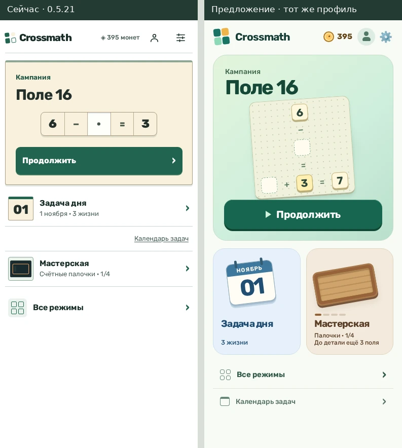
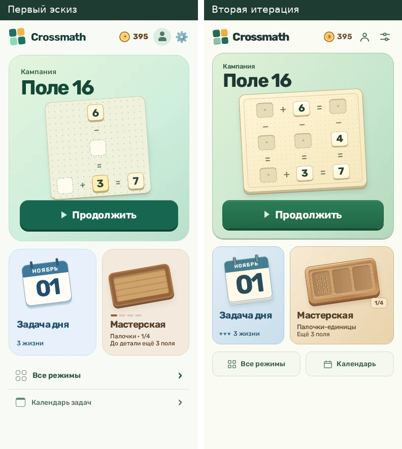
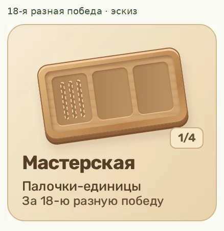

# Почему меню Crossmath напоминают справочник

**Разработчику.** [Единое ТЗ на реализацию, финальные файлы, порядок работ и приёмка](IMPLEMENTATION_TZ_RU.md).

**Продолжение от 22 ноября.** [Три следующих экрана, очередь остальных и принятый жетон](secondary/README.md).

**22 ноября 2026 · 0.5.21 / 26.** Поле и начисление монет приняты владельцем. Изменение, которое стоит обсуждать сейчас, — по каким признакам игрок узнаёт занятие ещё до чтения подписи. Ниже один вариант главной для оценки направления. Дизайн следующих экранов зависит от решения владельца.

[Переключение в натуральном масштабе 390 × 844 CSS px](home-compare.gif) · [Шесть нынешних экранов](current.jpg).

## Что видно в нашей игре

В исследовательском браузере заново открыты главная, режимы, календарь, мастерская, карточка инструмента и профиль. Состояние сохранено после 15 побед. Воспроизведена сборка из игрового PR №4, HEAD `bd5d2c7`, игровой коммит `715286f`. Все девять файлов веб-сборки совпали по SHA-256 с опубликованными отпечатками APK 0.5.21. Размер окна 390 × 844 CSS px. [Сборка и отпечатки](https://github.com/DanilaH/crossmath-game/blob/bd5d2c76b493ed8bed4ab9fc380b04f7edcb4627/docs/acceptance/qa-0521/observations.json) · [приёмка 0.5.21](https://github.com/DanilaH/crossmath-game/blob/bd5d2c76b493ed8bed4ab9fc380b04f7edcb4627/docs/acceptance/qa-0521/README.md).

- В разделе режимов все четыре пункта занимают 333 × 54 px. Ведущий рисунок мал, название и вторая строка имеют одну и ту же иерархию, справа повторяется шеврон. В режиме выбора эта композиция выглядит как список настроек.
- На главной у Daily уже есть дата, у мастерской — собственный рисунок, у кампании — реальный пример 230 × 48 px. Сама кнопка Daily имеет размер 370 × 70 px, а мастерской — 370 × 71 px. Значения и назначения разные, но почти всё место достаётся строке. В профиле зрительный центр занимают рамки и текст блока рекордов, в том числе при пустом рекорде.
- В мастерской прибор уже крупнее, статус будущего экспоната и ближайшая деталь теперь разделены. Разработчик также согласовал шрифт управления в 0.5.21. Старое замечание о Georgia в заголовках относилось к 0.5.20. Следующее изменение должно быть заметно даже в чёрно-белом кадре.

## Что подтверждено у референсов

| Источник | Свидетельство | Применение |
|---|---|---|
| EasyFun Offline Crossmath 1.1.9 | В Unity-панели календаря есть LayoutDaily и BtnPlay, у события собственная панель с последовательностью уровней и наградами. В издательском кадре ежедневный вход показан отрывной датой, событие — отдельной иллюстрацией. Версия витринного кадра неизвестна. | Переносимый принцип — разные объекты на входе в разные активности. У нас это текущий математический ход, лист календаря и незаконченная деталь. Сама мастерская — идея Crossmath. Связанные sourceFeatureId `easy-daily-archive`, `easy-month-trophy`. [Разбор сборки и ссылки на изображения](../ui-audit-057/references.md) · [кадр Daily/Event](https://play-lh.googleusercontent.com/O1yDRz1qANAGS4dd6N1A9JECFBFaCS_qsHRcPgMCza39IZE8A11Yv8FzXYDwANb-vwZqSeb02vJkGo0LGhfT9g=w526-h296). |
| Guru 3.5.2 и 4.17.0 | В сборках есть отдельные семейства графики главной, кубков и статистики. В 4.17.0 найдены отдельные короны Daily, Endless и обычного режима. На витрине видны счёт и этап Endless, а в Battle — две стороны над полем. Точное размещение всех графических ресурсов в конкретной сборке неизвестно. | На выборе Endless можно показывать табло личного рекорда, в календаре — печать месяца. У каждого графического объекта есть игровое значение. Связанный ID `guru-endless`. [Поимённое перечисление ресурсов](../ui-audit-057/references.md) · [витрина Guru](https://play.google.com/store/apps/details?id=math.puzzle.games.crossmath.number.puzzles.free). |

## Приёмы для нашего интерфейса

| Поверхность | Что показать | Что проверять |
|---|---|---|
| Главная | Кампания получает центр экрана, фрагмент настоящего поля и одно основное действие. Сегодняшняя задача узнаётся по переворачиваемому листку. Текущий прибор — по собственному материалу и состоянию. | На эскизе показаны два пересекающихся уравнения поля 16 `cm-own-02-001`, 395 монет, дата 1 ноября и лоток счётных палочек 1/4. Это статическая композиция. На телефоне проверить, понимает ли игрок, где продолжить и куда нажать ради сегодняшней задачи. |
| Режимы | У кампании — участок маршрута с текущим номером. У спокойной игры — несколько фишек и фактическая цель. У испытания — знак сложности и условие. У Endless — крупный счёт или честное пустое табло на первом входе. Единая область нажатия у всех режимов. | Названия оставить читаемыми, состояние и цель — в одну короткую строку. Попросить игрока выбрать режим с рекордом. Проверить старый профиль и первый вход. |
| Календарь | Фокус — дата и месячный трофей. Сегодня выделяется формой листка, сыгранный день отмечается штампом. Разместить действия возврата к незаконченной дате и старому достижимому месяцу рядом с соответствующей датой. | Сохраняются открытый через месяц январь 30/31, бесплатный повтор и возврат к отложенной фишке. Доступный и сыгранный дни различаются при выключенном цвете. |
| Мастерская | На верстаке увеличить текущий прибор. Показывать уже заработанную часть и место следующей. В полке показывать силуэты приборов. На конкретной выдаче уместен один блик вдоль вставшей детали. | Текущая карточка соответствует полке, историческая — снимку награды. После победы эффект проигрывается один раз. Уменьшенное движение сохраняет статическую подсветку. |
| Профиль и настройки | В профиле ведущим сделать последний полученный знак или достигнутый рекорд. Статистику оставить ниже. Настройкам, помощи и подтверждению расхода подходит спокойный список с короткими подписями. | Добраться до настроек и вернуться тем же путём. У пустого профиля подсказать ближайшее реальное достижение. |

Для цифр поля, ранга и рекорда достаточно имеющегося Rubik с крупными табличными цифрами. У основной кнопки стоит попробовать небольшой нижний кант, который сжимается на касании и возвращается при отпускании. Светлая нейтральная основа, синий для даты, тёплое дерево для мастерской, зелёный для продолжения — авторская проба. В эскизе нет новой валюты или нового ресурса. Фрагменты референсных изображений в него не включены.

**Как принять направление.** На реальном телефоне показать главную человеку, который ещё не играл. Попросить продолжить кампанию, открыть сегодняшнюю задачу и показать ближайшую награду. Фиксировать первое касание, возвраты и слова игрока. При визуальном сравнении временно скрыть подписи и проверить, различаются ли три назначения по форме. Если подписи нужны для каждого из трёх, следующую итерацию посвятить признакам предметов. Реакция игроков, удержание и физический размер элементов на Android пока UNKNOWN.

**KIT IMPACT.** При аудите метаэкранов сравнивать зрительный вес объектов до нажатия и проверять, какие разные игровые занятия выглядят как одинаковые пункты меню. Предложение по композиции ждёт решения владельца.

## Вторая итерация главной

Владельцу понравилось первое направление. Второй эскиз проверяет две вещи на том же профиле с 15 победами — узнаётся ли характерное пересечение уравнений и понятно ли, что появится в лотке после следующих трёх новых полей. Игровая база по-прежнему 0.5.21 / 26, исходник 715286f, HEAD PR №4 bd5d2c7. Это авторская визуальная проба Crossmath, отрисованная в браузере для обсуждения.

В превью взяты пять пересекающихся равенств поля 16 из cm-own-02-001. Заданные числа выступают над пустыми гнёздами. Главное действие — «Продолжить». При ширине 390 px зазор от наклонённой доски до кнопки составил 15 px, на 320 px также 15 px. Цифры и гнёзда различаются даже без цветового акцента. При реализации сравнить с более редким фрагментом первого эскиза, чтобы сохранить читаемость на маленьком телефоне.

Календарная дата остаётся листком с кольцами. Мастерская занимает больше ширины. На 15 разных победах уже заработан лоток, три пустых места под палочки показывают ближайшую деталь. На 18-й разной победе должны появиться именно три палочки-единицы. Собственный исходный рисунок задаёт три отдельных штриха, конфигурация задаёт пороги 13, 18, 23, 28 для четырёх частей. Эскиз ниже показывает предложенный порядок движений на уже подтверждённой выдаче. Три элемента последовательно укладываются, индикатор переключается на 2/4, следующая деталь — пятёрки через пять новых полей. Анимация носит презентационный характер. Исторический результат использует свою квитанцию. Уменьшенное движение сразу показывает конечное состояние. Последние два условия — критерии будущей реализации. [Конфигурация коллекции](https://github.com/DanilaH/crossmath-game/blob/715286fa6c56e14ce84a6b8c805c226e8e41a98a/docs/spec/product/meta_v08/config.json) · [три палочки на слое part-2](https://github.com/DanilaH/crossmath-game/blob/715286fa6c56e14ce84a6b8c805c226e8e41a98a/docs/spec/product/meta_v08/art/counting_rods.svg).

Оценочный вопрос для телефона — после короткого взгляда сможет ли игрок объяснить, какую вещь получит через три поля. Меню остальных экранов имеет смысл развивать после выбора варианта владельцем.
