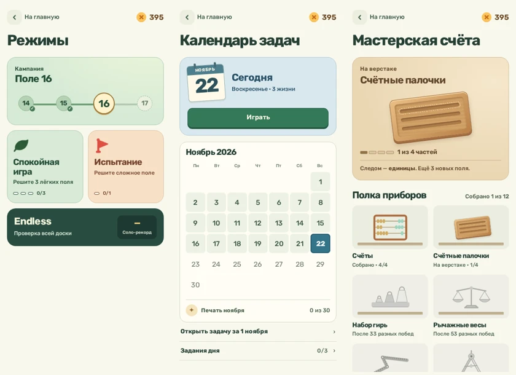

# Остальные экраны Crossmath

**Решение владельца, 22 ноября 2026.** Принят упрощённый набор пиктограмм и его последняя правка — светло-золотая монета с янтарной чеканкой ×. [16 пиктограмм для подключения, WebP 96×96](approved-icons.zip) · [Монета, PNG 96×96](coin-96.png). В шапке монета занимает 24 CSS px. Для эффекта начисления сохранить принятые владельцем полёт, время и момент смены баланса. Эскизы трёх экранов ниже — авторские предложения для обсуждения.

## Что уже работает

В браузере повторно открыт веб-пакет из PR №4, HEAD bd5d2c7, исходник игры 715286f, 0.5.21 / 26. Каждый файл пакета сверён с отпечатками в [приёмке подписанного APK](https://github.com/DanilaH/crossmath-game/blob/bd5d2c76b493ed8bed4ab9fc380b04f7edcb4627/docs/acceptance/qa-0521/observations.json). На контрольном профиле с 15 победами и 395 монетами проверены переходы через главную в режимы, календарь, мастерскую, карточку предмета, профиль и ранг. Дата 22 ноября 2026 зафиксирована в тестовом окружении. В продукте использовать effectiveDay профиля. На страницах сравнения слева текущий экран 390×844, справа эскиз для тех же данных. Эскизы также отрисованы при 320×568, горизонтального выхода страницы не обнаружено. Запуск на физическом телефоне и удобство касания предстоит проверить отдельно.

| Экран | В текущем продукте | Предлагаемое изменение | Приёмка после реализации |
|---|---|---|---|
| [Режимы](modes.webp) | Четыре одинаковые строки с шевронами. После 15 побед доступны все четыре. В состоянии теста текущая кампания на поле 16, Relax 0/3, Challenge 0/1, личного рекорда Endless ещё нет. | Кампания выглядит как маршрут с текущей остановкой. У Relax и Challenge видна фактическая цель и число шагов. Endless получает табло. Число на табло брать из самостоятельной категории рекорда, две категории оставлять в профиле. | На чистом профиле видны условия закрытых режимов. На контрольном профиле касание всей плитки сохраняет исходный маршрут, кампания по-прежнему открывает свой раздел с историей и последней квитанцией. Для живого Endless явно показать «Продолжить забег», для старого свободного сохранения вывести отдельный вход. |
| [Календарь](calendar.webp) | Уже есть сегодняшняя задача, доступные даты, незавершённые партии, месячная печать, архив и задания. Большая группа прошедших дат представлена карточками «ДД.ММ / Доступно». | Сверху отрывной лист с сегодняшним числом и основным действием. Ниже сетка месяца с отдельным прогрессом печати. Сегодня — выделенная дата, решено — штамп ✓, начато — точка и доступная подпись. Будущие даты без активной подложки. | Дату и её доступность брать из действующих правил. Прошедшая ячейка открывает соответствующую задачу. Проверить смену месяца, день с нулём жизней, возврат к старой незавершённой партии, достижимый январь 30/31 и архив полученных печатей. У старых доступных дат за пределами видимого месяца есть явный вход. |
| [Мастерская и карточка прибора](workshop.webp) | Уже есть 12 приборов, отдельные слои частей, состояние 1/4, следующая деталь и остаток до неё. В результате старой победы карточка хранит историческое состояние. | Крупный предмет на верстаке, занятое место и контур следующей детали. Ниже полка с собранным, текущим и будущими приборами. В примере активны лоток 1/4 и следующая группа «единицы» через 3 новых поля. Карточка использует тот же образ и показывает каждую из четырёх частей. | На переходе 1/4 → 2/4 палочки занимают первый паз один раз. Свободный просмотр показывает текущую сборку, квитанция поля 3 — рамку счётов 1/4 даже после 4/4. Будущие инструменты показывают реальное условие. Режим уменьшенного движения сохраняет статический результат. |

[Прогресс до следующей детали после победы. Примеры расчёта и анимация](workshop-progress.md).

## Следующая очередь

1. **Профиль, ранг, достижения.** На том же контрольном профиле уже заработан знак «За работу», есть ранг 2 с 75/120 XP и три достижения из двенадцати. Основную площадь сейчас забирает таблица двух пустых рекордов. Предложение — знак с названием и ранговая шкала наверху. Обе категории рекордов раскрываются ниже, после первого результата видны очки. Пустой профиль начинает с текущего ранга. Проверить отсутствие знаков, единственный рекорд, обе категории и возврат из карточки ранга.
2. **Итог, открытие режима, история поля.** Обычной победе достаточно награды и «Следующее поле». При открытии инструмента показать выданную деталь рядом с квитанцией и дать её открыть. Повтор пройденного поля отражает фактический переход и фактическую выплату. В исторической квитанции повторная выдача исключена. В Endless сохранить подтверждение завершения живого забега, в Daily — исход и точную дату.
3. **Служебные экраны.** У помощи и подтверждения расхода различимы цена, эффект, достаточность средств и возврат на поле. Пауза, правила, настройки, язык и восстановление получают общие шрифт, отступы и элементы управления; собственная сценография здесь не нужна. Игровые клетки и лоток уже приняты владельцем.

## Источники и границы

- EasyFun Offline 1.1.9. В prefab календаря есть LayoutDaily и BtnPlay. У режимов отдельные входы. Отрывная дата видна на издательском изображении, версия кадра неизвестна. IDs easy-six-relax, easy-six-challenge — MATCH, easy-daily-archive и easy-month-trophy — PARTIAL в [реестре игры](https://github.com/DanilaH/crossmath-game/blob/bd5d2c76b493ed8bed4ab9fc380b04f7edcb4627/docs/porting/ADOPTION_LEDGER.json).
- Guru 3.5.2 и 4.17.0. Раздельные ресурсы трофеев и статистики, у Endless счёт и этап на издательском кадре. Короткий путь с результата на следующее поле виден в публичной записи 00:30–00:34, версия записи неизвестна. guru-endless и guru-profile — PARTIAL, guru-result-next — MATCH. [Источник по файлам, изображениям и времени](../../ui-audit-057/references.md).
- Раскладка плиток, деревянный лоток, лист месяца и итоговый вид жетона — дизайн Crossmath. Эскиз показывает выбранное состояние светлой темы. Тёмная тема, пустые и исторические состояния и физическое устройство остаются в приёмке. Полная инвентаризация иных окон есть в [аудите 0.5.20](../../screen-audit-0520/SCREENS_RU.md), принятые исправления в 0.5.21 перечислены [отдельно](https://github.com/DanilaH/crossmath-game/blob/bd5d2c76b493ed8bed4ab9fc380b04f7edcb4627/docs/acceptance/qa-0521/README.md).
- Разработчику. Исходные действия, статусы дня, снимок исторического прибора и разбивку рекордов брать из [metaView.ts](https://github.com/DanilaH/crossmath-game/blob/bd5d2c76b493ed8bed4ab9fc380b04f7edcb4627/src/ui/metaView.ts). Компоновка в hub.css. Зависимости — текущий профиль, сохранённые партии, календарная политика, правила выдачи, тема и настройка движения. [Два вида меню при ширине 390 px, GIF](mode-switch.gif).

**KIT IMPACT.** Меняется оформление Crossmath. Новых общих правил, выплат или требований к runtime не появилось.
