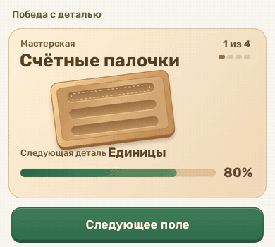

# Как ощущается выдача детали

Художественная проба для обсуждения, 22 ноября 2026. Основа — [накопление и перенос остатка](workshop-progress.md). Здесь меняется визуальная отдача. Сборка для сверки — [0.5.21 / 26, PR №4](https://github.com/DanilaH/crossmath-game/blob/bd5d2c76b493ed8bed4ab9fc380b04f7edcb4627/docs/acceptance/qa-0521/README.md). Одно впервые решённое поле добавляет один шаг. Две выдачи подряд использованы как пример для обработки пакета.

| Событие | Что видит игрок | Как проверить |
|---|---|---|
| Частичный прогресс | За 330 мс светлая кромка доходит до нового значения шкалы. Имя цели и прибор остаются на месте. | 15 → 16 разных полей, 40% → 60%, остаётся 1/4. |
| Достижение порога | Шкала доходит с 80% до 100% за 320 мс. За 90 мс на её конце собирается золотой штрих. Он покидает шкалу, раскрывается в три палочки. В верхней части дуги они расходятся веером, затем ускоряются в первый паз. | 17 → 18. Первый полёт занимает 500 мс. До контакта счётчик показывает 1/4. |
| Посадка | В кадре контакта палочки уже лежат в пазу. Счётчик меняется на 2/4, подпись — «Деталь получена · Единицы». Лоток подаётся на несколько пикселей и возвращается. По установленной детали проходит короткий блик, вокруг контакта расходятся несколько тёплых точек. | Короткий деревянный удар начинается на кадре контакта. Сверить с видео 60 кадров/с и на телефоне при включённом звуке. Шапка, кошелёк и кнопка «Следующее поле» стоят на месте. |
| Серия | Следующая связка отличается цветом и перевязью и занимает второй паз. Её полёт короче, 430 мс. Остаток коротко заполняет шкалу до следующей цели. | Условные 17 → 24. Порядок «Единицы», «Пятёрки», затем 20% до «Десятков». Полученный счётчик — 3/4. |
| Быстрый выход или уменьшенное движение | Следующее поле доступно во время эффекта. Для уменьшенного движения отобразить итоговую раскладку и подпись сразу. При повторном открытии показать сохранённый предмет. | Уйти и вернуться во время полёта. Проверить единственную выдачу, историческую квитанцию, тишину при отключённом звуке и отсутствие повторной церемонии. |

Числа выше — авторские тайминги эскиза. Отсчёт идёт от начала блока мастерской после принятой прибавки монет. В игровом результате разместить блок в доступной области без смещения основного действия. Ролик показывает фрагмент результата и собственный звуковой эскиз. Громкость на устройстве, вибрация и соседство с реальной анимацией монет требуют отдельной приёмки.

В 0.5.21 у победного звука уже есть акцент детали и отдельный акцент собранного прибора. При переносе согласовать деревянный удар с этим акцентом, чтобы на одну посадку пришёлся один удар. Виброотклик — отдельная проверка на устройстве с включённым переключателем. [Текущий синтез победы и детали](https://github.com/DanilaH/crossmath-game/blob/bd5d2c76b493ed8bed4ab9fc380b04f7edcb4627/src/ui/feedback.ts#L76)

**KIT IMPACT.** Параметры движения пока относятся к этой форме лотка и деталям Crossmath.
