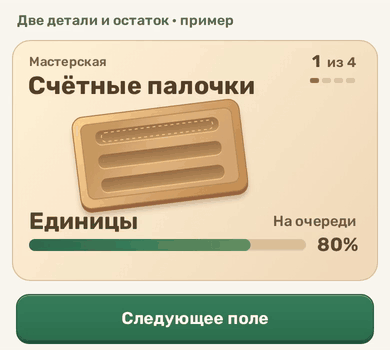

# Как меняются надписи при получении детали

**22 ноября 2026.** Владелец принял движение палочек и посадку из [предыдущего эскиза](workshop-feel.md) и попросил доработать смену надписей. Ниже предложена новая типографика. Сценарии сняты в отдельном браузерном эскизе. Для сравнения используется [приёмка игрового PR №4, 0.5.21 / 26](https://github.com/DanilaH/crossmath-game/blob/bd5d2c76b493ed8bed4ab9fc380b04f7edcb4627/docs/acceptance/qa-0521/README.md).

| Момент | Экран и привязка ко времени |
|---|---|
| Шкала идёт с 40% до 60% | Слева крупно написано «Единицы», справа — «На очереди». Взгляд читает одно название в одной позиции. Меняется процент. |
| Деталь ещё летит | Название стоит на прежней строке. За последние 65 мс перед контактом «На очереди» уступает место оттиску. Кадр с выдачей привязан к посадке в паз; заполнение шкалы может закончиться раньше. |
| Палочки сели | Справа отпечатывается зелёное «✓ ПОЛУЧЕНО». В этом же кадре название принимает цвет чернил. Оттиск опускается примерно на 2,5 CSS px, сжимается до окончательного размера и за 140 мс успокаивается под углом около 3,5°. Он использует тот же деревянный щелчок, что и посадка. |
| Счётчик прибора | Только первая цифра «1 из 4» прокатывается в коротком вертикальном окошке и становится «2». Основание для цифр, «из 4» и кнопка продолжения стоят на месте. Переход длится 145 мс. |
| Есть ещё одна цель | Старая бирка уходит влево вместе со своей печатью за 85 мс. Новое имя входит справа на ту же строку за 105 мс. Путь текста 13–14 CSS px. «Пятёрки» получают собственную печать только после своей посадки. |
| Приходит остаток | Вверху блока стоит новая цель «Десятки», у шкалы 20%. Под ней остаётся короткий итог «В лотке · Единицы и пятёрки». Для одиночной выдачи оттиск остаётся рядом с полученной деталью. |

Размер эскиза при ширине 390 CSS px — название детали около 24 px, оттиск 14 px. Семейство Rubik, имя детали и чернила дают основной акцент. В игровой вёрстке отвести место под самую длинную локализацию и крупные цифры. Область движения ограничивать только у сменяемых надписей, размеры панели и кликабельных действий во время показа стабильны.

**Приёмка для разработчика.** Снять одним проходом обычный прирост, одну выдачу и условный пакет с двумя порогами. На стоп-кадре перед первой посадкой читаются «Единицы» и прежний счётчик. После посадки имя остаётся на той же базе, рядом зелёная печать. На новом имени старая печать уже убрана. Проверить 320×568 и 390×844, обе темы, RU/EN, пропуск и повторное открытие исторической квитанции. При уменьшенном движении сразу ставить окончательные имя, счётчик и итог выдачи. Для экранного диктора сообщать завершённую выдачу один раз. Звук прикреплять к одному событию контакта. Геометрия и физическая читаемость на телефоне требуют приёмки в реализации.

**KIT IMPACT.** Это художественное предложение для наград мастерской Crossmath.
