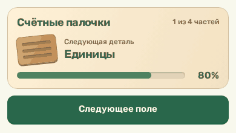

# Прогресс до детали в результате поля

**Предложение владельца от 22 ноября 2026.** В результате новой победы рядом с наградой показать, насколько игрок приблизился к следующей детали мастерской. Процент относится к одной названной детали. Общий счётчик показывает, сколько из четырёх частей уже установлено в прибор. Это развитие авторской мастерской Crossmath.

В GIF показано условное начисление сразу семи шагов, от 17 до 24 разных побед. В версии 0.5.21 / 26 обычное впервые решённое поле добавляет один шаг. GIF показывает самостоятельный блок результата при ширине 390 CSS px. Та же компоновка проверена при 320 CSS px. Анимация замедлена для чтения. Телефон и игровой APK с этой анимацией ещё предстоит проверить.

[Новая проба анимации с полётом и посадкой палочек](workshop-feel.md).

## Что видит игрок

1. На результате сохранить принятую анимацию монет. Когда прибавка видна в кошельке, запустить одну компактную шкалу под наградой. Основная кнопка ведёт дальше с момента, когда доступна в текущем результате.
2. Вверху название прибора и число собранных частей. У полосы имя следующей детали и целый процент. С 15 до 16 разных побед у счётных палочек заполнение до «Единиц» идёт с 40 до 60 процентов. Повтор уже решённого поля даёт нулевое изменение. Получение монет из других источников само по себе шкалу не двигает.
3. На 100% на мгновение показать «Деталь получена · Единицы», вставить деталь в лоток и изменить счётчик с 1/4 на 2/4. Если остатка нет, завершить на состоянии получения. При следующем просмотре мастерской показать новую цель и 0%. При наличии остатка сменить название цели и продолжить заполнение в том же блоке. При нескольких порогах показать каждую выдачу по порядку. В конце сохранить читаемый итог о полученных деталях в квитанции.
4. На четвёртой части показать готовый прибор. Действующие +20 монет за него входят в уже сохранённый итог. При наличии остатка перейти к первому элементу следующего прибора. После 48-й детали показывать «Коллекция собрана». Кнопка продолжения доступна во время показа. При уменьшенном движении показать общий итог выдачи и конечный прогресс одним кадром.

## Расчёт и приёмка

Шаг соответствует одному новому puzzleId в solvedIds. Для текущего интервала взять предыдущий пройденный порог L (до первой детали — 0) и следующий порог R. Видимый процент — целая часть 100 × (число разных решённых полей − L) / (R − L). Достижение границы даёт 100% по старой цели. Для продолжения пересчитать остаток в шагах относительно нового интервала. Первые пороги — 3, 4, 6 и 8, позднее встречается шаг в пять полей.

| Сценарий | Ожидаемый результат |
|---|---|
| 15 → 16 разных полей | «Единицы», 40% → 60%, у прибора 1/4. |
| 17 → 18 | 80% → 100%, выдача «Единиц», 2/4. Экран победы заканчивается полученной деталью. |
| Проверочный пакет 17 → 24 | 80% → 100% на 18-й победе, «Единицы»; новый интервал → 100% на 23-й, «Пятёрки»; 20% до «Десятков», прибор 3/4. |
| Разная длина интервалов, условный пакет 2 → 5 | «Рама» на 3-й, «Спицы» на 4-й, 50% до «Левых костяшек» на 6-й. |
| 27 → 29, условный пакет | На 28-й собран прибор 4/4, бонус +20 один раз. 1 из 5 шагов до первой детали следующего прибора, 20%. |
| Повтор, открытие старого результата, пропуск, перезапуск | Баланс и детали уже записаны один раз. Старый результат показывает собственный снимок. Для старой квитанции без достаточных данных показать сохранённую награду без реконструкции процентов по нынешнему профилю. |

Разработчику. Сохранить в той же транзакции результата исходное и конечное количество разных побед либо эквивалентный снимок. Для интервала перечислить пороги в порядке прохождения и соответствующие им детали. Отрисовка читает квитанцию. Пропуск, сворачивание и повторное открытие не должны присуждать награды. Для целого предмета сохранить ссылку на историческую карточку. Новые множители за сложность, скорость или просмотр рекламы требуют отдельного продуктового решения.

Источники по сборке — [пороги и награды](https://github.com/DanilaH/crossmath-game/blob/bd5d2c76b493ed8bed4ab9fc380b04f7edcb4627/docs/spec/product/meta_v08/config.json#L38), [расчёт и сохранение результата](https://github.com/DanilaH/crossmath-game/blob/bd5d2c76b493ed8bed4ab9fc380b04f7edcb4627/src/app/model.ts#L65), [отклик новой награды](https://github.com/DanilaH/crossmath-game/blob/bd5d2c76b493ed8bed4ab9fc380b04f7edcb4627/src/ui/gameUi.ts#L252), [представление исторической детали](https://github.com/DanilaH/crossmath-game/blob/bd5d2c76b493ed8bed4ab9fc380b04f7edcb4627/src/ui/metaView.ts#L39).

**KIT IMPACT.** Для одной цели уже используется getTierProgress. Последовательность выдачи и обратную связь в этом эскизе оцениваем в контексте Crossmath.
