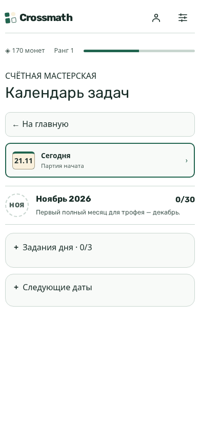

# Crossmath 0.5.16 · проверка A–C и ТЗ на мету

**Очередь разработки — M0, две правки переходов; M1, месячный трофей Daily; M2, продолжение целей Relax и Challenge.** Для локальной дуэли M3 ниже предложен отдельный релиз. Исходная версия — 0.5.16 / versionCode 21, PR #4, HEAD `6024dff`, исходник APK `ee35526`. Работать в актуальной ветке `feat/mode-unlocks-0.5.10`. Проверка 21 ноября 2026. [Игровой PR](https://github.com/DanilaH/crossmath-game/pull/4) · [Предыдущее ТЗ](../play-audit-0513/DELIVERY_SPEC_RU.md) · [Реестр](../ADOPTION_LEDGER.json).

## Что проверено в сборке

| Пакет | Независимый проход |
|---|---|
| A. Переходы и помощь | После кампании 16 и пяти побед Relax меню кампании вернуло результат `cm-own-02-001`. При 10 монетах оплата подсказки отключена и показана нехватка 50. Предупреждение о категории рекорда Endless видно до оплаты, отмена сохраняет самостоятельный забег. Старая дата с жизнями восстановилась. Остальные комбинации A, включая заголовки Rubik и поражение за границей архива, описаны в приёмке разработчика. |
| B. Выдача | Первый Relax после третьей победы и после кампании 16 выдал `cm-own-02-040`. Кампания 16 выдала `cm-own-02-001`. Каждая первая победа дала базовые +10. Первый Challenge после 15 побед выдал `cm-own-02-190`. |
| C. Персональная цель | Пять побед Relax дали **1 → 2 → 2 → 3 → 3**. Холодный запуск после второй сохранил счётчик. На четвёртом результате появилось «Цель выполнена · 3/3». После пятого поля меню всё ещё предлагает «Решите 3 лёгких поля · 3/3 ✓». Это исправляет продолжение целей M2. |
| Основа для M1 | Задача за 21 ноября, доигранная 22 декабря, записала 21 ноября и +30 за дату. В обычном календаре ноябрьская дата уже исчезла. Даты 21 ноября и 10 января с интервалом 50 дней выдали одинаковый puzzleId и два отдельных зачёта. На второй дате выплата составила 0 базовых и +30 за дату. В отдельном февральском профиле игровой сеанс и обычная запись сохранений подтвердили 28, затем 29 разных завершённых дат. |

Повторно прошли **84 модульных теста**, typecheck и сборка, штатные проверки контента и три сценария Chromium на веб-ресурсах APK. Независимый сценарий прошёл 16 полей кампании с чистого профиля касаниями в окне 390 × 844 CSS px. Календарные границы проверены управляемыми часами. Финал 240 подготовлен игровыми командами и расчётом завершения каждого поля, затем поле 1 повторено касаниями. Февраль подготовлен через 29 побед игрового сеанса и обычный модуль сохранения. Длинные подготовки отличаются от прохождения пальцем на телефоне. SHA-256 APK `b0f4fe6f2919db87da581f02dcf168e0c884fd4ebb9cf83f29f7e63b57b16f37`. Физическое обновление приложения и восстановление процесса Android остаются открытыми. [Наблюдения](observations.json) · [Сценарий интерфейса](replay.py) · [Приёмка разработчика](https://github.com/DanilaH/crossmath-game/blob/6024dff8f282ab94e7c7619de045da654f9ffdff/docs/acceptance/PACKAGES_ABC_0516.md).

**Повторить независимую проверку.** В рабочей копии игровой ревизии временно поместить [подготовку профилей](make-controls.ts) в tests/research-controls.test.ts. Задать CROSSMATH_CONTROLS_DIR абсолютным путём к каталогу результатов и запустить npx vitest run tests/research-controls.test.ts. Затем запустить Python-сценарий replay.py с тремя позиционными аргументами — корень игры, извлечённая из APK папка assets/public, тот же каталог результатов. Нужен Python Playwright с установленным Chromium; переменная CHROMIUM позволяет указать его исполняемый файл. Сценарий записывает наблюдения и кадры.

## M0. Исправить два перехода

**Дневное задание открывает уже проигранный Endless.** Сохранить забег с нулём жизней. В календаре нажать «Решите одно поле в забеге · 0/1». В 0.5.16 открылся тот же runId и экран поражения. Бесплатный новый забег доступен за дополнительное нажатие. Связанные ID — `guru-task-endless`, `guru-endless`. [Переход](https://github.com/DanilaH/crossmath-game/blob/6024dff8f282ab94e7c7619de045da654f9ffdff/src/app/session.ts#L254) · [GIF](endless-quest.gif).

- У проигранного забега прямо у цели предложить «Начать новый забег». По этому явному выбору сохранить старый итог один раз и открыть игровую доску с тремя жизнями. Из обычного раздела режимов сохранить доступ к старому результату и доступному восстановлению жизни.
- Проверить цель при активном забеге, выигранном этапе, поражении и вручную законченном забеге. Активный продолжается, выигранный этап ведёт к следующей доске, проигранный даёт явный новый старт. Касание цели само по себе не добавляет прогресс, не расходует монеты и не меняет старый рекорд.

**Повтор первого поля объявляет финал всей кампании.** На профиле с 240 завершёнными позициями открыть поле 1 из истории и решить его. Показано «Маршрут пройден», в меню затем «Продолжить · Поле 1». Баланс при этом не меняется. Связанный ID — `guru-result-next`. [Условие на результате](https://github.com/DanilaH/crossmath-game/blob/6024dff8f282ab94e7c7619de045da654f9ffdff/src/ui/gameUi.ts#L409) · [Меню](https://github.com/DanilaH/crossmath-game/blob/6024dff8f282ab94e7c7619de045da654f9ffdff/src/ui/metaView.ts#L388) · [GIF](final-replay.gif).

- Записывать в квитанции переход курсора с 239 на 240. На таком результате показать завершение кампании, при повторе — «Поле 1 решено повторно» и вход в историю. Главную кнопку закрытой кампании подписать «Пройденные поля».
- Проверить первый финиш 240-го поля, повтор первого и повтор 240-го, до и после загрузки. Отдельный случай — последний puzzleId ранее решён в Challenge. Факт первого завершения кампании живёт отдельно от базовой награды за новизну ID.

## M1. Месячный трофей Daily

**Донор.** EasyFun 1.1.9/1193 привязывает награду к году и месяцу сыгранной даты, длине месяца и признаку уже выданного приза. Изолированные проверки исходных ARM64-ветвей покрыли 28, 29, 30 и 31 день. Срок позднего показа и экран фактически активного варианта оригинала — UNKNOWN. Исходные ID — `easy-month-trophy`, `easy-month-replay`, `easy-month-archive-key`, `easy-month-award-flag`. [Разбор](https://github.com/DanilaH/mini-games-kit/blob/5ad2985fe6b1da8d137530a2cd13d632b9f8f263/research/games/crossmath/porting/easyfun-119/README.md) · [16 контрольных входов](https://github.com/DanilaH/mini-games-kit/blob/5ad2985fe6b1da8d137530a2cd13d632b9f8f263/research/games/crossmath/porting/easyfun-119/NATIVE_CASES.json).

**Вариант Crossmath.** Под сегодняшней задачей и перед дневными целями в календаре разместить строку с печатью месяца, названием и прогрессом. Сегодняшняя задача сохраняет главное действие. Награда первого выпуска — собственная календарная печать месяца и года. Действующее начисление монет за Daily и его анимация остаются самостоятельными.

| Состояние | Что показывать и куда ведёт действие |
|---|---|
| Профиль создан в середине месяца | «Ноябрь 2026 · 0/30. Первый полный месяц для трофея — декабрь». Играть доступные даты и собирать обычные выплаты можно сразу. При создании 1-го числа этот месяц может быть полным. |
| Месяц достижим | «Февраль 2028 · 28/29. Остался один день до трофея». Если нужен пропущенный доступный день, дать прямой вход в конкретную задачу. Будущий день до его наступления не открывать. |
| Получение | На результате последней нужной даты показать «Трофей февраля получен». В календаре — золотой оттиск и «29/29 · Трофей получен». Вход из этого результата открыть на заработанном месяце, даже при переходе через Новый год. При обычном входе показывать текущий месяц. Полученные месяцы доступны под «Мои трофеи» в календаре. |
| Пропуск истёк | Проверить незаконченные попытки с жизнями у каждой недостающей истёкшей даты. Если все ещё можно закрыть, предложить ближайшую из них. Если хотя бы одна окончательно недоступна, сохранить счётчик и сообщить, что этот месяц полностью закрыть уже нельзя. |

**Экранный пример.** В GIF показано предложение поверх календаря 0.5.16. Даты на карточках взяты из игровых сохранений. Ширина строки в макете 370 CSS px при 390 × 844 и 300 CSS px при 320 × 568. Высота 76 px, на узком экране длинная подсказка занимает около 86 px. В реализации оставить высоту по содержимому. Использовать Rubik, обе темы, текстовый признак получения и полное доступное название месяца. Печать может однократно проявиться после записи награды. При reduced motion сразу показать итог. У выплаты монет сохранить её звук; дополнительная вибрация в этой версии излишня. [Узкое окно](month-320.png) · [Измерения](layout.json).

**Учёт и сохранения.**

1. Единица прогресса — уникальная дата победы Daily из `attempt.dayKey`. Определять ключ трофея по году и месяцу этой даты, длину месяца — по григорианскому календарю. Учитывать закреплённую зону профиля, монотонный `effectiveDay` и существующее окно архива. Одинаковое поле на разных датах даёт два дня. Повтор той же даты — один день. [Даты и доступность](https://github.com/DanilaH/crossmath-game/blob/6024dff8f282ab94e7c7619de045da654f9ffdff/src/meta/calendar.ts) · [Начисление Daily](https://github.com/DanilaH/crossmath-game/blob/6024dff8f282ab94e7c7619de045da654f9ffdff/src/meta/progress.ts#L28).
2. Факт выдачи по ключу год-месяц, связанный месяц на экране результата и обычную выплату записывать одной транзакцией. После сбоя до записи повторить завершение; после успешной записи восстановить результат. Два тапа, повтор, смена зоны и просмотр истории не создают второго приза. [Точка завершения](https://github.com/DanilaH/crossmath-game/blob/6024dff8f282ab94e7c7619de045da654f9ffdff/src/app/model.ts#L49).
3. На обновлении восстановить доказуемые полные месяцы по `meta.completedDates`. Неизвестное время получения оставить неизвестным. Восстановленные печати поместить в историю без новых выплат и серии всплывающих окон. Сохранить активные и отложенные партии, фишки, кошелёк и цель Relax. Глубина списка видимых дат и срок хранения награждённых месяцев различаются.
4. Если профиль создан первого числа, а Daily открылся после пяти побед позже, учесть доступность предыдущих дней со дня создания. Необратимый пропуск определять по фактической возможности открыть или продолжить конкретную дату.

**Приёмка M1.** Февраль 2025 — 27/28 → 28/28; февраль 2024 — 28/29 → 29/29; апрель — 30, январь — 31. Завершить январскую дату из февраля и декабрьскую из января. Проверить 1-е и 20-е числа создания профиля, повтор одной даты, интервал 50 дней, живую и проигранную попытки 31-дневной давности, повтор записи и миграцию. Сдать короткую GIF последней победы и перехода к трофею, квитанцию до/после reload, RU/EN и обе темы на 320 × 568 и 390 × 844.

## M2. Продолжить персональные цели после 3/3

В EasyFun 1.1.9 для Relax и Challenge есть отдельные таблицы по 121 строке. Тип 0 задаёт число завершений классических полей нужной сложности. Тип 1 — достижение позиции маршрута. Порядок показа отдельных задач внутри одного звания в работающем оригинале UNKNOWN. Одна видимая цель и последовательность ниже — предложение Crossmath. Исходные ID — `easy-rank-relax`, `easy-rank-challenge`. [Конкретные строки из XAPK](rank-rows.json) · [Хеши таблиц в реестре источников](https://github.com/DanilaH/mini-games-kit/blob/5ad2985fe6b1da8d137530a2cd13d632b9f8f263/research/games/crossmath/porting/SCAN_SUMMARY.json).

| Дорожка | Строки EasyFun | Путь игрока в Crossmath |
|---|---|---|
| Relax | id 2 — 3 Easy, id 3 — 1 Normal, id 4 — достичь позиции 3 Relax | После действующих трёх лёгких предложить «Решите поле средней сложности». Засчитать Normal Short или Normal Long. При завершении ступени проверить достигнутую позицию дорожки. |
| Challenge | id 2 — 1 Hard, id 3 — 1 Expert, id 4 — достичь позиции 3 Challenge | После штатного открытия предложить «Решите сложное поле», затем «Решите экспертное поле». Порог третьей позиции проверить по курсору Challenge. |

На финише сохранить, какую цель игрок только что закрыл. Следующая видна в карточке режима. На результате поля другой сложности не воспроизводить эффект нового зачёта. Когда активных условий не осталось, вывести «Ступень пройдена ✓» вместо повелительного «Решите … 3/3». Если позиция 3 уже пройдена, закрыть этот порог сразу без лишней партии. Для результата и истории использовать снимок текущей цели и её значения на момент записи.

Перенести `relaxGoalIds` и состояния 0/1/2/3 без обнуления. Профиль с 3/3 при обновлении получает цель Normal. Для счётных условий засчитывать подходящие победы в нужной дорожке после активации. Старые квитанции сохраняют старый текст. Неизвестную историю сыгранных до обновления сложностей не восстанавливать догадкой. Условия позиции разрешается восстановить из фактического курсора. Помощь допустима. Ключ цели привязать к версии и дорожке. Повторный показ результата не добавляет вклад. Награда первой ступени — отметка в карточке. Дополнительные монеты, XP или билеты в предложении отсутствуют.

**Особенность нашего банка.** У 18 Expert Short и у 17 Hell Short значение `difficulty=expert`. Для цели Expert проверять `bucket=expert-short`; иначе поле «Хардкор» тоже продвинет её. [Расписание и корзины](https://github.com/DanilaH/crossmath-game/blob/6024dff8f282ab94e7c7619de045da654f9ffdff/src/content/rotation.ts) · [Текущая запись цели](https://github.com/DanilaH/crossmath-game/blob/6024dff8f282ab94e7c7619de045da654f9ffdff/src/meta/progress.ts#L7).

**Приёмка M2.** Первые четыре поля Relax дают 1 → 2 → 2 → 3, пятое Easy оставляет цель Normal, шестое Normal закрывает ступень. В Challenge первая Hard закрывает первую цель, вторая Hard сохраняет цель Expert, третья Expert закрывает ступень. Отдельно дать Hell с активной целью Expert. Проверить миграцию 0/3, 2/3, 3/3, оплату подсказки, одно поле между режимами, вход через дневную задачу, отказ от замены незаконченного поля и перезапуск. Полную лестницу званий и экономику рангов вести под прежними ID в следующих этапах.

## M3. Следующий отдельный релиз — локальная дуэль

В Guru 3.5.2 и 4.17.0 подтверждены базовый план соперника, отдельная реакция на ход, расход билета и расчёт серии. Для 16 уравнений, уровня бота 6 и нуля длинных выражений база плана составляет 70 секунд. Возможные реактивные задержки — 0 / 0,5 / 1 / 1,2 / 1,5 с. Эта ветка останавливается на `total − 3` внутренних единицах. Точное соответствие единицы экранным клеткам и активная серверная конфигурация оригинала — UNKNOWN. ID — `guru-battle-time`, `guru-battle-react`, `guru-battle-ticket`, `guru-battle-streak`, `ref-live-opponents`. [Первичные расчёты для обеих версий](https://github.com/DanilaH/crossmath-game/blob/6024dff8f282ab94e7c7619de045da654f9ffdff/docs/spec/R2_APK_BALANCE_RU.md#L45) · [Пакет E, подробные правила матча](../play-audit-0513/DELIVERY_SPEC_RU.md).

**Первая версия Crossmath.** В режимах явный вход «Дуэль с компьютером». Одна собственная доска, две подписанные стороны «Вы» и «Компьютер», два счётчика готовых уравнений. Предлагаемый момент открытия — после 20 разных побед, чтобы отделить его от двух открытий на 15-й. Для первого выпуска предлагаются бесплатный вход, счёт по активному времени, пауза обеих сторон в фоне и приоритет игрока при одинаковом времени финиша. Сохранять seed, расписание соперника и ожидающую реакцию. Undo не даёт повторно ускорить соперника одной и той же правкой. Итог виден сразу и записывается один раз; реванш создаёт новый ID матча. Цены билетов, награды серии и рекламу согласовать как отдельную экономическую задачу. Победы Battle хранить отдельно от рекордов Endless.

**Приёмка M3.** Выиграть и проиграть на фиксированном seed и управляемых часах. Подтвердить отдельные эффекты расписания и реакции: одним ответом на касание бот не финиширует. Проверить ошибочный ход, Undo, два тапа по финишу, равное время, паузу за одну реакцию до финиша, восстановление после выгрузки, повтор и возврат к старой кампании. До выбора дуэли владельцем порог 20 использовать только для оценочного сценария.

**Передача.** Разработчику пройти M0 → M1 → M2. Сначала сверить актуальный HEAD и воспроизведение. После каждого пакета обновить реестр с sourceFeatureId, ссылкой на diff и результаты, приложить APK и короткую GIF, затем брать следующий доступный пакет. Физическую проверку обозначать отдельно. M3 готов к оценке после выбора соревнования владельцем. Star Race и Brains сохраняют собственные этапы в реестре.

**KIT IMPACT.** Изменения относятся к Crossmath. Для трофея повторно использовать календарные функции и атомарную запись. Общий модуль периодических наград оценивать при втором применении.
