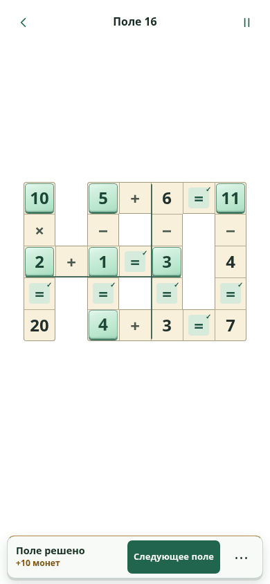

# Crossmath · ТЗ разработчику после аудита 0.5.13

**Цель.** Игрок попадает в обещанную партию, заранее видит последствия помощи и при первом входе в свободную игру получает новое поле и понятную ближайшую цель. Приоритет сохраняют игровая сетка, физические фишки и принятый владельцем эффект начисления монет.

**База.** 21 ноября 2026. Ветка разработки `feat/mode-unlocks-0.5.10`, PR #4, проверенный HEAD `96dc468`. Preview 0.5.13 / versionCode 18 собран с `071c35c`; разница — отчёт приёмки. Runtime геймкита `469928d03f4bae5053e23db26e82187bedbc252e`. Все примеры «сейчас» относятся к этой версии. На старте сверить свежий HEAD и пройти сценарии ниже. Если изменение уже приехало, принять его по сценарию и идти дальше. Работать в актуальной игровой ветке. Исследовательский PR #3 содержит материалы и более старую копию игрового кода. [Игровая ветка](https://github.com/DanilaH/crossmath-game/pull/4) · [Паспорт APK](https://github.com/DanilaH/crossmath-game/blob/96dc46873398b6d8367ce455d0bd6e7db6ffe25b/docs/acceptance/THEMES_0513.md) · [Аудит, все воспроизведения и GIF](README.md).

| Очередь | Что должно получиться | Когда брать |
|---|---|---|
| A. Исправления | Корректные переходы, честная кнопка помощи, единая типографика двух экранов | Сразу |
| B. Выдача Free | Сохранённая партия продолжается с того же места. Новое поле по возможности ещё не решалось | После A |
| C. Цель Relax | В режиме видна одна цель «Решите 3 лёгких поля». Победа показывает вклад | После B |
| D. Месячный трофей | Календарь показывает достижимый месячный приз и выдаёт его один раз | Следующий предлагаемый этап после C |
| E. Локальная дуэль Guru | Законченный матч с явно обозначенным компьютерным соперником | Отдельный следующий релиз после выбора соревновательного режима владельцем |

A–C образуют ближайшее задание. Выполнять последовательно, прикладывать результат каждого пакета и переходить к следующему. D и E описаны для планирования следующего релиза. При выборе D первым можно реализовать визуальный трофей без новых цен и выплат. Если одна аппаратная проверка остаётся открытой, фиксировать устройство и сценарий, продолжать независимую работу.

## A. Исправить воспроизведённые ошибки

| Место и sourceFeatureId | Как воспроизвести на 0.5.13 | Требование и приёмка |
|---|---|---|
| Режимы → Кампания → последний результат. `easy-switch`, `easy-result-tabs` | Решить кампанию 16 и два поля Relax. Внутри меню кампании результат ведёт в Relax, поле `cm-own-02-041`. | Подписать «Результат поля 16». Открывать последнее сохранённое завершение **слота кампании**, в примере `cm-own-02-001`. Если в слоте нет результата, действие скрыто. Проверить из Free, Daily и самой кампании, сохранность другой партии и отсутствие повторной выплаты. [Обработчик](https://github.com/DanilaH/crossmath-game/blob/96dc46873398b6d8367ce455d0bd6e7db6ffe25b/src/ui/metaView.ts#L391) · [GIF](result.gif). |
| Календарь и главная. `easy-daily-archive`, `easy-daily-life` | На дате 21 ноября потратить 3 жизни. 22 декабря «Начатые ранее → продолжить» открывает отключённый повтор. Главная тоже предлагает «Продолжить». | Старую дату с жизнями открыть с прежними ID и фишками. У истёкшей даты с нулём жизней убрать продолжение, с главной предлагать доступную партию. Если отображается её поражение, дать прямое действие «В календарь». Внутри окна сохранить бесплатный повтор проигрыша. Граница включительно: 30 дней назад дата доступна, 31 день назад — только ранее начатая и всё ещё игровая партия. Проверить активный и отложенный слоты, проигрыш, игру и победу. [Главная](https://github.com/DanilaH/crossmath-game/blob/96dc46873398b6d8367ce455d0bd6e7db6ffe25b/src/ui/metaView.ts#L208) · [Календарь](https://github.com/DanilaH/crossmath-game/blob/96dc46873398b6d8367ce455d0bd6e7db6ffe25b/src/ui/metaView.ts#L484) · [GIF](archive.gif). |
| Первая помощь в Endless. `guru-endless` | Игрок видит 395 монет и цену 60. После применения баланс 335 и весь забег помечен «С помощью», даже после Undo. | До применения любого из двух видов помощи в самостоятельном забеге показать рядом с ценой «Этот забег попадёт в рекорды с помощью». При отмене сохранить категорию и кошелёк. При применении сохранить оба изменения одной записью. Во втором вызове того же забега достаточно текущей метки категории. Проверить монеты, оплату кредитом, Undo и холодный запуск. [Помощь](https://github.com/DanilaH/crossmath-game/blob/96dc46873398b6d8367ce455d0bd6e7db6ffe25b/src/ui/gameUi.ts#L266) · [GIF](endless.gif). |
| Недостаток монет. `easy-hint-price` | 10 монет, 0 кредитов, кнопка «Применить · 60 монет» доступна. Отказ появляется только после касания. | Сразу показать «Не хватает 50 монет» и отключить оплату. Кнопка возврата к полю доступна. При 59/60 не хватает 1, при 60/60 оплата доступна, при одном кредите и нулевом балансе помощь расходует кредит. Проверить оба вида помощи, повторный тап, доступный/недоступный доказуемый ход. Сохранить защиту транзакции в игровом коде. [Отрисовка кнопки](https://github.com/DanilaH/crossmath-game/blob/96dc46873398b6d8367ce455d0bd6e7db6ffe25b/src/ui/gameUi.ts#L284) · [Списание](https://github.com/DanilaH/crossmath-game/blob/96dc46873398b6d8367ce455d0bd6e7db6ffe25b/src/app/session.ts#L118). |
| Заголовки «Начатые ранее» и «Жизни закончились». Правка оформления Crossmath | В окне кампании вычислен Rubik, в этих двух местах — Georgia. | Назначить двум функциональным заголовкам существующий стиль Rubik. Проверить русский и английский, светлую и тёмную тему, узкий экран и переносы. [CSS панели](https://github.com/DanilaH/crossmath-game/blob/96dc46873398b6d8367ce455d0bd6e7db6ffe25b/src/style.css#L29) · [Вычисленные стили](observations.json). |

## B. Выдавать новое свободное поле той же сложности

**Источник.** EasyFun 1.1.9 задаёт отдельные шестишаговые последовательности и повторное использование банка. `easy-six-relax`, `easy-six-challenge`, `easy-bank-reindex`. У Guru есть отдельная история масок `guru-mask-history`. Здесь исправляем повтор **того же puzzleId** между режимами. В 0.5.13 кампания 16–135 совпадает с первыми 120 полями Relax, 136–240 — с первыми 105 Challenge. Кампания 16 → первый Relax сейчас даёт одно и то же поле и результат «Решено повторно». [Источник EasyFun](https://github.com/DanilaH/mini-games-kit/blob/5ad2985fe6b1da8d137530a2cd13d632b9f8f263/research/games/crossmath/porting/SOURCE_FEATURES.json#L34) · [Текущая выдача](https://github.com/DanilaH/crossmath-game/blob/96dc46873398b6d8367ce455d0bd6e7db6ffe25b/src/content/catalog.ts#L27) · [GIF](overlap.gif).

**Политика Crossmath, предложенная для реализации.** Выдачу кампании и уже выданные попытки сохранить. Для **новой** позиции Relax или Challenge определить обычную корзину через существующий шестишаговый цикл. Из этой корзины выбрать ещё не решённый в профиле ID. Среди нескольких выбрать поле, стоящее позднее всех в кампании. Это детерминированно разводит начала дорожек в обе стороны и обходится текущим банком. Когда в корзине решено всё, применять существующий порядок повторов для позиции. Правило одно для открытия из меню, «Следующего поля» и перехода из дневного задания. Повтор по инициативе игрока открывает то же поле. Выдача меняет только новые назначения Free.

**Контрольный пример из нашего банка.** При обычном прохождении после трёх или шестнадцати побед первый Relax имеет корзину `easy-short`. При свободном выборе по указанному правилу он получит `cm-own-02-040` (кампания 133), а кампания 16 сохранит `cm-own-02-001`. У первого Challenge корзина `hard-short`, контрольный ID `cm-own-02-190` (кампания 239), если поле ещё доступно. Когда игрок пройдёт весь общий банк, повторы естественны. Базовая выплата остаётся одной на puzzleId во всех режимах.

**Что синхронизировать в коде.**

1. Развести неизменный порядок кампании и выбор нового поля Free. Один выбор должен обслуживать меню, проверку допустимости перехода и построение доступных целей дня. При изменении прогресса пересчитать ещё не принятое предложение задания. Если пользователь уже принял поле, вернуть закреплённую попытку. [Каталог](https://github.com/DanilaH/crossmath-game/blob/96dc46873398b6d8367ce455d0bd6e7db6ffe25b/src/content/catalog.ts#L22) · [Открытие Free](https://github.com/DanilaH/crossmath-game/blob/96dc46873398b6d8367ce455d0bd6e7db6ffe25b/src/app/session.ts#L182) · [Предложения заданий](https://github.com/DanilaH/crossmath-game/blob/96dc46873398b6d8367ce455d0bd6e7db6ffe25b/src/meta/missions.ts#L17).
2. Закрепить идентичность назначения вместе с попыткой, дорожкой и индексом в той же записи. Валидатор 0.5.13 требует `freeTrackPuzzle(track, freeIndex).puzzleId === attempt.puzzleId`. Для новой политики проверять версию назначения, позицию, соответствие корзине и сохранённому ID. Проверку старых назначений оставить корректной для старого формата. Тот же контракт применить к активному и отложенному слоту. Повторный вход с обновившимся списком решённых не выбирает другое поле. [Чтение сохранения](https://github.com/DanilaH/crossmath-game/blob/96dc46873398b6d8367ce455d0bd6e7db6ffe25b/src/app/model.ts#L109).
3. Повышать курсор ровно на одну позицию при её завершении. Выход, отказ заменить активную Free-партию, перезапуск незаконченного поля и повтор экрана результата не продвигают очередь. Сохранять правила старых кампаний content-v1, закреплённых Daily, рекордов Endless и общей награды за первый ID. Обновить `tests/meta.test.ts` в местах, где ожидание жёстко связано с прежним первым ID.

**Приёмка B.** На обоих профилях начать с чистого сохранения. Пройти оба порядка, «кампания 16 → первый Relax» и «Relax после третьей победы → кампания 16». В обоих случаях два разных ID, обе первые победы получают свои штатные награды. После 15 разных побед проверить старт Challenge. В каждой дорожке записать шесть последовательных корзин. Отдельно проверить исчерпанную корзину, одну оставшуюся нерешённую задачу, вход через цель дня, старый активный и отложенный Free-слот с расставленными фишками, отказ от замены и холодный запуск. Сравнить ID фишек, поле, курсор и кошелёк до и после обновления.

## C. Дать Relax первую персональную цель

**Первоисточник.** В EasyFun Offline Crossmath 1.1.9 / 1193 повторно прочитан TextAsset `template/relaxranktasktemplate`. SHA-256 XAPK `e12cce36ab165493e948f4c1303d41d91f653fece9ca23d3163d47b3fb2c9d8d`, таблицы `ea149b429c0c04127bea2f8e9a46899a54fd6cda3fb337cbb5907582b2e45807`. Среди 121 строки выбрана **строка данных с id 2**. Значения в порядке `id / RankLevel / RankStarLevel / TaskType / TaskGameModeType / TaskLevelParam / TaskCountParam` — `2 / 2 / 0 / 0 / 0 / 0 / 3`. Заголовок конфига для этой комбинации задаёт количество завершений, режим Classic, сложность Easy, число 3. Различие short/long в этом условии отсутствует. Строка id 1 относится к обучению. Экран и момент активации конкретной строки в оригинале по таблице UNKNOWN. `easy-rank-relax`; отдельные `easy-rank-challenge` и `easy-rank-coins` остаются в реестре. [Сводка хешей таблиц](https://github.com/DanilaH/mini-games-kit/blob/5ad2985fe6b1da8d137530a2cd13d632b9f8f263/research/games/crossmath/porting/SCAN_SUMMARY.json) · [Путь чтения данных](https://github.com/DanilaH/mini-games-kit/blob/5ad2985fe6b1da8d137530a2cd13d632b9f8f263/research/games/crossmath/porting/inspect_supplied_builds.py).

| Момент | Действие и обратная связь в нашей игре |
|---|---|
| После открытия режима | В существующей карточке «Спокойная игра» под названием показать «Решите 3 лёгких поля · 0/3». По касанию открывается закреплённое поле. |
| Первая и вторая подходящие победы | На обычном экране результата рядом с информацией режима показать «Лёгкие поля · 1/3» или «2/3». Кнопка следующего поля остаётся доступна. Одобренное начисление монет воспроизводится в обычном месте. |
| Неподходящее поле | Победа в Normal, кампании, Daily или Challenge сохраняет счётчик. Возврат в меню показывает предыдущий прогресс. |
| Третье подходящее поле | Показать «Цель выполнена · 3/3» и отметку в карточке Relax. Отметка доступна после холодного запуска. Пакет добавляет одну цель. Подтверждённых изменений общего ранга и денежной награды для нашего релиза нет. |

**Правило зачёта Crossmath.** Активировать цель при доступности Relax, у обновившегося профиля начать с ближайшего нового подходящего финиша. Зачесть три разных puzzleId, решённых в Relax после активации. Учитываются Easy Short, Easy Long, победа с помощью и первое для этой цели прохождение в Relax поля, ранее решённого в кампании. Последнее двигает персональную цель при нулевой повторной базовой награде. За один puzzleId максимум один вклад в эту цель. Закрытие цели, число и отображаемый на результате прогресс записать вместе с завершением поля. Перезагрузка, повторное открытие результата, перезапуск и двойное нажатие не добавляют вклад. Более ранние результаты не должны притворяться победами, сыгранными после появления цели.

**Приёмка C.** На чистом маршруте Relax первые четыре корзины — Easy Short, Easy Long, Normal Short, Easy Short. Ожидаемая история счётчика после них **1 → 2 → 2 → 3**. Между вторым и третьим полями выйти в кампанию, один раз перезапустить приложение. Отдельно пройти тот же ID дважды и открыть старую квитанцию второй победы после закрытия цели. Проверить локализацию, состояние завершения, отсутствие дополнительного списания или выплаты, отсутствие повторного эффекта при просмотре истории. Точки интеграции — `src/app/model.ts` (результат и сохранение), `src/meta` (цель), `src/ui/metaView.ts` и `src/ui/gameUi.ts` (карточка и результат). Использовать собственный текст и графику.

## D. Месячный трофей Daily

**Источник.** EasyFun проверяет календарные дни конкретного года и месяца и хранит признак выданного трофея. Точный срок позднего получения в оригинале UNKNOWN. `easy-month-trophy`, `easy-month-award-flag`, `easy-month-archive-key`, `easy-month-replay`. [Нативная проверка и контрольные даты](../EASYFUN_NATIVE_FOLLOWUP_RU.md).

**Вариант Crossmath для следующего релиза.** В календаре показывать один трофей и число решённых дат, например «Ноябрь · 18/30». Один календарный день даёт один зачёт независимо от числа попыток. На полном месяце выдать свой визуальный трофей и сохранить запись по профильному году и месяцу вместе с датой финиша. На повторном открытии показать полученный трофей. На первом неполном месяце сообщить «Первый полный месяц для трофея — декабрь», если профиль создан 20 ноября. По фактически сохранённой истории можно восстановить доказуемые полные месяцы без серии всплывающих окон и повторной выдачи. Правило неподтверждённой старой истории — показывать только подтверждённые даты. Новые монеты в бюджете этого варианта отсутствуют.

**Приёмка D.** Полный февраль на 28 и 29 дней, январь на 31, профиль с первого и с двадцатого числа. Завершение доступной январской даты из февраля относится к январю. Победа в старой начатой партии берёт закреплённый dayKey и профильную часовую зону. Дубль результата, смена системной зоны и перезапуск не создают второй трофей. Сохраняются действующее окно архива и отдельная награда Daily. Если пропущенный день стал недоступен, календарь показывает, почему этот месяц закрыть уже нельзя. Точки интеграции — `src/meta/calendar.ts`, `src/meta/progress.ts`, `src/app/model.ts`, `src/ui/metaView.ts`.

## E. Локальная дуэль Battle

**Источник.** В Guru 3.5.2 и 4.17.0 подтверждены базовый план соперника и отдельная ветка реакции на ход. Для 16 уравнений, уровня бота 6 и нуля длинных выражений база составляет 70 секунд: 16 × 4 + 1,5 × (16 − 12). Проверены задержки реакции 0 / 0,5 / 1 / 1,2 / 1,5 с. Реактивная ветка ограничена величиной total − 3 внутренних единиц. Соответствие единиц экранным клеткам, активный серверный пресет, полный таймлайн и состав живых соперников UNKNOWN. У билетов и серии побед есть отдельные пути в коде. `guru-battle-time`, `guru-battle-react`, `guru-battle-ticket`, `guru-battle-streak`, `ref-live-opponents`. [Формулы и разбор обеих версий](https://github.com/DanilaH/crossmath-game/blob/96dc46873398b6d8367ce455d0bd6e7db6ffe25b/docs/spec/R2_APK_BALANCE_RU.md#L45).

**Предлагаемый первый релиз.** В режимах видна «Дуэль с компьютером». На своём поле игрок видит два подписанных индикатора. Правила постановки и отмены фишек действуют как в обычной игре. Для нашей шкалы прогресса выбрать готовые равенства, явно подписать в интерфейсе. Расписание соперника и задержки выбирать один раз на матч и сохранять. Обычный таймер ведёт соперника к финишу, реакция на продвижение игрока ограничена и сама финиша вызвать не может. Для тестового пресета на 16 уравнений держать расчёт базы в 70 с отдельной проверкой. Частота обновления UI остаётся инженерным выбором. Табличную базу нельзя выдавать за обязательную длительность каждой партии.

**Решения для первой локальной версии.** Время матча — активное время игры. Пауза и сворачивание замораживают обе стороны. При выходе сохранить оставшуюся задержку реакции. После возврата она срабатывает один раз по оставшемуся активному времени. Реакцию разрешать при первом улучшении лучшего достигнутого прогресса, чтобы перестановка и Undo не ускоряли бота сериями. Победа игрока — решённое поле до финиша соперника; при равной отметке времени засчитывать победу игроку. Ничья по времени здесь правило нашей адаптации. Завершение фиксируется один раз, результат явно называет победителя. Повтор — отдельный локальный матч. Для первой версии предлагается свободный вход и история результата без новых выплат. Цены билетов, реклама, призы серии и общая таблица потребуют отдельного выбора владельца. До начала E также зафиксировать точку открытия режима и видимый вход. Действующий порог Endless менять для этого не требуется.

**Приёмка E.** Один матч на победу и один на поражение с фиксированным seed и управляемыми часами; ранний правильный ход, пустой/ошибочный ход, Undo, два тапа в момент финиша, равное время, пауза за одну реакцию до финиша, выгрузка и возврат. Сравнить обе стороны до и после восстановления, убедиться в одной записи результата. Игрок с первого экрана видит, что соперник компьютерный. Точки интеграции — правила матча и часы рядом с `src/meta/career.ts`, сохранение и маршрутизация в `src/app`, отдельные вход и результат в `src/ui`. Перед разработкой сравнить схему режима с существующим Endless, у которого другие жизни, проверка и таблица рекордов.

## Как сдавать пакеты

- Для A–C открыть изменённые экраны при **390 × 844** и **320 × 568 CSS px**, в светлой и тёмной темах. При увеличении текста проверить только затронутые кнопки и строки на этих экранах, включая RU/EN. Ориентир основных зон нажатия — существующие 48 CSS px. На результате остаются видимыми сумма и основное продолжение; вторичный текст переносится. GIF в документе показывают контрольную сборку 0.5.13. Интервалы кадров выбраны для чтения.
- Запустить `npm run check`, `npm run content:verify` и `npm run test:browser`. Для новых ошибок добавить регрессии на границу дат, чужой слот результата, цену помощи, сохранённое назначение и однократность цели. Видимые изменения сдать APK и короткой GIF прямо в чате. Подписать ветку, SHA исходника, версию, versionCode, SHA-256 APK и среду проверки. На физическом телефоне отдельно проверить обновление **того же Android-пакета и подписи**, сворачивание, касание и возврат. У контрольного preview 0.5.13 пакет `com.danilah.crossmath.themecheck`.
- В игровой ветке обновить `docs/STATUS.md`, `docs/SESSION_HANDOFF.md`, `docs/ROADMAP.md` и связать исследовательский реестр. При первом изменении B переписать в `docs/spec/product/content_v2/README.md` только раздел о **новых** выдачах Free; старое правило оставить описанным для ранее назначенных полей. После каждого пакета указать принятые sourceFeatureId, ссылку на diff, проверки и оставшиеся UNKNOWN в `docs/porting/ADOPTION_LEDGER.json`. Если файла в игровой ветке ещё нет, взять актуальную версию из исследовательского PR с сохранением его истории и замечаний. Перед заявлением о полноте прогнать `verify-reference-porting.py`.

**KIT IMPACT.** A–C выполняются в Crossmath с существующей версией runtime. После приёмки B оценить на второй игре, нужен ли в геймките общий подбор непройденного поля одной категории. Интеграция общего модуля не входит в ближайший выпуск.
