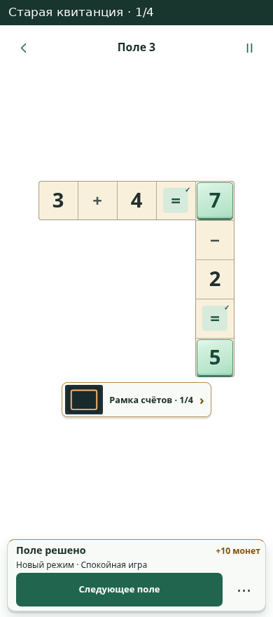

# Независимый аудит экранов Crossmath 0.5.20

**22 ноября 2026 · preview 0.5.20 / 25.** Кампания, свободная игра, Daily и Endless проходимы. Из следующей задачи на интерфейс я бы сделал небольшой выпуск с исправлением первой победы, старой награды и случайного завершения живого забега. Игровое поле и прибавку монет владелец принял. Проверки начисления, отмены и повторного открытия результата дают основания сохранить это поведение. [Каждый экран, действие и итог](SCREENS_RU.md) · [протокол наблюдений](observations.json).

Проверена сборка из `297fead` в PR №4, HEAD ветки `1d3dae9`. В `main` на момент проверки была 0.4.0 (`fa19fab`). PR №2 — предыдущая игровая ветка. Исследовательская линия — PR №3. SHA-256 preview APK `77472917177324698fd1813c5f047fd3d8d031b10fc56afaf14e8c72cddf3a5b`. Все девять файлов release-сборки совпали с веб-ресурсами APK побайтово. Версия runtime геймкита зафиксирована игрой на `469928d03f4bae5053e23db26e82187bedbc252e`. [Игровая сборка](https://github.com/DanilaH/crossmath-game/commit/297feadd480ceca40ba2dceaefd2a7987c86ae3a) · [приёмка разработчика](https://github.com/DanilaH/crossmath-game/blob/1d3dae920de3cf14cc2ee7744c98f19fb44bb344/docs/acceptance/qa-0520/README.md) · [решения владельца](https://github.com/DanilaH/crossmath-game/blob/1d3dae920de3cf14cc2ee7744c98f19fb44bb344/docs/PROJECT_DECISIONS.md).

## Что взять разработчику

Первые три пункта относятся к обычным путям игрока. Для каждого пункта указаны воспроизведение, затронутый код и проверка результата. Названия UI-01–08 служат номерами замечаний к нашему продукту. Исходные sourceFeatureId приведены отдельно. Сведения о Guru 3.5.2/4.17.0 и EasyFun Offline 1.1.9 взяты из закреплённого разбора. В этом проходе заново запускалась наша игра. [Исходный реестр с версией и доказательством для каждой строки](https://github.com/DanilaH/mini-games-kit/blob/5ad2985fe6b1da8d137530a2cd13d632b9f8f263/research/games/crossmath/porting/SOURCE_FEATURES.json).

### UI-01 · На первой победе пропадает подтверждение хода

Новый профиль → включить звук и вибрацию → выбрать 5 → поставить в единственную пустую клетку. При обычном движении браузер вызвал только звук выбора (24 мс). На четырёх из четырёх прогонов анимация посадки (42 мс) была отменена вызовом `resize` из `ResizeObserver`. Вызовы победного звука и вибрации отсутствовали. При уменьшенном движении на тех же устройствах эмуляции — четыре победных сигнала из четырёх. На полях 2 и 3 обе настройки движения дали победный сигнал во всех 16 проверках. Получение награды и следующий переход работали.

**Исправление.** Привязать однократную выдачу сигнала к принятому ходу. Синхронизировать его с посадкой в обычном случае и доставлять при перепланировке уже принятого хода. Отменённый жест, старый ход, уход в фон и закрытый звук должны оставаться тихими. Приёмка — одна победная реплика и один разрешённый вибропаттерн на двух ширинах с обычным и уменьшенным движением, ноль при выключенных переключателях. На Android отдельно послушать первый ход и сверить осязаемый импульс с установкой числа. Связанные ID `easy-sound-setting`, `easy-vibration-setting`. Сами звук и рисунок импульсов — реализация Crossmath. [Контакт фишки](https://github.com/DanilaH/crossmath-game/blob/297feadd480ceca40ba2dceaefd2a7987c86ae3a/src/ui/board.ts#L92) · [отмена при resize](https://github.com/DanilaH/crossmath-game/blob/297feadd480ceca40ba2dceaefd2a7987c86ae3a/src/ui/board.ts#L405) · [звуковые события](https://github.com/DanilaH/crossmath-game/blob/297feadd480ceca40ba2dceaefd2a7987c86ae3a/src/ui/feedback.ts#L24).

### UI-02 · Старая награда меняет смысл при нажатии

Пройти три поля кампании, собрать оставшиеся части счётов за пять побед в Relax, вернуться через «Кампания → Результат поля 3». На кнопке сохранилось «Рамка счётов · 1/4». В открытой с неё карточке уже «Собрано · 4/4» и четыре галочки. В квитанции сохранена одна деталь, на полке — четыре. **Исправление** — при входе из результата передавать в карточку число частей из этой квитанции. При входе с полки брать актуальное число. Приёмка — 1/4 из результата и 4/4 из мастерской после перезапуска, без изменения баланса и повторной анимации начисления. Приборы — собственная мета Crossmath. Связанные исходные экраны `guru-result-next`, `easy-result-tabs`. [Открытие карточки](https://github.com/DanilaH/crossmath-game/blob/297feadd480ceca40ba2dceaefd2a7987c86ae3a/src/ui/metaView.ts#L733).

### UI-03 · В паузе Endless легко закрыть живой забег

Пройти этап, поставить одну фишку следующего. На счету 40 очков, три жизни. Одно нажатие «Завершить забег и сохранить рекорд» переносит в профиль. Возврат в Endless запускает новую серию с нуля. Рекорд 40 сохранён, а продолжить прежнюю серию уже нельзя. Соседняя команда «Новый забег» запрашивает подтверждение. Это риск случайного завершения. Частоту таких нажатий покажет только наблюдение за игроками.

**Исправление.** Если забег жив, показать «Завершить забег с 40 очками?» и поставить начальный фокус на «Продолжить игру». При нуле жизней оставить прямой выход к рекорду. Приёмка — отмена сохраняет ID, фишку и три жизни. Подтверждение один раз пишет результат в правильную категорию. Базовый референс `guru-endless`. [Маршрут кнопок](https://github.com/DanilaH/crossmath-game/blob/297feadd480ceca40ba2dceaefd2a7987c86ae3a/src/ui/gameUi.ts#L55).

### UI-04 · При двух испорченных копиях игрок застревает на запуске

В изолированном профиле обе записи вручную заменены невалидными данными. Запуск показывает только «Повторить загрузку», вторая попытка приводит туда же. При исправной копии игра восстановилась. При разовом отказе записи и ход, и переключение звука удалось повторить штатной кнопкой. Частота двойной порчи в установленных играх UNKNOWN.

**Исправление.** Различить ошибку чтения и две доступные, но невалидные записи. Для второй ситуации дать осознанный выход «Начать заново…», сохранить повреждённые данные отдельно, явно подтвердить сброс. Приёмка — отмена сохраняет исходные байты, отказ в доступе не запускает сброс, исправный backup продолжает работать, подтверждённое начало открывает поле 1. Это собственная обработка хранения Crossmath. У `ref-background` отдельно остаётся проверка смерти процесса на Android. [Загрузка двух записей](https://github.com/DanilaH/crossmath-game/blob/297feadd480ceca40ba2dceaefd2a7987c86ae3a/src/app/saveRepository.ts#L22) · [экран ошибки](https://github.com/DanilaH/crossmath-game/blob/297feadd480ceca40ba2dceaefd2a7987c86ae3a/src/main.ts#L45).

### UI-05 · В полночь подсказка показывает недоступное действие

При нуле кредитов и 10 монетах подсказка стоит 60, видна нехватка 50. Оставить диалог открытым до обновления игрового дня. «Применить» становится активной, нажатие ничего не даёт. Баланс и фишки сохранились. **Исправление** — цена, сообщение и доступность кнопки должны вычисляться из одного состояния при каждом обновлении. Приёмка — после смены даты кнопка выключена при 10 монетах, работает с кредитом или полной стоимостью и списывает ровно один раз. Связанный ID `easy-hint-price`. В EasyFun цена в источнике 120, в Crossmath настройка равна 60. [Проверка оплаты](https://github.com/DanilaH/crossmath-game/blob/297feadd480ceca40ba2dceaefd2a7987c86ae3a/src/ui/gameUi.ts#L285) · [повторная запись disabled](https://github.com/DanilaH/crossmath-game/blob/297feadd480ceca40ba2dceaefd2a7987c86ae3a/src/ui/gameUi.ts#L461).

### UI-06 · После повтора «Следующее поле» может означать поле 16

Пройти 15 полей, открыть из истории поле 1, решить его повторно. «Следующее поле» открывает 16. Курсор кампании работает последовательно, подпись скрывает назначение кнопки. **Исправление** — в этом состоянии написать «Продолжить кампанию · Поле 16». Для полностью закрытой кампании сохранить существующий возврат в историю. Приёмка — подпись на RU/EN совпадает с фактическим полем, повтор не приносит новую базовую выплату. ID `guru-result-next`. [Выбор подписи](https://github.com/DanilaH/crossmath-game/blob/297feadd480ceca40ba2dceaefd2a7987c86ae3a/src/ui/gameUi.ts#L433).

### UI-07 · Открытие нового режима сообщает новость, но не ведёт в режим

На третьей победе видно «Новый режим · Спокойная игра». Чтобы попробовать режим, пришлось нажать «На главную», «Все режимы», «Спокойная игра». На пятой победе появляется Daily, на пятнадцатой одновременно открываются Испытание и Endless. Пояснение где их найти спрятано в деталях результата.

**Предложение.** Сделать саму строку открытия вторичным действием. На третьей победе подпись «Попробовать спокойную игру», на пятой — «Открыть задачу дня», на пятнадцатой — «Выбрать новый режим» с двумя новыми пунктами. Главным действием остаётся продолжение кампании. Приёмка — открытый режим достижим в одно нажатие при одиночном открытии и в два при двойном. После возврата кампания, квитанция и кошелёк на месте. Связанные ID `easy-daily-gate`, `guru-result-next`. Влияние на обнаружение режима проверить на новичках. [Рендер строки открытия и пояснения](https://github.com/DanilaH/crossmath-game/blob/297feadd480ceca40ba2dceaefd2a7987c86ae3a/src/ui/metaView.ts#L775).

### UI-08 · У мастерской нет ясной границы между текущим и будущим прибором

После 15 разных побед на верстаке «Счётные палочки · 1/4», до следующей детали три новых поля. В самом конце полки у пантографа 0/4, а карточка обещает «Дальше — опора». Для двух разных приборов интерфейс использует язык ближайшей награды. Основные заголовки главной, профиля и календаря набраны Rubik, мастерская и название прибора — Georgia, диалоги паузы, помощи и результата — system-ui. Этот скачок виден при переходе туда и обратно.

**Предложение.** Оставить фразу «Следующая деталь» только активному прибору. У будущего написать «Позже в коллекции» и условие из настоящей последовательности выдачи. Показать читаемый контур прибора, чтобы закрытые ячейки различались. Для названий экранов, кнопок и состояния использовать уже включённый Rubik. Отличить сам прибор формой, видимыми собранными деталями и одной подсветкой детали при получении. Приёмка — на скриншоте 320 × 568 в обеих темах игрок может назвать текущий прибор и ближайшую деталь. В архивной карточке квитанция определяет число полученных частей. Решения по типографике и графике — предложение Crossmath. [Полка и верстак](https://github.com/DanilaH/crossmath-game/blob/297feadd480ceca40ba2dceaefd2a7987c86ae3a/src/ui/metaView.ts#L590) · [карточка прибора](https://github.com/DanilaH/crossmath-game/blob/297feadd480ceca40ba2dceaefd2a7987c86ae3a/src/ui/metaView.ts#L739) · [текущие стили](https://github.com/DanilaH/crossmath-game/blob/297feadd480ceca40ba2dceaefd2a7987c86ae3a/src/ui/hub.css).

## Перепроверка исправлений 0.5.19

| Предыдущее замечание | Результат 0.5.20 |
|---|---|
| Сохранение упиралось в лимит на 829-й дате | Миграция профиля с 828 победами и незаконченной 829-й датой уменьшила запись с 4 193 948 до 556 080 байт. Штатная игровая сессия с адаптером в памяти дошла до 1 100 побед. Сохранено 691 238 байт и 36 месячных печатей. Повтор даты дал 0 монет за дату. |
| Старый архив замедлял ход кампании | Поле 6, два прогрева и семь ходов на точном веб-бандле. Медианы 3 / 23 / 41 / 48 мс при 0 / 30 / 180 / 365 решённых датах. На предыдущем аудите при 365 датах было 276 мс. Это время от отпускания до принятой цифры и разблокировки интерфейса на тестовом хосте. |
| В марте исчезал достижимый январский трофей | На новом профиле в контролируемом календаре пройдены 1–30 января. 1 марта из строки «30/31» открылась задача за 31 января. Победа начислила 30 монет за дату, появилась одна январская печать, она сохранилась после перезагрузки. |
| Старый финал кампании становился повтором | Модельными командами подготовили полный маршрут. Профиль 0.5.16 после миграции открыл «Маршрут пройден» с той же квитанцией и балансом 5 190. В текущей сборке открыли историю 240 полей и через интерфейс сыграли повтор поля 1. |

## Как повторить и где заканчются свидетельства

Проверялись Chromium 141.0.7390.37 с эмуляцией касаний, окна 390 × 844 и 320 × 568 CSS px. Отдельные сценарии проверены в RU/EN, в двух темах, при обычном и уменьшенном движении, с размером корневого шрифта 200%. Сцены длинной кампании и большого архива готовились командами модели. Подмена часов использована для календаря. Для сигнала первой победы использованы реальные браузерные часы. Три существующих UI-набора дали 13, 11 и 6 успешных групп проверок. Прошли 113 штатных тестов, проверка контента и release-сборка. [Матрица и ограничения по каждому экрану](SCREENS_RU.md) · [сценарии нашего прогона](screens.py) · [числа и показания элементов](observations.json).

Для повторения извлечь каталог `assets/public` из preview 0.5.20, взять игровой checkout `297fead` и Python с Playwright. Вызов — `CHROMIUM=/path/to/chrome python screens.py /path/to/game /path/to/assets/public /tmp/crossmath-shots seed`. Следом запускать тем же способом `routes`, `failures`, `edges`, `extra`, `month`, `feedback`, `contact`, `calendar_links` и `tools_and_timer`. Для `final_board` положить в каталог результатов `full-campaign.json` и `legacy-final.json`, полученные сценарием make-controls в двух игровых checkout. В каждом случае выходной файл называется `full-campaign.json`. Файл из версии 0.5.16 сохранить под именем `legacy-final.json`. Для времени и архива доступны отдельные сценарии. [Подготовка финала](../meta-0516/make-controls.ts) · [замер времени](../qa-0519/timing.py) · [длинный архив](https://github.com/DanilaH/crossmath-game/blob/1d3dae920de3cf14cc2ee7744c98f19fb44bb344/docs/acceptance/qa-0520/long-daily.ts).

**Что проверить на Android.** Установить именно preview 0.5.20 / 25, на чистом профиле включить звук и вибрацию, сравнить победы 1–3. Сохранить фишку, уйти в фон и восстановить после завершения процесса через ОС. Системной кнопкой «Назад» закрыть по очереди помощь, замену, карточку и паузу. Проверить системный крупный шрифт, вырез экрана, TalkBack и достижимость нижнего действия. Физические импульсы, акустика, нативная запись, доступность для реальных игроков и поведение рекламного провайдера остаются UNKNOWN. Соревнования и коммерческие экраны ведутся в исходном реестре и дорожной карте. Изменений объёма M3 аудит не требует.

**KIT IMPACT.** Для игр на геймките добавить в приёмку три переносимых сценария: первая победа с отменой анимации из-за resize, открытие старой награды после изменения коллекции, выход из живого забега с поставленной фишкой. Проверка verify-reference-porting.py прошла для 177 из 177 ID с нулём ошибок. В реестре также сохранены 46 отложенных строк и 27 строк с пробелами в доказательствах.
