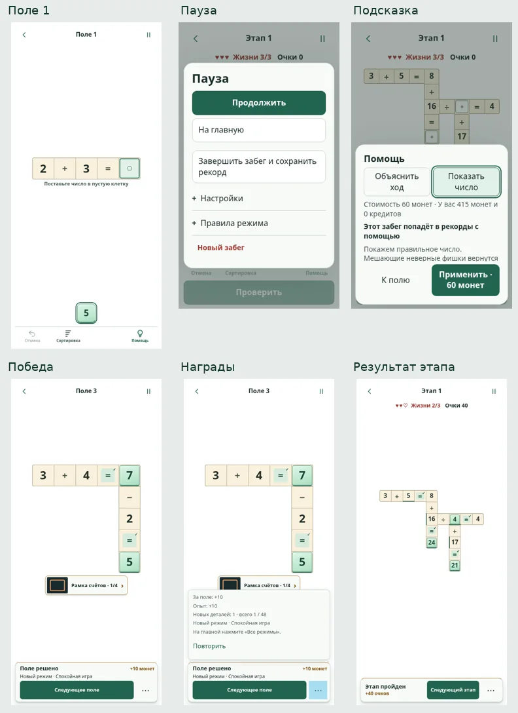
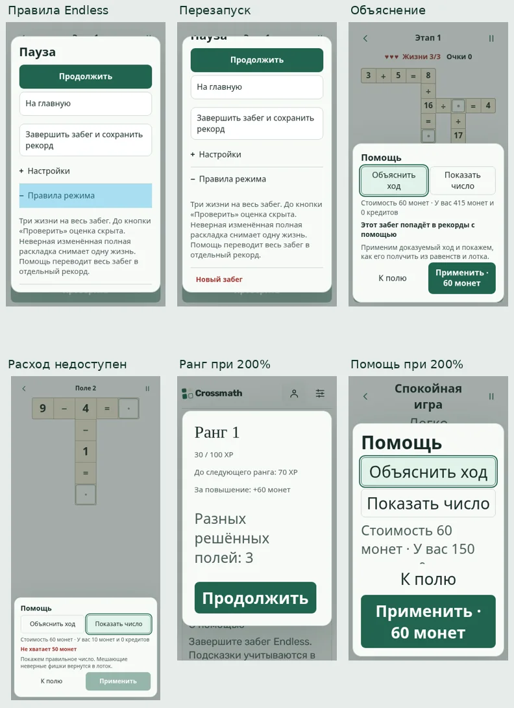
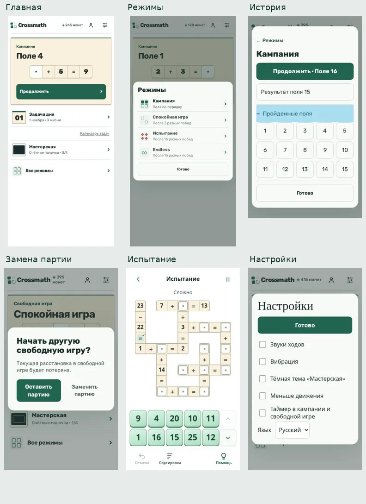
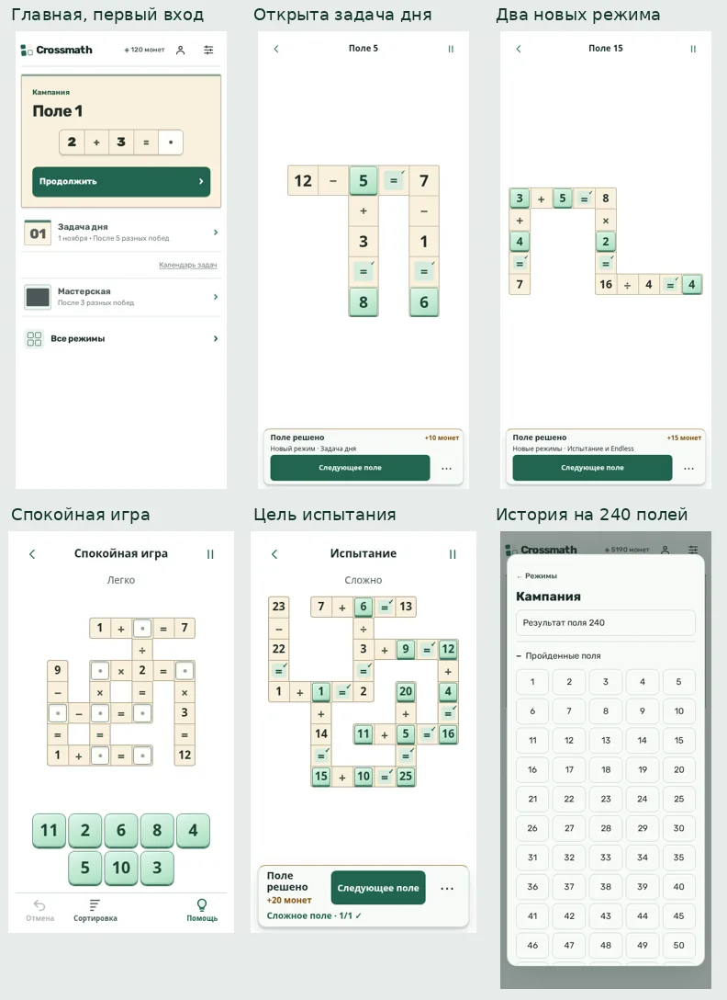
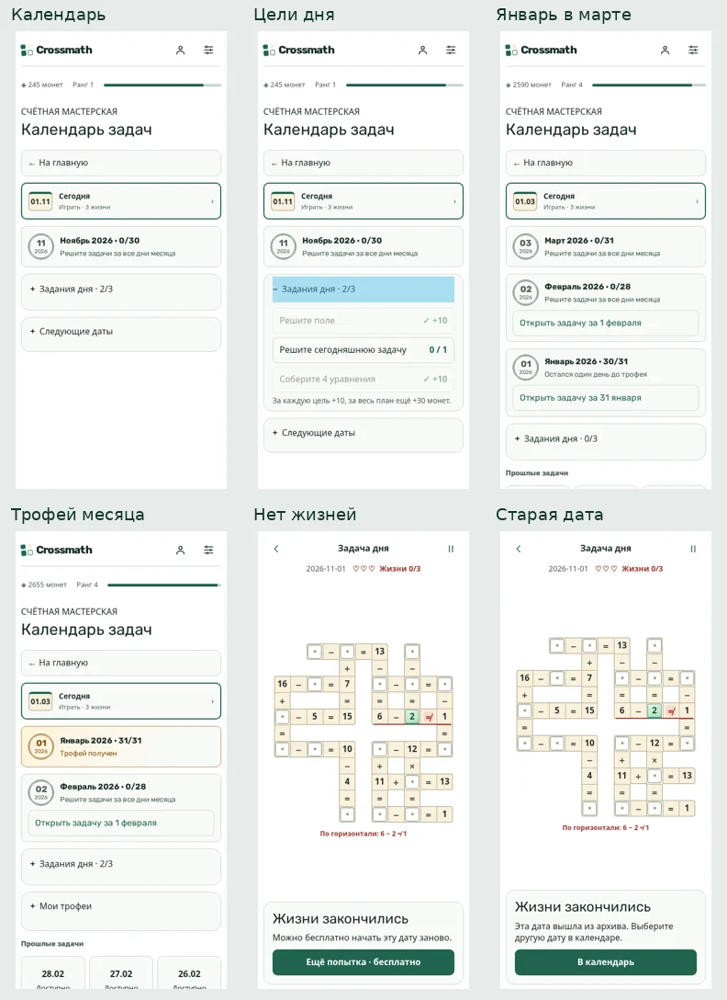
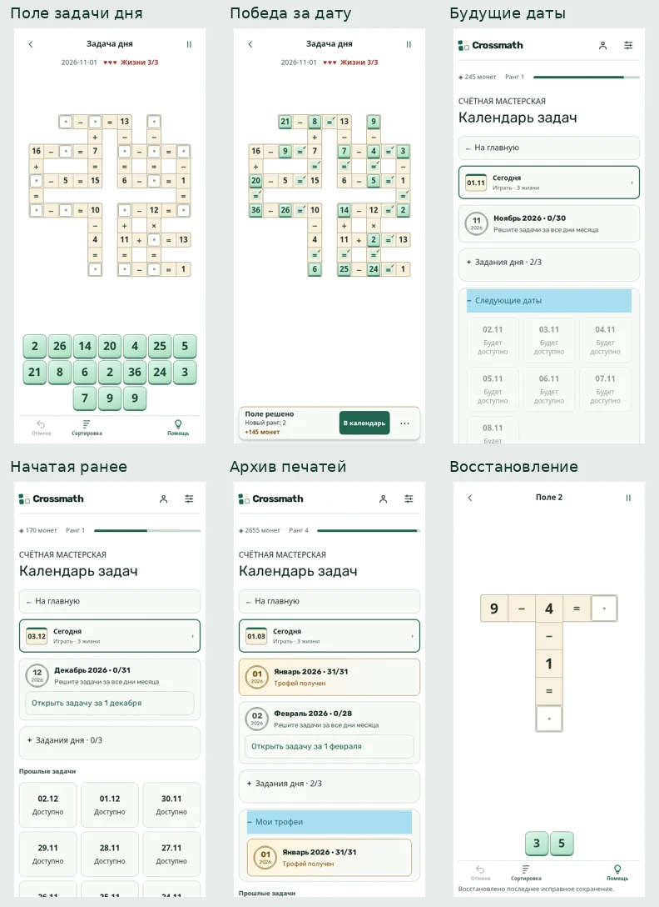
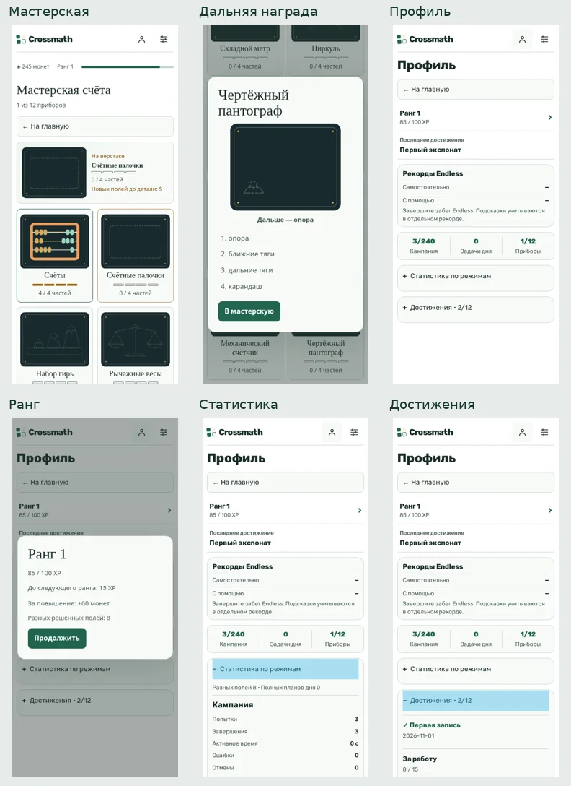
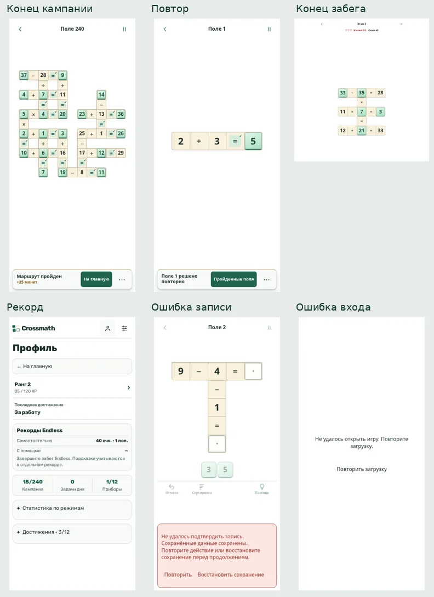

# Карта экранов и действий · Crossmath 0.5.20 / 25

Сквозной проход начат с пустого профиля. Четыре раздела оболочки, пять диалогов, встроенные панели и отдельные состояния победы, поражения и восстановления внесены ниже. Номера кадров соответствуют ключам в протоколе. Восемь листов содержат реальные снимки обозреваемого веб-бандла. Для компактности они уменьшены. Исходный размер окна указан в данных каждого кадра. [Наблюдения и действия](observations.json) · [восемь замечаний с приёмкой и кодом](README.md) · [оболочка приложения](https://github.com/DanilaH/crossmath-game/blob/297feadd480ceca40ba2dceaefd2a7987c86ae3a/index.html).

## Первый запуск, поле, награды

| Экран или состояние | Что сделано | Итог и критерий следующей проверки |
|---|---|---|
| 01. Первый запуск и обучение | Чистый профиль открыл поле 1. Доступны одна пустая клетка, одна фишка 5, инструкция «Поставьте число в пустую клетку». Поставили число в один ход. Штатный прогон дождался демонстрации бездействия и прервал её касанием. | Игрок начинает играть без меню. Оставить короткое действие и погасание демонстрации при вводе. Исправить подтверждение первой победы, UI-01. Кадр 01. |
| 02. Поле кампании, лоток, пересечения | Первые 25 полей в штатном touch-прогоне. Проверены выбор двумя способами, клавиатура, перенос, замена, два одинаковых числа, второй конфликт, отмена, сортировка и возврат в лоток. На поле 16 отдельным прогоном отсортировали семь значений, вернули фишку и восстановили через Undo. | Основная механика работает. На поле 147 прокрутка осталась внутри поля и лотка. Сохранить доступ к нижним действиям на маленьком экране. Кадр 01, группа fieldTools и ui/meta-ui. |
| 03. Пауза и правила | Открыли из живого Endless, раскрыли правила режима, вернулись к фишкам. В кампании время остановилось на 0:03 во время паузы и продолжилось после возврата. | Для обычного выхода действует «Продолжить». Для завершения живого забега нужен дополнительный шаг, UI-03. Кадры 25, 26, 44. |
| 04. Настройки | Из главной и паузы открыли настройки. Переключили тему, язык, звук, вибрацию и таймер. RU/EN и тема пережили перезагрузку. Проверены тишина при отключении звука и режим уменьшенного движения. | Сохранить независимые переключатели. Установленный Android и физическую синхронизацию принять отдельно. Кадры 30, 31, группы feedback/contact. |
| 05. Перезапуск поля | Проверили отмену диалога. На поле 16 подтвердили перезапуск с одной фишкой. После подтверждения раскладка пуста. У Endless у команды «Новый забег» собственное предупреждение. | Управление соответствует последствиям. Применить тот же принцип к досрочному завершению серии. Кадр 27, fieldTools. |
| 06. Помощь | Открыли «Объяснить ход» и «Показать число». На пересечении штатная проверка подтвердила стоимость одного действия. Undo не возвращает оплату. Специально потратили запас до 10 монет и 0 кредитов. | До смены дня видна нехватка 50, кнопка недоступна. После смены дня появляется ложное активное действие, UI-05. В Endless видна пометка о влиянии на рекорд. Кадры 28, 29, 36, 37, 47. |
| 07. Победа, прибавка монет и «Награды и действия» | Открыли подробности начисления, перезагрузили результат, проверили повторное поле. Сумма дохода по квитанции воспроизводится. Из результата этапа доступно продолжение. | Сохранить прибавку монет и однократное зачисление. Исправление сигнала первого хода не должно вызывать повторную выплату или озвучку исторического результата. Кадры win-1/3/8, 06. |
| 08. Открытие режимов на победе | На победах 3, 5 и 15 показаны соответственно Спокойная игра, Задача дня, Испытание и Endless. С основной кнопки игрок продолжает кампанию. | Добавить вторичный прямой переход из сообщения об открытии. На пятнадцатой победе дать выбрать один из двух режимов, UI-07. Кадры win-3, win-5, win-15. |
| 09. Карточка полученной детали | Вновь открыли квитанцию поля 3 после пяти побед в Relax. Нажали «Рамка счётов · 1/4», получили четыре отмеченные детали. После закрытия вернулись на результат. | Показывать состояние именно полученной награды, UI-02. Кадры 04, 05 и GIF. |

## Главная, режимы и история

| Экран или состояние | Что сделано | Итог и критерий следующей проверки |
|---|---|---|
| 10. Главная | Открыли до разблокировок и после. Проверили главную кнопку кампании, вход в сегодняшнюю дату, «Все режимы», мастерскую, профиль и возврат. Штатный прогон проверил геометрию на обеих ширинах. | Частые действия находятся без прокрутки в проверенных стандартных размерах. Сохранить отдельную кнопку сегодняшней игры. Кадры 02 и 07. |
| 11. Выбор режима | До порога видны блокировки и число побед. После 3/5/15 фактически вошли в соответствующие режимы. Проверена граница 14→15 для Endless. | Эта панель годится для повторного выбора. Укоротить первый вход сразу после открытия, UI-07. Кадры 03, 20, 22, 24. |
| 12. Кампания и пройденные поля | Проверили историю 15 полей, старый результат и повтор поля 1. Подготовили модельный профиль на 240 полей, открыли весь список и переиграли первое поле касаниями. | При открытом маршруте подпись повторной победы должна показывать фактическое назначение, UI-06. В завершённом маршруте возврат к списку работает. Кадры 19 и 49. |
| 13. Завершённая кампания и повтор после финала | Открыли финальную квитанцию текущей версии и профиль 0.5.16. Получили «Маршрут пройден». Повтор обозначен «Поле 1 решено повторно», кнопка ведёт в пройденные поля. | Предыдущее замечание о миграции закрыто в веб-проверке. При следующей миграции повторить обе ветки на сохранённой квитанции. Кадры 48–50. |
| 14. Замена незаконченной партии | Из Relax открыли Испытание, отменили замену, повторили и подтвердили. Штатный тест проверяет фокус, Escape, сохранение фишек при отмене, сбой записи и повтор. | Диалог уместно объясняет последствие. Сохранить безопасный фокус и возврат к инициировавшей кнопке. Кадр 21. |
| 15. Спокойная игра | Из разблокированного режима прошли пять полей подряд, получили детали. При возврате исторический результат кампании был доступен. | Переходы и выдача новых полей работали в проверенной последовательности. Сохранить краткую цель в контексте режима. Кадр 20 и группа routes. |
| 16. Испытание и его результат | Из активной свободной партии подтвердили переход, решили поле, увидели «Сложное поле · 1/1 ✓» и +20 монет. | Цель читается на результате. На следующих изменениях проверить прогресс до и после перезапуска на границе ступени. Кадры 22, 23. |

## Задача дня и календарь

| Экран или состояние | Что сделано | Итог и критерий следующей проверки |
|---|---|---|
| 17. Календарь, прошлые и будущие даты | Открыли сегодняшнюю дату, список будущих дат и старую задачу. Вернулись в календарь после победы. Игра показывает разные состояния прошедшего и предстоящего дня. | Дату можно найти и после выхода. У незавершённой даты вне окна отдельный маршрут, см. строку 19. Кадры 14, 15, 18. |
| 18. Цели дня | Раскрыли список с оплаченными и неоплаченными слотами. Нажали «Решите поле · 0/1», открылась подходящая задача Daily. Штатная проверка прошла результат с разбивкой оплаты и повторную загрузку. | Сохранить прямой вход и явную отметку выплаченной цели. При смене набора проверять цель, подменённую из-за недоступного режима. Кадр 16 и questStart. |
| 19. Активная и отложенная задача дня | Открыли 1 ноября, поставили одну правильную фишку и вернулись 3 декабря. В «Начатые ранее» нашли 1 ноября. После нажатия восстановились тот же ID, фишка и все три жизни. | Работает за пределами обычного окна архива. Сохранить это поведение при изменении политики хранения. Кадры 17, 51. |
| 20. Ноль жизней и истёкшая дата | Трижды замкнули неверное уравнение, между ошибками использовали Undo. Жизни 3→2→1→0. Бесплатный повтор дал три жизни при прежнем балансе. У истёкшей проигранной даты «В календарь» вернуло в календарь. | Два действия соответствуют доступности даты. Сохранить отдельный текст для просроченного поражения. Кадры 38, 39. |
| 21. Месячный трофей и архив наград | Сыграли январь до 30/31, 1 марта добрали 31 января прямым входом. Стало 31/31, январская печать осталась после перезапуска в «Мои трофеи». | Исправление прошлого аудита принято в браузере. При следующих изменениях сохранить отдельную проверку доступной, просроченной и начатой даты. Кадры 40–42. |

## Endless, мастерская и профиль

| Экран или состояние | Что сделано | Итог и критерий следующей проверки |
|---|---|---|
| 22. Поле Endless и «Проверить» | Запущен новый забег с тремя жизнями. До проверки раскладка нейтральна. В штатном прогоне отклонённая раскладка сняла одну жизнь, повтор той же не снял вторую. Успех перенёс очки и жизни. | Сохранить явную проверку и различие между ошибкой игрока и повторным нажатием. Кадр 24 и группа endless-ui. |
| 23. Победа этапа, поражение, выход к рекорду | Прошли этап на 40 очков, начали следующий и завершили забег из паузы. На экране поражения отдельно проверены ноль жизней и бесплатное начало новой серии. | На живом забеге подтвердить досрочный выход, UI-03. После поражения прямое завершение оправдано. Кадры 44, 45 и набор endless-ui. |
| 24. Мастерская и верстак | Открыли полку до и после сборки счётов. У активного прибора видны число частей и сколько новых полей до детали. Проверили и полную коллекцию контрольным профилем в штатном наборе. | Основная идея работает. Дать текущей детали главный визуальный акцент, будущему прибору — понятный силуэт и статус, UI-08. Кадры 08, 09, 31. |
| 25. Карточка прибора на полке | Открыли готовые счёты, активный верстак и последний закрытый пантограф. Проверили список частей и возврат. | Развести тексты будущего прибора и ближайшей награды. У архивной квитанции независимое состояние, UI-02/08. Кадры 05, 09, 43. |
| 26. Профиль и рекорды | Открыли пустую таблицу, затем профиль с самостоятельным результатом 40 очков. Штатный сценарий подтвердил отдельную категорию серии с помощью. Из профиля доступны ранг, статистика и достижения. | Работает разделение записей, пустому состоянию дано пояснение. При исправлении UI-03 подтвердить отсутствие записи после отмены. Кадры 10, 45. |
| 27. Ранг | Открыли карточку из профиля. Видны текущий опыт, остаток до порога, награда в монетах, число разных полей. Проверили закрытие на 320 × 568 с корневым шрифтом 200%. | Контент и кнопка достижимы в этой конфигурации. Отдельно принять системный шрифт Android и TalkBack. Кадры 11, 46. |
| 28. Статистика и достижения | Раскрыли обе секции профиля. Проверены состояния до награды и после. Штатный прогон отдельно получил постоянный знак за три разных этапа Endless и проверил защиту от повторной выдачи. | Разделы уместно оставлены вторичными. При следующем изменении сохранить актуальность агрегатов и дату/условие наград там, где их показывает продукт. Кадры 12, 13. |

## Загрузка, восстановление, платформенные состояния

| Экран или состояние | Что сделано | Итог и критерий следующей проверки |
|---|---|---|
| 29. Ошибка записи и повтор действия | Имитировали отказ записи при ходе и при изменении звука. Модалка закрылась. «Повторить» доступно для нажатия, настройка сохранилась, ход увеличил ревизию ровно на один. | Сохранить доступ к восстановлению поверх любых диалогов. Кадры 32–33. |
| 30. Восстановление из копии и ошибка старта | Невалидная основная запись с исправной копией дала уведомление о восстановлении. С двумя невалидными записями повторная загрузка зациклилась. | Нужен доступный выход из подтверждённой двойной порчи, UI-04. Кадры 34–35. |
| За границами самостоятельного экрана | Провайдер рекламы отсутствовал, соответствующие необязательные предложения скрыты. Фактический доступный маршрут экранов соревнований/магазина в проверенном preview отсутствует. | Показ реальной рекламы, покупка, системное восстановление, аппаратная вибрация, TalkBack и живые показатели — UNKNOWN. Проверять соответствующий провайдер, устройство и среду отдельно. Полный список исходных систем, включая отложенные, остаётся в реестре. |

**Размеры и визуальная приёмка.** В кадре 01 кнопка единственной фишки высотой 48 CSS px, активная клетка 56 CSS px при ширине окна 390. На экране нехватки монет и в паузе Endless у основных действий измерена высота 48 CSS px. В наблюдавшихся диалогах ранга и помощи на ширине 320 при 200% корневого шрифта не было горизонтального переполнения страницы. Это размеры браузерной раскладки. Физический размер зон на телефоне, сочетания с системным масштабом и распознаваемость иконок людьми остаются отдельными проверками. [Размеры действий и доступность в DOM по кадрам](observations.json).
