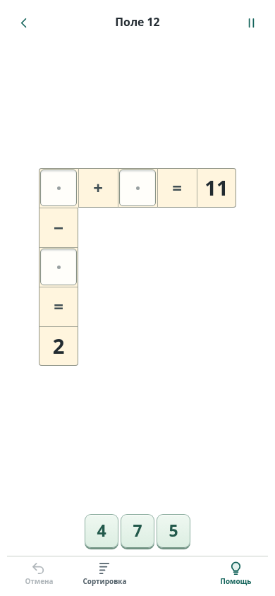

# Светлая тема Crossmath

**Решение владельца.** Нынешняя «Мастерская» со сине-графитовым фоном, светлыми уравнениями и янтарными фишками становится тёмной темой. Светлая тема предназначена для первого запуска. При переходе на новую версию человек, явно выбравший тёмную тему, должен получить тёмную. Поведение для существующего профиля без истории явного выбора следует определить при реализации.

**Как выглядит референс.** На Google Play у Guru Crossmath 50 млн+ скачиваний, у EasyFun Offline Crossmath 1 млн+. Для светлого поля берём Guru. На издательском кадре белый фон, чёрные цифры, тонкая сетка, бледно-жёлтые клетки с условиями, более светлые пустые места и отдельные бледно-мятные фишки внизу. Это наблюдение по витрине, точная версия и значения цветов на устройстве UNKNOWN. На игровой записи с 00:30 до 00:34 видны светлый фон и различие между завершённым и новым полем. [Guru в Google Play](https://play.google.com/store/apps/details?id=math.puzzle.games.crossmath.number.puzzles.free) · [EasyFun в Google Play](https://play.google.com/store/apps/details?id=math.crossmath.game.puzzle.free.easyfun.number.sudoku.match) · [Запись Guru, 00:30](https://www.youtube.com/watch?v=xxoueeCnA6A&t=30s).

**Пример для нашей игры.** Поле 12 достигнуто прохождением с чистого профиля в веб-коде подписанного preview 0.5.11, versionCode 16. В Chromium touch 390 × 844 CSS px, 100%, применена [пробная таблица цветов](board-study.css). На GIF три кадра одного поля до выбора, после касания пустой клетки и после подстановки правильного числа. Геометрия и реакции на касания взяты из этой сборки. Цвета в примере предложены для Crossmath. SHA-256 исходного APK `bc7b193350df22ec386e80e282a5d610e998f098dab1fa7a8dff2014acda78c5`. [Исходный код проверенной ветки](https://github.com/DanilaH/crossmath-game/blob/401adc97fa9bb997967b38c093b132c9c7aa3b5f/src/ui/play.css).

| Элемент | Предложение для светлой темы |
| --- | --- |
| Фон и шапка | Белые. Основной текст графитовый. Линия отделяет инструменты внизу. |
| Данное число и оператор | Общая тёплая поверхность уравнения. Тонкая граница сохраняет форму пересечения. |
| Пустая клетка | Почти белая с контуром и точкой. Её можно узнать до подсказки. |
| Фишка в лотке | Мятная с небольшим нижним ребром. Перенесённое число сохраняет вид своей фишки. |
| Выбор | Контрастная обводка активной клетки. Связанные числа получают более мягкий фон. |
| Монеты и находки | Сохранить материал жетона и одобренный эффект выплаты. Золото заметнее, когда обычные числа имеют свой цвет. |

**Первая проверка в сборке.** На одном сохранении открыть поле 12 и плотное поле 25, выбрать, поставить и снять фишку, затем закрыть поле победой. Должны различаться данное число, пустое место, выбор, ошибка и награда. Проверить переключение из настроек и повторный запуск. На главной, в календаре и мастерской применить ту же палитру текста, фона и основных действий. Отдельно проверить контраст монет на белом в момент выплаты. Сейчас пример показывает только поле 12.

**KIT IMPACT.** Решение и палитра относятся к Crossmath.
