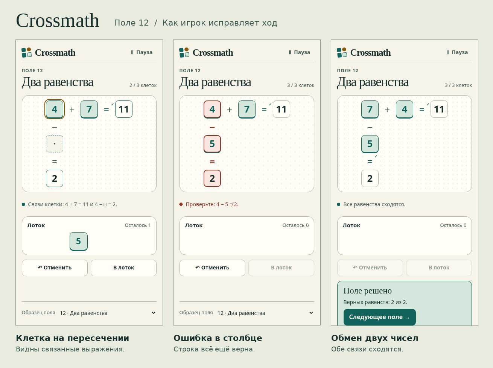

# Crossmath

**Исторический технический контракт v1.0.** 27.11.2026 владелец утвердил [v1.1 — актуальный продуктовый контракт](Crossmath_TZ_v1.1_RU.md). Ниже сохранены исходные технические требования и исторические параметры; при конфликте scope, приоритетов, Endless, меты и лиги действует v1.1. Не считать описанный ниже полный старый состав заданием на текущий релиз.

## Техническое задание на разработку игры

Версия 1.0 · 18 ноября 2026 · Для разработчика, дизайнера интерфейса и QA

Соберите офлайн-головоломку с арифметическими кроссвордами. Игрок берёт числа из лотка и заполняет пересекающиеся равенства. Удовольствие от хода возникает, когда число, подходившее в строку, удаётся подтвердить второй связью. Игрок может тут же проверить гипотезу, переставить фишки и увидеть причину ошибки.

**Первое, что принимает владелец продукта,** — устанавливаемая тестовая сборка. На чистом профиле игра открывает поле 1. На поле 12 игрок исправляет противоречие одним обменом. После закрытия процесса возвращаются его фишки, а повторное открытие результата сохраняет единственную выплату. Исполняемый вертикальный срез включает помощь, сохранение и выдачу награды.

**Историческая полная поставка v1.0** включала Campaign, Free, Daily, Endless, помощь, профиль, задания, мастерскую, рекламу и RU/EN. Актуальный состав v1.1 — Campaign/Relax/Challenge/Daily, усиленный core, мастерская и недельная локальная лига; Endless временно отключается, прочие соревнования/сезоны/магазин/IAP/энергия/онлайн отложены. См. v1.1.

**Что уже готово.** В архиве есть данные для импорта, решения для проверки и раскрытия, конфигурация баланса, рисунки альбома и HTML-образец управления. Исследованы Guru Crossmath 3.5.2 и 4.17.0 и Offline Crossmath 1.1.9. Для разработки используем собственные поля, графику и правила выдачи. Протоколы эталонных моделей относятся к материалам исследования. Сборку игры принимает разработка и QA.

**Порядок чтения.** Разделы 1–5 определяют старт проекта, ядро, контент, интерфейс и помощь. Разделы 6–11 описывают режимы, мету, сохранение, монетизацию и измерение. В разделах 12–13 указаны этапы и приёмочные сценарии. Числовые параметры берутся из включённых версионированных файлов. При расхождении старых исследовательских предложений с настоящим ТЗ действует версия 1.0.

## 1. Старт проекта и платформенная основа

Первый исполняемый ориентир — портретный Android-клиент с офлайн-ядром. Для нового проекта рекомендуем TypeScript, Phaser и Capacitor из Android-шаблона mini-games-kit. Это рабочий выбор для начала разработки. При наличии действующего клиента сначала проверить его ветку, сборку, сохранения и закреплённые версии зависимостей. Порт Yandex Games может использовать то же ядро и собственный платформенный адаптер.

| Шаг разработчика | Результат |
|---|---|
| Проверить потребительский репозиторий | Записаны ветка, HEAD, локальные решения, платформа, package ID тестовых сборок и способ запуска. Существующие изменения сохраняются. Боевой package ID и подпись подтверждает владелец до выпуска. |
| Подключить kit | Сверена ревизия 469928d03f4bae5053e23db26e82187bedbc252e. В ней есть запускаемый Android host, нативная атомарная запись, Back/lifecycle, единый владелец системных отступов и выпускные проверки APK. Конкретные SDK рекламы и аналитики подключает проект. |
| Создать новый Android host | Из точного checkout kit выполнить команду ниже, задав CROSSMATH_APP_ID с выбранным идентификатором. Для существующего приложения применять его текущий bootstrap и закрепить отдельно версии runtime и guidance. Способ генерации и команды сборки записать в README игры. |
| Подключить материалы | Импортировать каталоги product/content_v09 и product/meta_v08 в пайплайн проекта. Пять демонстрационных полей доступны в product/ux_v10/Crossmath_Play.html. Политика выдачи, цены, сохранение и художественные решения принадлежат Crossmath. |
| Проверить границу платформы | Первый экран и сохранённая партия доступны без сети и рекламного SDK. Готовность клиента определяется по фактически видимому игровому экрану с доступным вводом. |

```bash
npm run bootstrap:android:create -- ../crossmath --app-id "$CROSSMATH_APP_ID" --orientation portrait --name crossmath --app-name Crossmath
npm run guidance:doctor -- ../crossmath --strict
```

Порядок и ограничения шаблона зафиксированы в [документации Android host](https://github.com/DanilaH/mini-games-kit/blob/469928d03f4bae5053e23db26e82187bedbc252e/docs/android/BOOTSTRAP.md). Используйте Task Router и публичные API выбранной ревизии. Для другой площадки различаются хост, реклама, жизненный цикл и выпускная проверка. Готовность площадки подтверждается на её собственной сборке.

## 2. Модель поля и команды игрока

Определение PuzzleDefinition неизменяемо в пределах версии. Числа от 1 до 99 включительно. Каждое выражение имеет вид a op b = c, направлено вправо или вниз. Допустимы сложение, вычитание, умножение и точное целочисленное деление. Для ÷ проверять a = b × c при b > 0. Для неподдерживаемого выражения валидатор возвращает ошибку импорта. Общая клетка строки и столбца хранится один раз.

**Отрисовка из данных.** Координаты (0,0) начинаются вверху слева. У клетки есть id, x, y и необязательное given. Операция и знак равенства находятся посередине соответствующей пары числовых узлов. Индексы в equations.cells ссылаются на ID узлов. Из каждого элемента tray создать экземпляр с устойчивым ID по его исходному индексу. Обе пятёрки различимы в сохранении. Для валидатора единственности их перестановка при одинаковых значениях эквивалентна.

| Команда | Изменение за один ход |
|---|---|
| PlaceFromTray | Разместить имеющийся tokenId в изменяемой клетке. Если клетка занята, вернуть вытесненный экземпляр в лоток. |
| MoveCell | Перенести число в пустую изменяемую клетку либо атомарно обменять два экземпляра. Нажатие на выбранную клетку снимает выбор. |
| ReturnToTray / Undo | Вернуть фишку в свободное для неё место. Undo восстанавливает прежнюю раскладку и идентичность экземпляров. Жизни, помощь, расходы и уже записанные награды сохраняются. Граница undo — победа. |
| SortTray | Устойчивая сортировка по значению. Равные числа сохраняют взаимный порядок. Геометрия лотка остаётся фиксированной во время жеста. |
| ApplyHint / SubmitEndless | Помощь применяется к сохранённой ревизии. В Endless отправка доступна на полном поле и проверяется отдельной командой. |
| Pause / Resume / Restart | Пауза имеет собственную причину. Перезапуск создаёт новый attemptId с исходным полем. В интерфейсе подтверждать замену незавершённой партии. |

**Инварианты после каждой команды.** Каждый экземпляр находится ровно в одном месте. Данные числа и уравнения остаются неизменными. Устаревшая ревизия, повторная доставка, пустой источник и фиксированная цель оставляют раскладку прежней. Для принятого размещения повысить boardRevision и пересчитать все затронутые выражения, включая обе оси и обе стороны обмена.

Неполное выражение нейтрально. Полное получает арифметический результат. Для победы заполнены все пропуски, соблюдён состав лотка и верны все выражения. В Endless добавляется явная отправка. Правильно собранную строку можно изменить, даже если в пересекающемся столбце уже обнаружена ошибка. Победа независима от порядка ходов.

## 3. Банк задач и обучение

Выпуск контента 1 содержит **240 собственных полей**. Первые 15 — авторские уроки, остальные 225 — подготовленные и проверенные определения. В клиенте выдавать канонические ID из routes.json. Подготовленный банк позволяет начать выпуск без генерации чисел во время партии.

| Данные в product/content_v09 | Использование |
|---|---|
| boards.json | Стабильные puzzleId, contentVersion, rulesetVersion, геометрия, уравнения, лоток, сложность, позиция и учебные теги. Основной источник для игры. |
| routes.json | Порядок кампании, пулы свободной игры, календарная последовательность и маршрут забега. Сохранять выбранный ID и версию назначения. |
| author_solutions.json | Ответ и трасса логических ходов. Ответ доступен валидатору и отдельной услуге раскрытия. Записанная трасса годится для своей последовательности начальных ходов. |
| verify.py, logic.py, check_routes.py | Проверить схему, грамматику, связность, видимую геометрию, лоток и единственность до второго решения. Ошибка, несколько решений или исчерпание бюджета останавливают публикацию этой задачи. Сверить поддержку каждого шага и маршруты. |

Сложности во всём банке — 70 Easy, 80 Standard, 60 Hard и 30 Expert. После обучения Easy строится на прямых и обратных вычислениях. Standard добавляет пропуски и связи. Hard требует хотя бы одного шага по лотку или пересечению в выбранной цепочке. Expert использует пересечение или несколько ограничений лотка. Число пропусков само по себе не определяет сложность для игрока.

| Поля | Чему учится игрок |
|---|---|
| 1–3 | На поле 1 единственный ход завершает 2 + 3 = 5. На втором появляется выбор чисел и вычитание, на третьем одна фишка участвует в двух выражениях. |
| 4–6 | Найти недостающее слагаемое, затем вычитаемое. Шестое поле даёт короткую знакомую цепочку без нового правила. |
| 7–9 | Учесть две отдельные пятёрки, затем использовать умножение и точное деление. |
| 10–12 | Найти пересечение множеств {4,5} и {4,6}. На поле 11 отвергнуть 4 + 4 при одной четвёрке. На поле 12 исправить локально верную гипотезу. |
| 13–15 | Совместить приёмы, пройти передышку и закончить учебный маршрут самостоятельно. Помощь доступна по запросу. |

В исследованных играх на выдачу влияют каталоги, профили и типы сложности. Для нашей первой поставки ритм определяют campaignSequence и явные признаки приёмов. Ошибки, остаток монет и отказы от видео не подменяют выданное поле и не меняют решение. Формулу внутренней метки stuck Guru переносить не требуется.

При импорте ожидаются 240 единственных решений, 240 полных логических трасс и 1422 проверенных назначения. Поле 12 и два одинаковых числа поля 7 — обязательные игровые примеры. Меняя банк после выпуска, сохраняйте старые определения для открытых партий. Существенно иной задаче присваивайте новый ID. За косметическую правку существующей задачи базовая награда остаётся прежней.

## 4. Управление и ощущение хода

За основу берём читаемость уравнений Guru и отчётливый лоток EasyFun. В нашей игре поле похоже на лист счётной мастерской. Данные числа — плоские таблички, пустые места — пунктир с точкой, фишки игрока — цветное основание с нижней кромкой. Цифры табличные. Символы на экране — ×, ÷ и −. Светлый фон #F6F3E9, цифры #182E2C, фишка #11635B на #D3E8DA, выбор #855809, ошибка #923829. Тёмная тема сохраняет геометрию.

| Событие | Видимый и слышимый ответ |
|---|---|
| Выбор и перенос | Работают оба порядка касания и drag одной рукой. Контур выбора появляется в ближайшем кадре. При выборе узла показать обе его связи. Стартовый порог переноса 8 dp, образ фишки располагается выше пальца. Под пальцем подсвечивается точная цель. |
| Установка и промах | При отпускании над целью выполнить одну команду. Стартовая длительность посадки 130 мс, при промахе возвращать фишку примерно за 140 мс. Следующий ход доступен сразу. Системная отмена, фон и изменение геометрии снимают захват. |
| Верное и неверное равенство | В обычной игре у верного равенства появляется ✓, при противоречии отметить проблемное выражение и написать, например, «4 − 5 ≠ 2». Цвет дублируется символом и текстом. Правильная соседняя строка остаётся видна и редактируема. |
| Звук и вибрация | Выбор — короткий щелчок, установка — один тон, верное равенство — восходящая пара, ошибка — нисходящая, победа — короткая фраза. Один итоговый сигнал на команду по приоритету победа → новая ошибка → новая верная связь → постановка. |
| Доступность | Зоны числовых клеток и фишек 48 dp, без перекрытия. Проверить системный шрифт 200%, TalkBack, управление касаниями без drag, цветовые состояния, тихий режим и reduced motion. При снижении движения фишка сразу занимает место. |

**Контрольный эпизод.** В поле 12 поставить 4 и 7 в верхнюю строку, затем 5 под минусом. Строка 4 + 7 = 11 верна, столбец 4 − 5 ≠ 2 выделен. Обмен верхних чисел одной командой даёт 7 + 4 = 11 и 7 − 5 = 2. Возникает ровно одна победа. Те же действия повторить двумя касаниями с выключенным звуком.



## 5. Логическая подсказка и раскрытие ответа

Игроку доступны «Объяснить ход» и отдельное «Показать число». Перед подтверждением сообщить вид помощи и стоимость. После успешной записи показать назначенные числа, выделить опорные выражения и дать короткое объяснение на языке интерфейса. За несколько назначений одного плана списывается одна помощь.

| Шаг | Контракт |
|---|---|
| Получить снимок | Текущая boardRevision, видимые значения, экземпляры, связи и выбор игрока. Источник скрытого решения изолирован от логического решателя. |
| Построить доказательство | Сначала одно неизвестное и обратная арифметика, затем ограничения доступных экземпляров и полный набор положительных делителей, затем совместимые варианты пересекающихся выражений. Ограничение бюджета даёт no_step. |
| Проверить независимо | Проверяющий код подтверждает арифметику, опоры, наличие всех экземпляров и совместимость сразу всех назначений. Список делителей 12 включает 1, 2, 3, 4, 6, 12. Источником истины служат числа и ссылки на уравнения. |
| Применить | Повторно сверить boardRevision, статус и ресурс. В одной транзакции разместить фишки, вернуть мешающие экземпляры согласно плану, списать один credit или 60 монет, поставить assisted и увеличить hintsUsed. |
| Обработать отказ | Для busy, stale_snapshot, already_solved, insufficient_resource, invalid_proof и no_step расход равен нулю. Повтор operationId возвращает сохранённый результат. При отсутствии доказуемого шага предложить раскрытие отдельной кнопкой. |

**Пример объяснения.** На поле 10 горизонталь допускает 4 и 5, вертикаль — 4 и 6. Допустимое значение общей клетки одно. Показать обе связи и объяснить, почему осталось 4. На поле с противоречием можно доказать конкретный конфликт либо вернуть no_step. В режиме раскрытия сервису разрешено читать авторский ответ и возвращать мешающие экземпляры в лоток.

После undo восстанавливается раскладка, а число оплаченных обращений и отметка assisted сохраняются. В Daily помощь и возврат числа не снимают жизнь. В Endless действия помощи явно инициирует игрок. В обычном ходе до «Проверить» сохраняется нейтральность результата. Если подсказка заполнила последнее место в Endless, кнопка проверки становится доступна.

Регрессии HC01–HC12 находятся в contracts/Crossmath_Hint_Developer_Contract_v06_RU.md. Для выпуска 1 валидатор отвергает любые выражения длиннее a op b = c. Проверять правильный ответ, ложную опору, дубли в лотке, устаревший снимок, многоклеточный план, повторную оплату и сбой записи.

## 6. Четыре режима и выдача полей

| Режим | Старт и выбор задачи | Ошибка, завершение и продолжение |
|---|---|---|
| Кампания | Доступна сразу. 240 ID в campaignSequence. Пройден очередной ID — продвинуть курсор, даже если раньше он был решён в Daily. | Ограничения ошибок и времени отсутствуют. Победа по всем равенствам. Доступны повтор и отдельная сохранённая партия. После 240-й показать завершение маршрута. |
| Свободная игра | После трёх разных впервые решённых задач. Открывается группа, в которой игрок уже решил хотя бы одно поле. Выдача из соответствующего freePlayPools, отдельный активный слот. | Та же локальная проверка. Внутри доступной группы сначала предложить нерешённый ID, после исчерпания — обозначенный повтор. Выбор открытой сложности сохраняется. |
| Daily | После пяти первых решений. Фиксировать задачу на выбранную профильную дату. Доступны сегодня и 30 предыдущих дат, начиная с даты создания профиля. | Три жизни на попытку. Новое полностью ошибочное выражение или изменение значений в уже ошибочном снимает максимум одну жизнь за команду. Освобождение клетки, undo и помощь бесплатны. При нуле — бесплатный повтор или разрешённое продолжение. |
| Endless | После 15 первых решений. Последовательность 225 основных полей, курсор по кругу. Сохранить runId, stageId, puzzleId, жизни, помощь, счёт и позицию. | Три жизни на весь забег. До отправки скрыть оценку, ✓, ≠ и соответствующие звуки. За неверную отправку изменённого полного поля −1. За неполное или повтор неизменённой неверной раскладки штраф 0. После верной отправки — очки и следующий этап. |

**Календарь.** Зону IANA фиксировать при создании профиля. Индекс дня — математический остаток от числа календарных дней с 2026-01-01 по длине dailySequence (135). Использовать календарные даты в профильной зоне. Хранить назначенный ID, дату и версию календаря. Начатую старую задачу можно закончить после выхода даты из окна. Бонус относится к выбранной дате, вклад в сегодняшние задания — к эффективной дате завершения.

**Забег.** За верно отправленное поле начислить 10 × число уравнений × множитель сложности 1/2/3/4. Начислять один раз на runId + stageId. Сравнивать рекорды одной версии правил, разделять assisted и самостоятельные. Хранить последнюю отвергнутую раскладку по значениям, чтобы перестановка одинаковых фишек или повтор кнопки не давали нового штрафа за ту же раскладку.

**Граница целей.** Разблокировка, базовая награда и коллекция считают канонические puzzleId по всему профилю. Продвижение кампании, бонус календарной даты, вклад в дневные задания и очки этапа имеют отдельные ключи. Истечение даты, смена режима и получение новой конфигурации сохраняют открытые партии.

## 7. Экономика, альбом и задания дня

Единый источник стартовых параметров — product/meta_v08/config.json. Новый профиль получает 120 монет, 0 кредитов подсказки и ранг 1 с 0/100 XP. Для применения подсказки первым расходуется один кредит, затем при его отсутствии 60 монет. Игрок с нулём монет может продолжать и начинать новые партии.

| Источник | Что начислить и когда |
|---|---|
| Первое решение puzzleId | Easy / Standard / Hard / Expert дают 10 / 15 / 20 / 25 монет и столько же XP. Помощь сохраняет прогресс. Базовая выплата одна на ID во всех режимах. |
| Daily и дневные цели | +30 монет за впервые закрытую целевую дату. По +10 за каждый из трёх слотов заданий, ещё +30 за комплект. Максимум заданий 60 в сутки, календарная выплата учитывается отдельно. |
| Ранг | Для перехода с ранга L требуется min(100 + 20 × (L − 1), 300) XP. Перенести остаток, обработать каждое повышение, по +60 монет за новое значение ранга. |
| Мастерская счёта | 12 карточек по 4 видимых слоя. Первые пороги деталей — 3, 4, 6, 8 новых побед; далее каждые 5 до 228-й. Полная карта даёт +20 монет. После 48-й детали альбом остаётся доступным. |
| Достижения | 12 постоянных знаков из config.json. Условия включают новые поля, разные даты, полные наборы заданий, карты, ранг и три разных этапа одного забега. Знаки не добавляют монеты. |

**Выдача задач дня.** Пятую победу сначала записать, затем открыть задания без обратного начисления. Выбрать одну из семи строк rotation по активному дню выдачи. Пропущенные дни не прокручивают цикл. Проверить, что три условия выполнимы на совместно доступном маршруте длиной до трёх разных ID с учётом уже засчитанного. Сохранить условия, пороги, прогресс и дату. Игрок может нажать на цель и перейти к подходящему полю.

При недоступности искать минимум замен, при равенстве — сначала слот 3, затем 2, затем 1. Резервы по слотам — одно поле, одно поле маршрута, одно уравнение. Выплаченные слоты фиксированы. У сохранённых условий прогресс остаётся, у заменённого неоплаченного достаточно одного нового действия. Если доступного маршрута нет, отложить первичную выдачу либо сохранить текущий набор до восстановления доступности или смены дня. Сам набор выдаётся один раз за dayKey.

**Пример чека.** После пяти новых Easy игрок впервые решает сегодняшнюю новую Daily сложности Easy с четырьмя уравнениями. В первой тройке стоят одно поле, сегодняшняя Daily и четыре уравнения. На результате +100 монет (10 + 30 + 3 × 10 + 30), +10 XP и третья деталь счётов. При повторе этой же партии в тот же день все указанные денежные дельты равны нулю. На следующий день знакомый puzzleId может продвинуть задания без новой базовой выплаты.

## 8. Экраны, переходы и настройки

Главное действие на главной — «Продолжить» для сохранённой партии, затем сегодняшняя Daily, затем маршрут. Если сохранено несколько партий, основной переход ведёт в последнюю активную, остальные доступны через режимы. На чистом профиле сразу открыть учебное поле 1. Кнопка системного Back закрывает верхний диалог, из поля открывает паузу, с главной передаёт действие хосту.

| Экран или состояние | Что видит и делает игрок |
|---|---|
| Поле и пауза | Уровень или дата, видимые правила текущего режима, поле, лоток, отмена, сортировка и помощь. Пауза позволяет продолжить, прочитать правила, выйти с сохранением или начать заново. При выборе ячейки читаются связанные равенства. |
| Помощь и исчерпание жизней | Вид помощи, стоимость, остаток и явное подтверждение. При нуле жизней ввод заблокирован, бесплатный старт доступен сразу. Если предложение видео доступно, показать конкретно +1 жизнь либо один кредит. |
| Победа | После записи показать итог, дельты монет и XP, одну заметную награду и «Следующее поле». Приоритет события — весь альбом, карточка, открытие режима, деталь, ранг, полный дневной набор. Остальное раскрывается в строке «Прогресс». |
| Календарь, задания и альбом | Различимы сегодня, доступная прошлая дата, решённая, начатая и будущая. Цель ведёт в выполнимую задачу. В альбоме видны полученные слои конкретного инструмента, прогресс до следующей детали и полная коллекция после 228-й победы. |
| Профиль, статистика, рекорды | Ранг с остатком XP, разные решённые задачи, активное время, ошибки, использование помощи, знаки и рекорды Endless. Для нового профиля показываем пустое состояние. Отдельно учитывать попытки, завершения и уникальные задачи. |
| Настройки, справка, поддержка | RU/EN, светлая и тёмная темы, звук, вибрация, reduced motion и видимость таймера в спокойных режимах. Сохранять выбор. Справка описывает жесты, проверку и штрафы текущего режима. В релизе доступны контакты поддержки. |
| Возврат, напоминания и ошибки | Для хоста с поддержкой напоминаний предложить добровольное напоминание о Daily из её контекста. Разрешение запросить при включении, отказ запомнить, отключение отменяет расписание. После ошибки записи показать безопасный повтор и восстановление. |

Браузерный стенд открывается на поле 12 и имеет переключатель из пяти образцов. В пользовательской сборке точкой входа служит кампания и профиль. Расчётный игровой экран проверять с safe area, баннером, русскими/английскими строками, крупным шрифтом и на устройстве с TalkBack. На малом экране сокращать декоративные отступы, сохраняя видимый знак, доступную цель и путь к лотку.

## 9. Сохранение, завершение и восстановление

| Компонент | Данные и ответственность |
|---|---|
| RulesEngine / AttemptState | Чистый переход snapshot + command → новый снимок и события. В попытке хранятся ID и версии поля, режима и правил, placements по tokenId, история, ревизия, жизни, elapsedPlaying, помощь, причины паузы, статус, ссылка на день или этап. |
| ProgressReducer / профиль | Канонические завершения, освоенные сложности, курсоры, даты, слоты, вклады в задания, остатки ресурсов и XP, карточки, достижения, личные рекорды. Все эффекты наград рассчитываются из подтверждённого события. |
| SaveRepository | Версионированная локальная транзакция или атомарная замена согласованного снимка, резервная копия последнего исправного состояния. Данные статического банка не дублировать в профиле. Предусмотреть рост истории и лимит размера одной записи хоста. |
| UI и платформенный слой | Отображают результат успешной записи. Эффекты, видимость рекламы и анимации не выдают награды. Активное время идёт по монотонным часам только в активном состоянии Playing; обдумывание хода в активной партии входит в время. |

**Завершение.** Зафиксировать попытку и целевой dayKey. Перед зачётом обновить сегодняшний набор по профильной зоне. Посчитать первую победу, вклад в цели, бонус даты, XP, ранги, детали и открытия. Записать в одной операции статус, инвентарь, профиль, квитанции и данные экрана результата. После сбоя до записи повторить операцию. После сбоя за записью открыть сохранённый результат. При конфликте ревизий перечитать профиль и пересчитать.

| Действие | Постоянный ключ в пределах профиля |
|---|---|
| База / Daily / вклад в задания | puzzleId / выбранный dayKey / effectiveDayKey + puzzleId соответственно. |
| Слот / комплект | dayKey + slotIndex (0–2) / dayKey. Замена условия внутри слота сохраняет ключ выплаты. |
| Карта, ранг, знак | collectionId + cardId / версия правил ранга + достигнутый уровень / achievementId. |
| Очки этапа / помощь / видео | runId + stageId / operationId и ожидаемая boardRevision / requestId, вид награды и связанная попытка или забег. |

**Восстановление.** Смена системной зоны не меняет профильную зону. Активный ключ заданий не регрессирует при откате часов. Паузы user, background, ad, modal независимы. При холодном старте восстановить пользовательскую паузу и заново определить внешние блокировки. При повреждении проверить резервную копию, изолировать повреждённую запись, сохранить исправный профиль и показать понятное действие. При нехватке места сохранить предыдущее подтверждённое состояние и предложить повтор.

**Миграция альбома.** Сохранить максимум из прежних деталей, четырёх деталей на полную прежнюю карту и нового числа по порогам. Ограничить 48. Прежние карты сопоставить постоянным cardId и отметить оплаченными. Доплатить только за впервые завершённые миграцией карты. Дважды применённая миграция даёт ту же сумму и тот же прогресс.

## 10. Реклама и платформа

В базовой версии есть баннер, добровольное видео и полноэкранная реклама в переходе между партиями. Реальные идентификаторы, подключение провайдера и подпись относятся к проекту выпуска. Офлайн-головоломки и бесплатный перезапуск работают при отсутствии провайдера.

| Формат | Показ и обработка результата |
|---|---|
| Баннер | Один владелец баннера на уровне хоста, отдельный измеряемый резерв вне поля и лотка. Переход между совместимыми экранами сохраняет размещение. При fullscreen или в фоне скрыть. Обновление размеров отложить до завершения жеста либо отменить захват. Safe area учитывать один раз. |
| Видео за помощь | Только по запросу. Сохранить requestId и тип до показа. Подтверждённый completed даёт один hintCredit. Чтобы потратить кредит, игрок применяет помощь отдельным действием. cancelled, failed и unavailable дают ноль. |
| Видео за продолжение | При исчерпании жизней Daily или Endless один подтверждённый показ даёт +1 для указанной попытки или забега. Лимит один на attemptId либо runId. Повторный callback, закрытие после награды и поздний ответ не удваивают жизнь. Истёкшая попытка не пополняет новую. |
| Interstitial | Защитить первые пять новых побед, включая переход с пятой. Начиная со следующего доступного перехода — после записанного результата по действию продолжения. Между успешными показами минимум 180 активных секунд, после rewarded — 120 секунд защиты. |
| Прерывания | Отказ от видео, помощь, касание поля и сам возврат из фона не запускают interstitial. Если загрузка задержалась или пришёл no-fill, переход продолжается. Возврат из рекламы снимает только свою причину паузы. |

Рекламный адаптер имеет сценарные реализации для тестов и настоящий адаптер выбранной площадки. Готовность объявления проверяется до показа. Хранить устойчивый requestId, статус и подтверждение доставки награды, разделить закрытие и награждение. Отдельно проверить последовательности «награда → закрытие», «закрытие → поздний ответ», повтор callback, выход процесса и выключенная сеть. Показы и частоту проверять по фактическим событиям SDK.

Для Android сверить production package, сертификат, versionCode, фактический SDK, ориентацию, системные отступы, нативный Back и содержимое итогового артефакта. Выделить тестовые и боевые конфигурации, исключить переключатель задач, средства выдачи валюты и диагностические панели из пользовательской сборки. При подключении отдельного магазина или веб-площадки повторить испытания её адаптера и подтвердить комплект публикации владельцем.

## 11. Измерения и балансировка

| Продуктовый вопрос | События и способ оценки |
|---|---|
| Понятен ли первый ход? | first_playable_open, сознательный puzzle_started_by_player, первый принятый ход, первая победа; считать время до хода и долю завершивших поле 1. Для поля 12 — вид противоречия, исправление, помощь и выход. |
| Как меняется сложность? | По puzzleId, сложности и учебному приёму считать активное время, отмены, ошибки, подсказки по видам, перезапуски и незавершённые попытки. Сравнивать необученных и повторных игроков раздельно. |
| Работает ли мета? | daily_offered/started/completed, quest_set_issued/replaced/completed, progress/album_opened и достижение порогов. После результата разделять следующее поле, просмотр детали и выход. |
| Хватает ли помощи? | hint_requested/applied/insufficient с балансом и исходом операции; измерять долю вернувшихся к решению после отказа, запас более 20 подсказок, источники и расходы. |
| Что делает реклама? | eligible, requested, shown, completed, no-fill, cancelled, reward_settled, время до возврата к вводу. Оценивать отказы, завершение сессии после показа, успешную доставку и доступность бесплатного пути. |
| Возвращаются ли игроки? | D1/D7/D30 от первого доступного игрового экрана. В числителе установки с сознательным стартом или возобновлением игры ровно в нужную календарную дату. В знаменателе установки когорты с полным окном. Фоновые открытия исключить. |

У общего события есть eventId, тип, версия клиента, контента и баланса, профильная дата, источник входа, режим, puzzleId и применимые attemptId/runId/stageId. Для операций с ресурсами записывать источник, ключ и денежную дельту. Измерять покрытие аналитикой, учитывать отказ и тестовые установки. Сетевые и аналитические сбои не должны останавливать партию.

**Начальная экономика сознательно щедрая.** В модели игрок с тремя полями в день к 30-й дате имеет 3045 монет после 22 подсказок. Модель также показывает дефицит у часто использующего помощь игрока. Это основание следить за обеими группами и расходами по дням. Реальный темп монет и эффект рекламы измерять на выпускной конфигурации.

**Полевой прогон до настройки баланса.** По очереди дать пяти новым игрокам телефон и поле 1 без объяснений. На уровне 12 попросить показать, какое равенство требует исправления. Записать первое касание, время, случайные замены и способ исправления. После первой карточки попросить назвать, что именно добавилось в мастерскую. Для проверки D7 отдельно допускается эксперимент «первая карта на 8-й или 18-й победе» с заранее заданными выборкой и эффектом. Базовая поставка использует 8-ю победу.

## 12. Дорожная карта и результаты этапов

Движемся по проверяемым версиям. После каждого этапа разработчик передаёт коммит, способ запуска, полученный артефакт, протокол проверок и известные отклонения. Сроки можно оценить после проверки репозитория, стека и доступности площадки. Зависимости по задачам DEV01–DEV15 приведены в product/implementation_backlog_v07.csv. За порядок поставки отвечает таблица ниже.

| Этап | Что входит | Что показать владельцу |
|---|---|---|
| A. Основа и ядро | Закрепить kit, поднять портретный host. Импортировать банк и маршруты. Реализовать валидатор и детерминированные команды. | Запускаемая оболочка, первый импорт всех 240 полей, регрессии дубликатов, обмена и локальной проверки. |
| B. Игровая сессия | Поле, лоток, жесты, отмена и сортировка; пауза, сохранение, результат и минимальная транзакция первой награды. Собственная графика и звуки. | Устанавливаемая сборка с настоящим управлением. На 1-м поле пройти жест, на 7-м сохранить два одинаковых числа, на 12-м исправить столбец. Повторный вход восстанавливает партию. |
| C. Вертикальный срез | Помощь, независимая проверка, применение и раскрытие, 15 учебных эпизодов, возобновление и однократная награда. | Первый полный срез для владельца. Показать помощь на поле 10, исправление на 12-м, холодный старт и повтор результата. Приложить протокол P01–P07 в части среза. |
| D. Мета и календарь | Свободная игра, Daily, ротация достижимых целей, ранг, карточки, журнал наград и миграция. | Показать открытия на 3/5 победах, первую карточку на восьмой, пример +100, переход через полночь и корректное состояние на 228/229. |
| E. Полная игровая версия | Endless, личные рекорды, профиль, достижения, RU/EN, настройки и платформенные адаптеры. Сначала сценарный провайдер, затем настоящий. | Работают все четыре режима. Показать отклонённую отправку Endless, отличия двух рекордов, отменённое видео, позднюю награду и возврат из рекламы без потери хода. |
| F. Приёмка выпуска | Проверить устройства, 200% шрифт, TalkBack, офлайн, аварийные остановки, рекламу, выпускной APK, тексты и фактические скриншоты. | Подписанный и проверенный артефакт выбранного канала, SHA-256, версия, протокол P01–P10 / HC01–HC12 / M01–M12 и список непроверенного. Решение о публикации принимает владелец. |

**Что уже проверено при передаче.** В этом выпуске повторно запущены проверка 240 полей, 84 сочетания банка с календарём и задачами, а также 32 проверки модели меты. В модели 224 сочетания доступного инвентаря и 540 дневных срезов экономики. В комплекте сохранён протокол предыдущих 31 проверки HTML. Эти результаты можно использовать как исходную контрольную точку при интеграции в клиент.

## 13. Сквозная приёмка

| ID | Сценарий | Условие приёмки |
|---|---|---|
| P01 | Поле 7. Взять две пятёрки, поставить, заменить, обменять, вернуть и отменить. Повторить один жест двумя входными событиями. | Состав экземпляров и заданные клетки неизменны. Одна принятая команда даёт одно изменение. |
| P02 | Прогнать валидатор на данных после импорта и на намеренно сломанных копиях. | Все 240 проходят, по одному решению каждое. Отбрасываются неоднозначные, невыполнимые и некорректно связанные поля. |
| P03 | Поле 12. Получить верную строку и неверный столбец, исправить обменом. Повторить в Endless. | В обычном режиме видно спорное выражение, оба числа доступны. В Endless до отправки отсутствуют подсказки о корректности и штрафы. |
| P04 | Завершить задачу, остановить процесс до записи, после записи и во время результата. Повторить событие завершения. | Возвращается корректная партия или записанный чек. Монеты, XP, детали, ранг и переход курсора выдаются однократно. |
| P05 | Подсказка на поле 10, некорректная опора, нехватка ресурса, повтор операции, изменившаяся ревизия. | При успешном плане верный вывод и один расход; при отказе ноль. Приложены результаты HC01–HC12. |
| P06 | Закрыть игру после размещения, помощи, победы и во время рекламы. Изменить системную зону, пересечь полночь. | Возвращаются версии, позиции и квитанции. Фоновое время исключено. Выбранная дата и дневной набор следуют разным правилам ключей. |
| P07 | 320×568, 360×640, 390×844, 800×1280 логических единиц. Реальный телефон, поле 11×11, две темы, крупный текст, TalkBack и reduced motion. | Число, обе связи и целевое действие доступны. Жест и кнопки работают с баннером. Нет перекрытых целей и повторного списания на отменённом жесте. |
| P08 | Достичь порогов 3/5/15, сменить цель, вызвать два повышения ранга, закрыть 12-ю карту и выиграть ещё поле. | Открытия однократны, прежние слоты сохранены. Альбом расходует ровно 48 деталей. Приложены результаты M01–M12. |
| P09 | Реклама недоступна, отменена, завершена, ответ задержан и продублирован. Отказаться при нуле жизней. | Свободный перезапуск доступен. Успех даёт один ресурс своей операции. Фон, подсказка и отказ сами по себе не вызывают рекламу. |
| P10 | Установить именно проверяемый выпускной артефакт. Пройти старт, игру, восстановление, локализации и SDK. | Версия и хеш записаны. Тестовые инструменты отсутствуют в пользовательской сборке. Страница магазина и скриншоты соответствуют доступным функциям. |

В протоколе фиксировать версию, устройство и ОС, конфигурацию, шаги, ожидаемое и фактическое состояние, способ наблюдения и статус. Для проверки начислений сверять состояние до и после. Для тактильного отклика, доступности, настоящих объявлений и человеческого понимания нужен соответствующий реальный прогон.

## 14. Навигация по комплекту

| Путь от корня архива | Для чего открыть |
|---|---|
| START_HERE.md | Короткое поручение разработчику, рекомендуемый старт и команды повторной проверки. |
| Crossmath_TZ_v1.0_RU.md и PDF | Один и тот же свод требований. Markdown удобно положить в репозиторий и ссылаться на номера разделов в задачах. |
| product/content_v09/ | Импорт полей и маршрутов, ответы, проверяющие программы, визуал первых 15 полей и журнал аудита. |
| product/first_15_plan.csv | На каждый урок есть конкретный puzzleId, цель игрока, отличие от предыдущего и правило помощи. |
| product/meta_v08/ | Рабочий config.json, 12 собственных многослойных SVG в art, обзор коллекции, 90-дневная модель, её результаты и проверяющий код. |
| product/ux_v10/ | Автономный интерактивный Crossmath_Play.html, три кадра решения поля 12, реестр наблюдений в исходных сборках и протокол браузерных проверок. |
| contracts/ | Подробные контракты помощи, UX и меты. Содержат поимённые HC01–HC12, M01–M12, ротацию дневных целей и условия 12 знаков. |
| research/three_builds/ и research/guru/ | Исследовательские отчёты и доказательства по референсам. Адреса, порт генератора и неизвестные настройки конкурентов используются для понимания происхождения решения. |
| product/implementation_backlog_v07.csv | Базовые задачи DEV01–DEV15, зависимости, критерии и исходные статусы. Данные и интерактивный образец уже готовы; игровой клиент сдаётся по этапам. |

**Рабочие уточнения версии 1.0.** Для нового Android-проекта рекомендованы портретный шаблон Capacitor/Phaser, приоритет нерешённых полей внутри открытой группы свободной игры и продолжение последней активной партии при нескольких сохранениях. В Endless одинаковая раскладка определяется по значениям. Из вариантов показа interstitial выбран осознанный переход к следующей партии после записанного результата. Эти решения можно независимо уточнить на срезе. Начальные тайминги, цены и пороги остаются версионированными параметрами.
